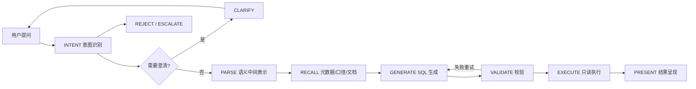

# DataPro — 企业数据管家 Agent

> 面向业务人员的自然语言取数助手：**Chat2SQL、元数据/口径问答、数据巡检**。
>
> 当前状态：**MVP 可运行骨架**，核心链路已打通并接本机 MySQL 数仓，**尚未上线**。
> 项目长期上下文与协作约定见 [AGENTS.md](AGENTS.md)。

## 核心约束

- **全程只读**：数仓查询使用只读账号，SQL 先经 `sqlglot` 白名单校验（写操作、表白名单、危险函数、LIMIT、字段存在性），执行侧再叠加超时、行数上限与扫描量拦截。
- **先口径后取数**：口径歧义先澄清，召回不到不臆造，必要时转人工（`escalate`），不返回看似正确的错误数据。
- **确定性时间语义**：「昨天 / 上周 / 近 N 天 / 指定日期」由 `app/core/time_window.py` 解析，模型只写 `{date_start}` / `{date_end}` 占位符，不做日期算术。
- **全程留痕**：节点级审计、查询记录、统一错误码（`E001`~`E010` + `trace_id`）、溯源标记码 `DP-xxxx` 可回查。

## 功能一览

- **取数链路**：意图识别 → 澄清 → 语义中间表示（QuerySpec）→ 元数据/口径/文档召回 → SQL 生成 → 校验 → 只读执行 → 结果呈现；失败定向重试、扫描量拦截、结果语义自检。
- **多轮与口径**：多轮槽位继承、时间/指标/维度替换；口径歧义 A/B 澄清与管理员裁决；别名召回（「广告 ROI」「客单」「新客」等）。
- **答案呈现**：answer-first 一句话总结 + KPI + 图表/表格 + 「依据」折叠（SQL、口径、行数、耗时），支持复制、重生成、Markdown/CSV 导出。
- **文件能力**：CSV/TSV/JSON/XLSX 上传解析成临时表；在线预览与编辑（Univer + SheetJS）；版本链、回滚与单元格级 diff。
- **知识增强**：文档知识库 RAG（`.md/.txt/.html` 上传、分段、向量 + 词法融合检索）与可选元数据向量召回（`auto/local/api` 三种编码器）。
- **图片理解**：图片先经视觉模型转文字描述再进入问答链路；失败时给出确切原因，不让模型自由发挥。
- **管理面**：登录鉴权与权限点、用户级表白名单、权限自助申请、LLM 注册表（密钥仅存引用）、设置中心、对话记录、用量统计。
- **运维能力**：大结果集导出审批、定时任务、数据巡检与 webhook 告警、Prometheus 指标、Langfuse 可选埋点、数据生命周期清理。
- **辅助能力**：技能包、自动学习（技能规范/记忆）、新媒体行业术语库、联网问答、前端水印与脱敏。

## 处理链路



## 技术栈

| 层 | 选型 |
|---|---|
| 后端 | Python ≥ 3.11、FastAPI、SQLAlchemy 2、Alembic（两棵迁移树）、pymysql、sqlglot、APScheduler、Redis |
| 前端 | Vue 3、Vite 6、Element Plus（按需引入）、Univer 开源版、SheetJS、Vitest |
| 存储 | MySQL 8（`datapro` 业务库 / `datapro_source` 数据源库 / `dwd_shop` 只读数仓）、Redis（会话/限流/黑名单） |
| 可观测 | Prometheus 文本端点、Langfuse（可选，未配 Key 时 no-op） |
| 部署 | Docker Compose、K8s 清单（`ops/k8s/`） |

默认端口：后端 `127.0.0.1:8100`，前端 dev `5175`（代理 `/api`、`/admin`），Compose 前端 `8080`。

## 仓库结构

```text
.
├── AGENTS.md                 # 项目长期上下文与维护约定
├── README.md                 # 本文件
├── datapro/                  # 主工程
│   ├── app/                  # FastAPI 入口、api/core/db/llm/services
│   ├── alembic/              # 业务库迁移
│   ├── alembic_source/       # 数据源库迁移（独立版本链）
│   ├── frontend/             # Vue 3 前端
│   ├── importer/             # 元数据导入、向量灌库、编码器导出
│   ├── eval/                 # 评测集、runner、harvest、召回评测
│   ├── worker/               # 巡检、日期对齐、Langfuse 自检
│   ├── prompts/              # 意图/SQL 生成/修复/口径问答等提示词
│   ├── tests/                # 后端测试
│   ├── .env.example          # 全量配置样例
│   └── docker-compose.yml    # mysql + redis + api + worker + frontend
├── docs/                     # 29 份设计、评审、测试与运维文档
└── ops/                      # K8s、Prometheus、Langfuse、MySQL 初始化脚本
```

## 快速开始

### 前置条件

- Python ≥ 3.11、Node.js ≥ 20、MySQL 8、Redis。
- 一个可读的示例数仓 `dwd_shop`。**注意：数仓建表与种子数据不随仓库分发**，需自行准备；元数据填报模板在 `datapro/importer/templates/`。
- 可选：OpenAI 兼容的 LLM Key。没有 Key 时用 `LLM_MOCK=true` 仍可跑通骨架与测试，但生成能力受限。

### 本地开发

```bash
# 1. 准备配置
cp datapro/.env.example datapro/.env
# 编辑 datapro/.env：填 APP_DATABASE_URL / DATA_SOURCE_URL / REDIS_URL / AUTH_SECRET 等

# 2. 后端
cd datapro
python -m venv .venv
source .venv/bin/activate          # Windows PowerShell: .venv\Scripts\activate
pip install -e ".[dev]"
python -m uvicorn app.main:app --host 127.0.0.1 --port 8100

# 3. 前端（另开终端）
cd datapro/frontend
npm ci
npm run dev                        # http://localhost:5175
```

后端启动时会自动执行 Alembic 迁移并初始化演示账号；`INIT_DB_ON_STARTUP=false` 时请自行执行 `python -m alembic upgrade head`（多副本部署应由 initContainer 执行一次）。

健康检查：

```bash
curl http://127.0.0.1:8100/health
curl http://127.0.0.1:8100/metrics
```

演示账号（仅 dev，生产请改密或接 SSO）：

| 账号 | 密码 | 角色 |
|---|---|---|
| `admin` | `admin123` | 管理员 |
| `analyst` | `user123` | 普通用户 |

### 容器方式

```bash
cd datapro
cp .env.example .env
docker compose up -d
```

Compose 会创建 MySQL（`datapro`、`datapro_source`）、Redis、API、worker 和前端（`:8080`）。`dwd_shop` 示例数仓仍需自行准备，并把 `DATA_SOURCE_URL` 指向可达实例。

## 常用验证与运维命令

在 `datapro/` 目录执行：

```bash
python -m pytest -q                                  # 后端单测
cd frontend && npm test && npm run build             # 前端测试与构建（回到上级再执行下面的命令）
cd ..
python -m alembic current                            # 业务库迁移状态
python -m alembic upgrade head                       # 升级业务库
python -m app.db.source_session                      # 单独迁移数据源库
python -m worker.inspection_worker                   # 巡检 worker
python -m eval.runner eval_v1_seed --verbose         # 种子集评测
python -m eval.recall_eval --out eval/reports/recall_report.json
python -m importer.import_metadata --file 元数据.xlsx --dry-run
python -m importer.warm_vectors                      # 向量预热（需先启用向量召回）
```

CI（`.github/workflows/ci.yml`）会在 push/PR 时跑后端 pytest、前端 Vitest 与 build。

## 配置要点

完整配置见 [`datapro/.env.example`](datapro/.env.example)，几个容易踩坑的项：

| 变量 | 作用 |
|---|---|
| `APP_DATABASE_URL` / `SOURCE_DATABASE_URL` | 业务库与数据源库；后者留空时推导为 `<业务库>_source` |
| `DATA_SOURCE_URL` | 数仓**只读**连接；生产必须使用只读账号 |
| `LLM_MOCK` | `true` 时用内置 mock/模板降级，不调用真实模型 |
| `AUTH_SECRET` | Token 签名密钥，生产必须替换为强随机值 |
| `VISION_ENABLED` / `VISION_MODEL` | 图片理解开关与视觉模型；关掉后只给诚实说明 |
| `EMBED_BASE_URL` / `EMBED_MODEL` / `EMBED_API_KEY_REF` | 三项齐备才启用语义检索，否则文档 RAG 退化为词法 |
| `VECTOR_RECALL_ENABLED` | 元数据向量召回，默认关闭；开启后建议先预热 |
| `DOC_RAG_ENABLED` / `DOC_RAG_MIN_SCORE` | 文档知识库 RAG 与命中阈值，低于阈值回答「未收录」 |

**密钥管理**：LLM/Embedding/视觉模型的 Key 不落库明文，只存引用（`env:变量名` / `file:路径#变量` / `kms://路径#字段`），由 `app/services/secret_ref.py` 解析，解析失败按「未配置」处理。`.env`、`datapro/data/`、`ops/k8s/secret.yaml` 已被 `.gitignore` 排除，**不要把真实凭据提交到仓库**。自检：`python -m app.services.secret_ref check`。

## 文档索引

**产品与治理**：[项目章程](docs/DataPro项目章程.md) · [功能清单](docs/DataPro-功能清单.md) · [灰度方案与用户手册](docs/DataPro-灰度方案与用户手册.md) · [团队协作规范与交付流程](docs/DataPro-团队协作规范与交付流程.md) · [现状分析与优化需求池](docs/DataPro-现状分析与优化需求池.md) · [治理模板包](docs/DataPro-治理模板包.md)

**架构与设计**：[架构设计 HLD](docs/DataPro-架构设计HLD.md) · [Prompt 设计](docs/DataPro-Prompt设计.md) · [权限与脱敏设计](docs/DataPro-权限与脱敏设计.md) · [架构评审与技术优化方案](docs/DataPro-架构评审与技术优化方案.md) · [元数据与口径库模板](docs/DataPro-元数据与口径库模板.md) · [ToolSchema 与接口规范](docs/DataPro-ToolSchema与接口规范.md) · [JSON 字段取数评审](docs/DataPro-JSON字段取数评审.md)

**评审与体验**：[缺口分析-使用者与卖家视角](docs/DataPro-缺口分析-使用者与卖家视角.md) · [缺口分析-前后端技术评审](docs/DataPro-缺口分析-前后端技术评审.md) · [缺口分析-前端](docs/DataPro-缺口分析-前端.md) · [缺口分析-后端](docs/DataPro-缺口分析-后端.md) · [页面体验小功能清单](docs/DataPro-页面体验小功能清单.md) · [页面体验小功能-技术评审](docs/DataPro-页面体验小功能-技术评审.md) · [页面体验小功能-前端](docs/DataPro-页面体验小功能-前端.md) · [页面体验小功能-后端](docs/DataPro-页面体验小功能-后端.md) · [前端遗留项-后端配套](docs/DataPro-前端遗留项-后端配套.md)

**Agent 执行能力（设计态）**：[场景与边界](docs/DataPro-Agent执行能力-场景与边界.md) · [架构设计](docs/DataPro-Agent执行能力-架构设计.md) · [高危 B 能力-安全开放设计](docs/DataPro-高危B能力-安全开放设计.md)

**数据与集成**：[先知采集落表-技术方案](docs/DataPro-先知采集落表-技术方案.md) · [本地向量编码器-导出与部署](docs/本地向量编码器-导出与部署.md)

**测试与运维**：[测试方案](docs/DataPro-测试方案.md) · [评测集 v1 规范](docs/DataPro-评测集v1规范.md) · [运维手册 Runbook](docs/DataPro-运维手册Runbook.md)

## 边界与已知事项

- 本项目是 MVP，**未上线**；`dwd_shop` 示例数仓与种子数据不在仓库内。
- Docker / K8s 清单已提供，需在实际目标环境验证；开发机上的本机特殊路径处理见 [AGENTS.md §5](AGENTS.md)。
- Agent 直接操控平台功能、高危外部平台写入（B 类）目前**只有设计文档，未实现**；相关能力受 G1~G8 门禁约束，门禁未满足前 No-Go。
- 上传文件目前只在**当前会话**有效，跨会话召回不可用；默认时间窗锚点依赖数仓分区时钟，探测失败会回退日历 T-1。
