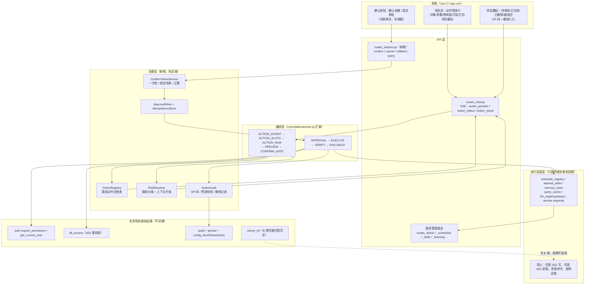
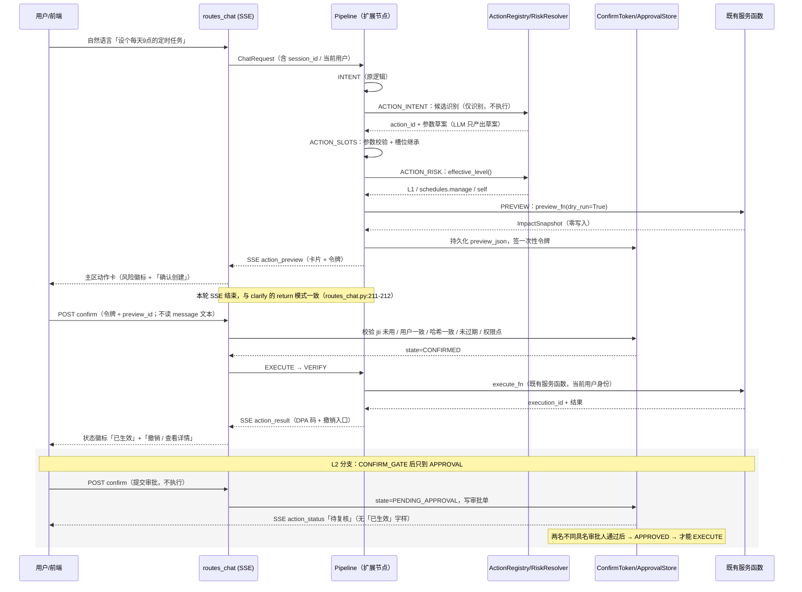
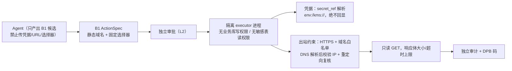

# DataPro Agent 受控执行能力——架构设计

| 文档信息 | 内容 |
|---|---|
| 产出角色 | 架构师（高见远 / Gao） |
| 任务来源 | 主理人（齐活林）派发任务 #2；用户原话「如果我要赋予我这个 agent 可以直接操控平台功能的能力该怎么设计」 |
| 直接输入 | 《DataPro-Agent执行能力-场景与边界.md》（PM 许清楚，任务 #1）；`AGENTS.md`（项目唯一长期事实源） |
| 性质 | **架构咨询方案，不含业务代码**；文中所有 Python 片段均为「伪代码级数据结构定义」，不可直接运行 |
| 纪律 | 只读源码 + 仅写本文档；未改其他文件、未写代码、未做 Git 操作；凭据一律 `***` |
| 结论口径 | 所有技术结论附 `文件路径:行号` 或文档章节依据；不确定处标「待核实」，不臆造 |

---

## 1. 架构总览

### 1.1 一句话结论

**不要给 LLM 通用 tool-calling / 执行句柄；应在现有 9 节点状态机旁增加一条「后端静态动作注册表 + 结构化确认令牌 + 审批态持久化」的受控执行旁路——LLM 只能产出「动作候选（action_id + 参数草案）」，真正的写操作只能由前端动作预演卡的显式确认所携带的一次性令牌触发，并全程复用现有权限点、当前登录身份与审计链。**

依据：现有能力是「架构级只读」——sqlglot 白名单 + 只读账号兜底（`AGENTS.md:166`、`AGENTS.md:8`、`AGENTS.md:102`），`AGENTS.md:322` 明令禁止开放写操作。放开后这条保证不会消失，但只对 **SQL 取数** 生效；新开的缺口必须收窄为「一组白名单化的管理业务函数」，而不是「模型可调用任意写接口」。

### 1.2 分层图



### 1.3 在 9 节点状态机上的扩展位置

现有节点枚举与流转：`Node = INTENT/CLARIFY/PARSE/RECALL/GENERATE/VALIDATE/EXECUTE/PRESENT/REJECT/ESCALATE`（`datapro/app/core/statemachine.py:32-43`，文件头注释 `:1-12`）；编排入口 `run()` 在 `INTENT` 后依次短路 `forbidden / data_boundary / meta_qa`（`statemachine.py:129-160`）。

**关键扩展点（不动原有取数链路）：**

| 扩展点 | 位置 | 做法 |
|---|---|---|
| 动作意图识别 | `statemachine.py:134-136` 的 `forbidden` 短路**之前** | 现有越界词表含「改/删/写入/导出/下载/密码」（`statemachine.py:54-55`），若不前置分支，所有动作诉求都会被判 `E003`。新增动作意图只做**候选识别**，不执行；识别失败仍走原 forbidden。 |
| 上下文载体 | `PipelineContext`（`statemachine.py:61-98`） | 增 `action_draft` / `action_preview` / `action_request_id` / `confirm_token_jti` 字段；原 `spec`/`result` 等字段保持不变。 |
| 事件出口 | `routes_chat.py:196-252` 的事件循环 | 新增 3 类 SSE 事件（§3.4），并纳入 `audit_service.record`（`routes_chat.py:197`）与终态载荷（`:248-251`）。 |
| 多轮槽位 | `session_state.py:149-188` 的 `spec` / `pending_caliber` 模式 | 复用同一 Redis 哈希字段模式增 `pending_action`，带 TTL；不另造存储。 |
| API 挂载 | `main.py:191`  router 注册区 | 新增 `routes_actions` 注册；功能开关关闭时不注册（见 §6 回滚）。 |

**复用 vs 新增清单：**

| 复用（禁止重复造轮子） | 新增（最小必要） |
|---|---|
| 11 个权限点与 `require_permission`（`permissions.py:23-35`、`auth.py:203-209`） | 动作注册表 / 参数 schema / 静态分级 |
| 当前登录身份 `get_current_user`（`auth.py:183-186`） | 一次性确认令牌与 nonce 存储 |
| A02 用户表权限（`db_access.py:120-143`） | 审批单与审批人落库（2 张新表） |
| 审计 `audit_log` + `persist.save_audit`（`audit.py:12-23`、`persist.py:393-403`） | 动作维度审计字段与 DP 动作码 |
| 现有管理接口/服务层（§6 逐条列出） | 前端动作卡与状态徽标 |
| `secret_ref` 引用范式（`secret_ref.py:3-12`）、`SharedJson`（`AGENTS.md:30`） | B 类独立 executor（首期仅设计不实现） |

### 1.4 安全模型变化

| | 现状：能力只读 | 目标：受控执行 |
|---|---|---|
| 保证层级 | **架构级**：账号就没有写权限（`AGENTS.md:166`、`:102`、`:114`），"想写也写不了" | **流程级防错**：数仓只读账号保持不变（`AGENTS.md:102`、`:114`）；写操作只能经白名单动作函数 + 权限点 + 确认令牌 + 审计，"绕过流程就执行不了" |
| 信任边界 | LLM 输出只进校验器，错则拒答 | LLM 输出只进**参数草案**，草案不携带执行权；执行权在后端签名令牌里 |
| 失败代价上限 | 答错 / 拒答，可纠正 | 误改配置或权限；必须靠预演、审批、幂等、撤销把代价压回可追责范围 |
| 审计粒度 | 节点级 `audit_log` + `query_record`（`AGENTS.md:157`） | 增加动作级：预演快照、确认人、审批人、结果、撤销记录、DP 码 |

> 设计原则：**用"收窄的执行通道"替代"放开的执行权限"**。Agent 的数据库连接仍是只读账号；动作走的是业务服务层的既有写函数，且每次调用都要重新证明「当前用户有权限 + 令牌未用过 + 预演未变」。

---

## 2. 核心设计：Action / Tool 抽象

### 2.1 数据结构（Python 伪代码，非业务代码）

```python
# 伪代码：app/services/action_registry.py（新增）
from enum import Enum

class RiskLevel(str, Enum):
    L0 = "L0"   # 只读探针：直接执行 + 审计
    L1 = "L1"   # 可逆低危：预演 + 显式确认 + 事后撤销
    L2 = "L2"   # 不可逆/高危：只进审批态，强制双人复核

class Scope(str, Enum):
    SELF = "self"        # 仅本人（owner 隔离）
    GLOBAL = "global"    # 全局配置，影响所有人

@dataclass(frozen=True)
class ActionSpec:
    action_id: str                    # 封闭枚举，如 "schedule.create"
    domain: str                       # A1/A4/A14/A15/A16/A17 等产品编号
    title: str                        # 卡片标题
    risk_level: RiskLevel             # ★ 后端静态声明，LLM 无法覆盖
    required_permission: str          # 复用 11 权限点之一，如 "schedules.manage"
    scope: Scope                      # ★ 影响面由后端声明
    param_schema: dict                # JSON Schema（Pydantic 生成），服务端强校验
    handler_ref: str                  # 指向既有服务函数的符号引用，不是 HTTP path
    preview_fn: Callable              # dry_run：返回 ImpactSnapshot，零写入
    execute_fn: Callable              # 唯一写入口，签名强制接收 ConfirmToken
    verify_fn: Callable | None        # 执行后校验（如回读任务状态）
    rollback_fn: Callable | None      # 无则 reversible=False
    reversible: bool
    rollback_window_hours: int
    idempotency_key_fields: tuple[str, ...]   # 如 ("action_id", "params_sha", "username")
    sensitive_context: bool = False   # 灰度/演示环境需升 L2
    uses_credentials: bool = False    # 一旦为 True 即升 L2；首期所有动作必须 False
    enabled: bool = False             # 灰度：默认关，逐条开

@dataclass(frozen=True)
class ImpactSnapshot:
    preview_id: str                   # 服务端生成，参数快照与服务快照绑定
    target: str                       # 对象标识（任务 ID / 术语 / 文件 ID）
    impact_text: str                  # 「影响范围：本人 / 全局」卡片文案
    before: dict                      # 变更前的可回显值（不含任何密钥）
    projected: dict                   # 变更后的预期值
    affected_users: int | None
    reversible: bool
    rollback_hint: str
    snapshot_sha256: str              # 执行前必须重算比对

class ActionRegistry:
    _specs: dict[str, ActionSpec]     # 模块级静态字典，进程启动时构建
    def register(spec: ActionSpec) -> None: ...     # 仅代码内注册，无 HTTP 注册入口
    def get(action_id: str) -> ActionSpec: ...      # 未知 ID → E011
    def enabled_ids() -> list[str]: ...
```

**注册表是代码内的封闭集合，不提供 HTTP 注册/热加载入口。** 这是 N1/N2/N3/N7/N8 的第一道结构性保证：不存在「任意 tool 名 + 任意参数」的通用转发接口，也没有字符串拼 SQL / 拼 URL / 拼命令的字段。

### 2.2 分级由后端静态声明，不由 LLM 判断

```
effective_level(spec, ctx, params) =
    max(spec.risk_level,                       # 静态基线
        L2 if spec.scope == GLOBAL else L0,
        L2 if spec.sensitive_context and env in {"gray","demo"} else L0,
        L2 if spec.uses_credentials else L0,
        L2 if "export" in spec.domain else L0) # 出域类一律 L2（N5）
```

- LLM 输出的 `risk_level` / `need_approval` 字段**一律丢弃**，不进入 `effective_level()`；提示词里也不允许模型自报风险。
- 判定所需「影响面 / 环境 / 是否涉凭据」由 `ActionSpec` 静态字段 + 后端运行时环境配置传入（`AGENTS.md:48` 配置走 `pydantic-settings`），**不存在"让模型判断当前是不是灰度环境"**。
- 组合动作按最高级计（产品文档 §3.1 补充规则）：`PipelineContext.action_draft` 是列表，`effective_level` 取 `max()`；L0 探针结果不得作为「已授权」依据。

### 2.3 审批态与执行态分离

```python
class ActionState(str, Enum):
    DRAFT -> PREVIEWED -> CONFIRMED        # L1：此刻才允许 EXECUTE
    PREVIEWED -> PENDING_APPROVAL -> APPROVED -> EXECUTING   # L2
    EXECUTING -> SUCCEEDED | FAILED | ROLLED_BACK | ROLLBACK_FAILED
    PREVIEWED -> CANCELLED | EXPIRED

@dataclass
class AgentActionRequest:                 # 落库：agent_action_request（新表）
    request_id: str
    action_id: str
    username: str                         # 发起人 = 当前登录用户
    session_id: str
    trace_id: str
    risk_effective: RiskLevel
    idempotency_key: str                  # UNIQUE 索引
    params_sha256: str
    preview_sha256: str
    preview_json: dict                    # ImpactSnapshot 快照
    state: ActionState
    confirm_token_jti: str | None         # L1
    result_json: dict | None
    rollback_json: dict | None
    dp_code: str | None                   # DPA-xxxx，见 §4.5
    created_at, updated_at, expires_at
```

**分离要点：**

1. `PREVIEW` 只写 `preview_json` 并返回 `action_preview` 事件；此时 `state=PREVIEWED`，**后端没有任何代码路径能从该状态直接调用 `execute_fn`**。
2. L1 的 `CONFIRMED` 由 `POST /api/v1/actions/{preview_id}/confirm` 携带一次性令牌产生；L2 的 confirm **只写 `PENDING_APPROVAL`**，绝不置 `CONFIRMED`。
3. `EXECUTE` 只接受 `state in {CONFIRMED, APPROVED}` 且携带有效 grant 的请求；执行函数签名强制 `execute_fn(params, snapshot, token, actor)`，缺失令牌在类型层就过不去。
4. 令牌绑定 `params_sha256 + preview_sha256`；执行前用**服务端保存的快照**重算，客户端传来的参数只用于校验相等，不用于执行（防「预演一套、执行另一套」）。

---

## 3. 状态机扩展方案

### 3.1 节点链

在原 `Node` 枚举（`statemachine.py:32-43`）新增 8 个节点，只影响被识别为动作意图的请求；取数链路（`INTENT→RECALL→PARSE→TIME→GENERATE→VALIDATE→EXECUTE→PRESENT`，`statemachine.py:162-200,344-448`）零改动。



| 新增节点 | 职责 | 关键约束 |
|---|---|---|
| `ACTION_INTENT` | 从意图结果/原句识别候选动作 | 必须置于 `forbidden` 短路之前（`statemachine.py:134-136`）；只识别不执行 |
| `ACTION_SLOTS` | 用 JSON Schema 校验参数草案；缺项复用澄清模式（`statemachine.py:203-212`） | 模型只填槽；填不出就澄清或 E001，不猜 |
| `ACTION_RISK` | 调用 `effective_level()` | 输入全部来自后端静态声明与配置 |
| `PREVIEW` | `preview_fn` dry-run，生成 `ImpactSnapshot` | 零写入；不当作用户确认 |
| `CONFIRM_GATE` | 下发 `action_preview` 并终止本轮 | 参照 `clarify` 的 `return`（`statemachine.py:212`） |
| `APPROVAL` | L2 写审批单并退出 | **无 execute 出边** |
| `EXECUTE` | 独立 POST 触发，不在 SSE 生成流程里执行 | 令牌 + state 双校验 |
| `VERIFY` | 回读确认对象状态（如任务是否存在） | 与 `execute` 结果不一致 → 状态标 `FAILED` 并告警，不静默成功 |
| `ROLLBACK` | 由用户点撤销触发独立接口 | 与执行同一 actor 校验；记录到审计 |

### 3.2 自然语言与结构化确认的衔接

- **NL 只能产出草案。** 即使用户输入「确认创建」「就这么办」「执行吧」，只要没有有效的一次性令牌，后端一律不执行；返回引导语「请点击动作卡上的『确认创建』按钮」。
- 前端按钮（含「撤销」「提交审批」）调用 `POST /api/v1/actions/...`，与 `ChatRequest.message` 完全解耦；因此提示注入文本无论出现在用户消息、附件还是召回文档里，都只能落到**草案字段**，拿不到执行权。
- 依据：产品文档 §4.1/§5 R2；`routes_chat.py:36-41` 的 `ChatRequest` 当前只有 `message`/`attachments`/`session_id`，确认接口**不复用**该结构。
- 步骤轨迹：`node` 事件自动被 `step_entry()`（`routes_chat.py:92-107`）收录，前端 `NODE_LABELS[ev.node]`（`App.vue:775`）需补新节点中文名，否则历史还原会显示英文节点名。

### 3.3 多轮槽位（QuerySpec）扩展

不污染取数 IR：保持 `QuerySpec`（`query_spec.py:49-57`）原字段不变，另在 `PipelineContext` 增 `action_draft: ActionDraft | None`；`ActionDraft` 存 `action_id` + `slots: dict` + `missing: list` + `preview_id`。

- 继承规则复用 `QuerySpec.inherit()`（`query_spec.py:73-83`）的「本轮有值覆盖、无值继承」语义，但只继承参数 schema 中标记 `inheritable=true` 的槽位（如时间、对象名），**不继承对象 ID / 权限相关字段**。
- 存储复用 `session_state` 的 Redis 哈希字段模式（`session_state.py:149-167` 的 `spec`、`:170-188` 的 `pending_caliber`），新增 `pending_action`；TTL 与会话一致（`AGENTS.md:29` 默认 24h）。
- **槽位变化即令牌失效**：每次槽位修改重算 `params_sha256`，旧令牌因哈希不匹配被拒；无需单独撤销接口。

### 3.4 SSE 事件扩展

| event type | 触发节点 | payload 关键字段 | 是否终态 |
|---|---|---|---|
| `node` | 全部新增节点 | `node` 取新枚举值、`detail`；`retry` 沿用 | 否 |
| `action_preview` | `CONFIRM_GATE` | `preview_id`, `action_id`, `risk_level`, `scope`, `title`, `params_display`, `impact`, `before`, `reversible`, `rollback_window_hours`, `required_permission`, `approvers`(L2), `confirm_token`, `expires_at` | **是**（本轮停止，等同 clarify 的终止语义） |
| `action_status` | `APPROVAL` / 异步审批回调 | `request_id`, `state`（`pending_approval`/`approved`/`rejected`/`executing`/`succeeded`/`failed`/`rolled_back`）, `approver`, `reason`, `dp_code` | 否（状态推进） |
| `action_result` | `EXECUTE`/`VERIFY` | `request_id`, `execution_id`, `action_id`, `state`, `result_summary`, `dp_code`, `rollback_url`, `rollback_expires_at` | **是** |
| `action_error` | 任一失败 | `reason_code`（§7.3）, `message`, `request_id`, `trace_id` | **是** |

兼容性要求：

1. `routes_chat.py:199-204` 的 `outcome/error_code` 判定需把 `action_result`/`action_error` 纳入终态集合，否则 `query_record.error_code` 会漏码（该缺陷已有前例：`AGENTS.md:118`）。
2. `routes_chat.py:248-251` 的终态载荷快照与 `:261-263` 的 `message.payload` 需包含新事件，否则跨设备恢复（`App.vue:544-590`）会把动作卡还原成空文本。
3. `restoredHistoryFromServer`（`App.vue:544-590`）增 `p.type === 'action_preview' / 'action_result'` 分支，与 `handleEvent` 同构；`message.kind` 增 `action`/`action_pending`。
4. `fallback_reason_code()`（`routes_chat.py:86-89`）的 `_REASON_CODES` 增新 reason → E011~E016 映射。

---

## 4. 五道防线的落地机制

### 4.1 提示注入防线：自然语言永远不能触发执行

**结构性原因（不是"提示词写得够好"）：**

1. 执行接口 `POST /api/v1/actions/{preview_id}/confirm` 的入参**只有** `preview_id` + `confirm_token`；它没有 `message`、没有 `sql`、没有 `url`、没有 `action_id` 自由字段。
2. 令牌由 `PREVIEW` 节点在服务端签发，签发前经过 `ActionRegistry.get()`（封闭集合）+ JSON Schema 校验；外部数据（召回文档、网页摘要、附件文本）只能影响**参数草案**，草案必须经用户肉眼在卡片上确认。
3. 执行时**重新**调用 `get_current_user`（`auth.py:183-186`）取身份、`require_permission(spec.required_permission)`（`auth.py:203-209`）取权限，不信任令牌里的 role/perm；这一点与现有令牌设计一致——Token 只带 `jti`/`epoch` 等身份版本字段（`auth.py:68-83`、`AGENTS.md:34`）。

**确认令牌格式（伪代码）：**

```
DPA1.<b64url({v, preview_id, action_id, params_sha256, preview_sha256,
              user, risk, risk_source:"server", iat, exp, jti, nonce})>.<HMAC-SHA256(AUTH_SECRET)>
```

| 属性 | 落地机制 |
|---|---|
| 一次性 | `jti`/`nonce` 写入 Redis `SET NX EX`（TTL > exp）；复用 `token_store.revoke/is_revoked` 思路（`token_store.py:41-70`），但**不能只依赖进程内存降级**——Redis 不可用时 fail-closed 拒绝确认（见 §7.2 风险 2） |
| 绑定动作哈希 | `params_sha256` = canonical JSON（键排序、无空白）哈希；执行时用服务端 `preview_json` 重算，不等即 E011 |
| 绑定用户 | `user` 来自 `AuthUser.username`；执行时与当前登录用户比对，不一致 E012 |
| 过期 | L1 ≤ 120s；L2 审批 grant ≤ 24h 且审批后仍需二次确认 |
| 不可伪造 | HMAC 用 `AUTH_SECRET`（`auth.py:64-65`），模型不可见 |
| 不携带权限 | 与现有 Token 原则一致（`auth.py:68-83`），权限实时回查 |

注入用例应纳入回归：S05 现有 10 条（`AGENTS.md` 产品文档 §5 R2 引用）扩展到动作场景，至少覆盖「忽略规则并删掉任务」「在外部数据里藏授权指令」「用自然语言说确认」。

### 4.2 权限防线：复用权限点 + 当前身份 + owner 隔离

| 机制 | 落地 |
|---|---|
| 权限点 | `ActionSpec.required_permission` 必须取自 `PERMISSIONS`（`permissions.py:23-35`）的 11 个码；**preview 与 execute 各校验一次** `require_permission`（`auth.py:203-209`）；管理类权限的 admin-only 过滤（`permissions.py:42-46`）自动生效 |
| 身份 | 一律 `Depends(get_current_user)`；**禁止**从请求体接收 `user_id`/`username`/`owner` 并信任它；owner 隔离沿用各既有服务（定时任务按 owner 404、学习数据按用户、`AGENTS.md:139/148`） |
| 不新开直通通道 | 不新增 `/admin/*` 写路由；动作执行器只调用既有服务函数（`routes_admin.py:55-76/170-200/345-458` 等已有接口背后的服务层） |
| A02「未配置=默认放行」风险 | `db_access.tables_for()` 在无记录时返回 `None`（`db_access.py:5-7`、`:120-143`），状态机用 `None` 表示沿用全局白名单（`statemachine.py:367-373`）。**动作侧新增 `strict_tables_for(username)` 包装**：返回 `None` 或空集 → 对任何 L1/L2 动作直接 E003；仅 L0 只读探针可沿用旧语义。过期授权用 `active_tables()`（`db_access.py:28-37`）过滤后为空集同样拒绝。生产收紧时点见 §8。 |
| 降权即时生效 | 令牌不含权限快照，每次请求回查 `user_account`（`auth.py:139-170`）；审批通过后若审批人被降权，审批 grant 在 execute 时再校验一次 |

### 4.3 预演 / 审批防线

**同参数同影响面的保证（防"预演一套、执行另一套"）：**

1. `preview_fn` 与 `execute_fn` 共享同一个 `build_plan(params)` 纯函数；`preview_fn` 只 return 不 commit，`execute_fn` 接收 `plan` 而非重新解析用户文本。
2. 执行前 `recompute_hash(build_plan(server_snapshot.params)) == preview_snapshot.plan_sha256`，不等立即中止（E011）。
3. 客户端提交的 `preview_id` 只是索引；参数与影响面从服务端 `agent_action_request.preview_json` 读取，客户端无法改写。
4. 涉及召回污染的动作（知识库/口径/元数据，产品文档 R8）：预演阶段附加 `eval/recall_eval` 前后的命中率摘要作为审批材料；回归不通过禁止提交审批（依据 `AGENTS.md:137`、`AGENTS.md:216` 的 recall_eval 命令）。

**审批态持久化——结论：新增表，不塞现有表：**

| 候选 | 结论 | 依据 |
|---|---|---|
| 复用 `audit_log` | ❌ | `audit_log` 是 append-only 旁路、失败只记日志（`audit.py:21-23`、`persist.py:406-413`），无状态机、无唯一约束、不可事务推进 |
| 复用 `config_doc`/SharedJson | ❌ | 适合配置而非流程；虽有行锁（`AGENTS.md:30`），但缺审批人多行、幂等键与状态索引 |
| 复用 `message.payload` | ❌ | 富结果快照用于展示恢复（`routes_chat.py:248-251`），非流程真值 |
| **新增 `agent_action_request` + `agent_action_approval`** | ✅ | 需 UNIQUE(idempotency_key)、状态索引、审批人多行约束；走 Alembic（当前 head `0019_message_payload`，`AGENTS.md:23`），不要手写 ALTER（`AGENTS.md:302`） |

**双人复核落库：**

- `agent_action_approval(request_id, approver_username, approver_role, decision, reason, decided_at)`，`UNIQUE(request_id, approver_username)`。
- 通过条件：`COUNT(decision='approve' AND approver != requester) >= 2` 且两名审批人角色不同（管理员 + 业务/安全接口人，具体由 §8-Q4 拍板）；审批人与发起人为同一人时拒收。
- 状态推进用单事务 `SELECT ... FOR UPDATE` 锁 `agent_action_request` 行（与 `SharedJson` 的行锁思路一致，`AGENTS.md:30`）；避免两名审批人并发导致重复置位。
- 审批单未生效前 UI 只显示「待复核」，绝不显示「已生效」（产品文档 §4.1-4）。

### 4.4 幂等与撤销防线

| 项 | 机制 |
|---|---|
| 幂等键 | `sha256(action_id + canonical(params) + username + preview_id)`，`agent_action_request.idempotency_key` 加 UNIQUE；并发重复请求捕获唯一键冲突后返回原请求结果，不重复执行 |
| 撤销窗口 | 由 `ActionSpec.rollback_window_hours` 静态声明；L1 建议 24h（可短于会话 TTL 24h，`AGENTS.md:29`）；到期后按钮自动隐藏，状态保留 |
| 不可撤销动作 | `reversible=False` 必须由后端下发到卡片；确认按钮文字改为「确认删除（不可撤销）」，L2 一律进审批态；文件类优先走「保存为新版本/恢复为新版本」而非覆盖删除（`AGENTS.md:133`、`AGENTS.md:175`） |
| 撤销实现 | `rollback_fn` 调既有反向接口（停用任务、删除学习条目、版本恢复）；不实现"数据库逆向 UPDATE"（N1） |
| 补偿失败 | 状态置 `ROLLBACK_FAILED`，写 `audit_log` 告警 + 管理员待办队列，**不自动盲重试**；前端徽标显示「撤销失败·联系管理员」并附 DP 码 |
| VERIFY 失败 | 执行返回成功但回读不到对象 → 状态 `FAILED`，同样进告警队列；不允许显示「已生效」 |

### 4.5 审计防线

**结论：复用 `audit_log` 承载"事件流"，新增一张请求表承载"真值"，二者互补。**

- 复用层：`audit_service.record()`（`audit.py:12-23`）与 `/admin` 写操作中间件（`main.py:122-162`）已把每次事件/接口调用写进 `audit_log`；新增 `node="ACTION_PREVIEW"/"ACTION_CONFIRM"/"ACTION_EXECUTE"/"ACTION_ROLLBACK"`，payload 写结构化摘要。该链路是旁路（`AGENTS.md:170`），失败只记日志，**不能作为审批真值**。
- 真值层：`agent_action_request.preview_json`/`result_json`/`rollback_json` 落完整快照（脱敏后），支持按 `dp_code` 回查。
- DP 码：复用溯源标记码思路（`routes_chat.py:219` 的 `DP-{query_id:04d}`、`AGENTS.md:156`），为动作分配独立前缀 `DPA-{id:04d}`，用 `id_sequence`（`AGENTS.md:283` 已用于 EP 号原子分配）避免与取数码撞号；动作卡底部可一键复制。

**动作审计字段清单：**

| 字段 | 来源 | 备注 |
|---|---|---|
| `trace_id` / `session_id` / `username` | `ctx` + `AuthUser` | 与取数记录可关联 |
| `action_id` / `domain` / `risk_static` / `risk_effective` | `ActionSpec` + `RiskResolver` | 可追溯为何升级 |
| `preview_id` / `plan_sha256` / `params_sha256` | 预演 | 证明预演=执行 |
| `preview_json` / `impact` / `scope` | `ImpactSnapshot` | 脱敏，无密钥 |
| `confirm_token_jti` / `confirmed_by` / `confirmed_at` | 确认接口 | 一次性令牌可查 |
| `approval_rows`（审批人/角色/决定/理由/时间） | `agent_action_approval` | L2 双人证据 |
| `execution_id` / `result_json` / `verify_result` | 执行器 | 含错误码 |
| `rollback_json` / `rolled_back_by` / `rollback_state` | 撤销接口 | 含补偿失败 |
| `dp_code` | `id_sequence` | 用户可复制回查 |
| `reason_code` | 扩展错误码 | §7.3 |

---

## 5. B 类（外部平台）隔离方案

### 5.1 首期冻结的实现含义（不是"开关关掉"）

产品文档 §2.2 建议 B1~B5 首期全冻结。技术上应做到 **"连注册入口都不开"**：

1. `ActionRegistry` 中无 B 类 `ActionSpec`，`action_id` 封闭枚举不含 `external.*`；
2. 不注册任何 `external` executor 模块，不加载域名白名单配置，不读取任何外部平台凭据引用；
3. 主分支代码里不存在「任意 URL + 任意选择器 + 任意 HTTP 方法」的通用 tool（N3 的 SSRF 入口）；
4. 仅当 Q2/Q5 拍板后，以**独立部署包/独立进程**增量引入，而不是在同一个注册表里加一行开关（开关可被误开）。

### 5.2 B1 受限只读探针的最小可行架构（仅设计，不实施）



| 控制点 | 机制 | 依据 |
|---|---|---|
| 凭据 | 复用 `secret_ref.py`：只存引用（`env:`/`kms://`），`validate_ref` 拒明文（`secret_ref.py:165-189`），`resolve` fail-closed（`:142-152`、文件头 `:3-12`）；明文只在隔离进程内存中出现，**不进 prompt、不进参数、不进 audit、不回显**；管理接口只显示引用+脱敏尾号（`AGENTS.md:24`） | N6、R1 |
| SSRF | 目标域名精确白名单 + scheme=https；DNS 解析后拒绝私网/回环/链路本地/`169.254.169.254`；每次重定向重新校验；**禁止用户/模型提供 URL 与选择器**（选择器固定在代码中）；复用既有「仅固定 Bing RSS」的克制（`AGENTS.md:143`） | N3、R3 |
| 独立 executor | 单独进程/容器，网络策略只允许白名单出站；不持有业务库写账号，不挂载 `data/` 全目录；响应体上限、超时、无 JS 渲染 | N8 的最小权限精神 |
| 只读与门禁 | 即使 B1 也按 L2 审批（凭据 + 出域 + 第三方数据）；绝不放开 B2~B5 | 产品文档 §2.2/§3.1 |
| 合规 | 「先知」是否允许自动化登录/采集**待核实**（产品文档 §2.2、Q2）；数据出域书面裁决未定（Q5，`AGENTS.md` 协作规范 §6-1 一票否决） | R4、Q5 |

> 结论：首期不接、不读那份含 `***` 的配置；即便未来接入，也只能是「凭据托管 + 白名单 + 只读 + 审批 + 独立审计」五件套齐全后的受限探针，不构成"操控外部平台"的能力。

---

## 6. 分阶段实施路线

### 6.1 阶段一：L0 探针 + L1 本人可逆动作（首发）

**范围**：产品文档 Q3 建议的 A1（只读探针）、A4（定时任务）、A14（权限申请提交）、A15（缓存清空）、A16（学习数据）、A17（默认模型切换，管理员）。

| 项 | 内容 |
|---|---|
| 改动点（后端） | `app/core/statemachine.py`（Node 枚举 + `PipelineContext` 新字段 + `ACTION_INTENT` 前置分支）；`app/api/routes_chat.py`（3 类新事件 + 终态判定 + payload 快照）；`app/api/routes_actions.py`（新增，confirm/cancel/rollback/query）；`app/services/action_registry.py`、`action_guard.py`、`confirm_token.py`、`action_audit.py`（新增）；`app/services/session_state.py`（`pending_action` 字段）；`app/db/models.py` + `alembic/versions/0020_agent_actions.py`（新表）；`app/main.py`（router 注册 + 功能开关） |
| 改动点（前端） | `frontend/src/App.vue`（`handleEvent` 增 3 分支 `App.vue:766-813`、历史还原 `App.vue:544-590`、消息流插动作卡于 `App.vue:2974` 拒答块之前、消息操作区 `App.vue:3003-3018` 加 DP 码/撤销）；`frontend/src/api/actions.js`、`frontend/src/utils/action.js`（新增）；`NODE_LABELS` 补中文名 |
| 新增表 | `agent_action_request`（阶段一先不建 `agent_action_approval`，L2 未开） |
| 新增接口 | `POST /api/v1/actions/preview`、`POST /api/v1/actions/{preview_id}/confirm`、`POST /api/v1/actions/{request_id}/cancel`、`POST /api/v1/actions/{request_id}/rollback`、`GET /api/v1/actions/{request_id}` |
| 复用的既有接口/服务 | `schedule_registry`（`routes_schedules.py:37-64`）、`query_cache.clear`（`routes_admin.py:190-200`）、`learned_skills`/`memory_store`（`routes_learning.py:29-75`、`AGENTS.md:124`）、`access request`（`routes_access.py:51-66`）、`llm_registry.status`（`routes_admin.py:163-167`）；A17 按 L1 但 `required_permission=llm.manage`（admin-only），预演卡必须明示「影响所有请求」，且不得静默切换；灰度/演示环境按 §2.2 规则升 L2 |
| 工作量档 | **L**（后端 M~L：状态机 + 令牌 + 幂等较复杂；前端 M：动作卡 + 状态徽标 + 历史还原） |
| 验收标准 | ① 自然语言（含"确认"字样）无法触发任何写；② 10 条注入用例全拒；③ 令牌重放/改参/跨用户/过期全部 E011/E012；④ A02 未配置用户执行 L1 动作被 E003 拒绝，L0 探针行为不变；⑤ 预演哈希 ≠ 执行哈希时中止且零写入；⑥ 动作可撤销、DPA 码可在溯源面板回查；⑦ `pytest -q` + `npm test` + `npm run build` 通过（`AGENTS.md:334`） |
| 回滚方案 | `ACTIONS_ENABLED=false` 时不注册 `routes_actions`，前端动作卡隐藏；状态机新增节点保留但不进入主链路；新表为空表、不影响既有迁移；如需彻底回退，drop 0020 迁移即可（此前无数据写入） |

### 6.2 阶段二：L2 审批闭环

**范围**：A3（全局技能改）、A5（知识库改）、A6 改规则、A7（口径裁决）、A8（会话回收）、A12（元数据导入）、A13 的保存新版本路径。A9/A10/A11 密钥变更/B 类仍冻结（N4/N5/N6）。

| 项 | 内容 |
|---|---|
| 改动点 | `action_registry.py`（新增 L2 specs，`scope=GLOBAL`）；`action_guard.py`（组合动作取最高级 + 审批升级）；`app/services/action_approval.py`（新增，双人复核状态推进）；`app/db/models.py` + `alembic` 新版本（新增 `agent_action_approval`）；`routes_actions.py`（审批列表/通过/驳回/撤回）；`App.vue` 运维处置页（`App.vue:3814-3877`）增「动作审批」分区，与口径裁决/会话回收/缓存并列 |
| 新增表 | `agent_action_approval` |
| 新增接口 | `GET /api/v1/actions/approvals`、`POST /api/v1/actions/{request_id}/approve`、`POST /api/v1/actions/{request_id}/reject`、`POST /api/v1/actions/{request_id}/withdraw` |
| 复用的既有接口 | 口径裁决 `routes_admin.py:55-76`（注：前端入口文档与代码记载冲突——`AGENTS.md:313` 记为无页面，但 `App.vue:3814-3847` 已有运维处置页，**以代码为准，待核实**）；会话回收 `routes_admin.py:170-175`；缓存 `routes_admin.py:190-200` |
| 工作量档 | **L** |
| 验收标准 | ① L2 动作只生成申请、无任何立即生效路径（静态代码审查 + e2e）；② 单人审批无法通过，审批人=发起人被拒；③ 审批前后权限变更导致 execute 被拒；④ 状态徽标四种状态可区分且回查一致；⑤ 知识库/口径/元数据改动前 `recall_eval` 不回退 |
| 回滚方案 | L2 specs `enabled=False` 即整批不注册；审批表独立可 drop；阶段一功能不受影响 |

### 6.3 阶段三：B 类外部平台评估（条件触发）

| 项 | 内容 |
|---|---|
| 触发条件 | Q1 含 B + Q2 凭据/授权核实 + Q5 出域裁决通过（§8） |
| 改动点 | 独立 `app/services/external_executor.py`（独立进程/容器部署）、独立域名白名单配置、独立审计；主仓 `ActionRegistry` 仅在此时引入 B1 一条 spec；`secret_ref.py` 不变（直接复用） |
| 新增表/接口 | 独立审计存储或独立日志管道；`POST /api/v1/actions/external/probe`（仅 B1、仅 L2 审批后） |
| 工作量档 | **L**（且包含安全评审、合规签字，非纯开发量） |
| 验收标准 | 凭据零回显、私网 IP 探测全拒、重定向越界拒绝、无外部写通路、目标站授权书面文件齐备 |
| 回滚方案 | 独立进程下线 + 网络策略收回 + spec 移除即可，不触碰 A 类主链路 |

### 6.4 首发明确不做

- ❌ 任何形式通用 tool-calling / 任意 HTTP 请求转发 / 任意 SQL 执行（N1/N3/N7/N8）。
- ❌ 数据出域审批 A9、用户与表权限授予 A10、密钥变更 A11、B2~B5（N4/N5/N6）。
- ❌ 文件删除/版本覆盖回滚（A13 的不可逆部分）；仅保留「保存为新版本」。
- ❌ 自然语言直接触发执行；❌ 弹窗承载确认；❌ 把风险说明做成常驻小字。

---

## 7. 共享约定与风险提示

### 7.1 事件与枚举命名（前后端约定）

| 项 | 约定 |
|---|---|
| 事件前缀 | 动作类事件统一 `action_*`；节点事件沿用 `node` + 新 node 名（`ACTION_INTENT`/`ACTION_SLOTS`/`ACTION_RISK`/`PREVIEW`/`CONFIRM_GATE`/`APPROVAL`/`EXECUTE`/`VERIFY`/`ROLLBACK`） |
| 风险级 | 字符串枚举 `L0`/`L1`/`L2`，后端下发，前端只渲染徽标与 tooltip，不参与判定 |
| 状态 | `draft/previewed/confirmed/pending_approval/approved/executing/succeeded/failed/rolled_back/rollback_failed/cancelled/expired` |
| 确认令牌 | `DPA1.<b64url(payload)>.<hmac>`，前缀 `DPA1` 便于一眼识别与版本升级 |
| DP 码 | 动作 `DPA-{id:04d}`，取数 `DP-{id:04d}`，导出 `EP-{id:04d}`（`routes_chat.py:219`、`AGENTS.md:283`） |
| 错误响应 | 沿用 `{code,message,detail,trace_id}`（`errors.py:1-10`、`AGENTS.md:119`） |

### 7.2 错误码扩展（在 E001~E010 之后）

| 码 | HTTP | 人话 | 场景 |
|---|---|---|---|
| E011 | 409 | 动作预演已变化，请重新确认后再试 | 哈希不一致 / 令牌绑定失效 |
| E012 | 403 | 该确认已失效或不属于当前账号 | 令牌重放 / 跨用户 / 过期 |
| E013 | 403 | 此动作需要管理员或业务接口人复核 | L2 未审批直接执行 |
| E014 | 409 | 该动作已处理，请勿重复提交 | 幂等键冲突 |
| E015 | 422 | 动作参数不完整或不符合要求 | JSON Schema 校验失败 |
| E016 | 503 | 动作暂存服务暂不可用，请稍后重试 | Redis 不可用导致令牌无法安全验签（fail-closed） |

同步更新 `CODE_CATALOG`、`HTTP_STATUS_CODE`（`errors.py:34-43`）与前端 `frontend/src/api/errors.js`（`AGENTS.md:119`），并在 `routes_chat._REASON_CODES`（`routes_chat.py:45`）补映射。

### 7.3 视觉红线对动作卡的约束

依据 `AGENTS.md:168`（§4.2-6）与产品文档 §4.1：

- **不用弹窗**，动作卡插在对话消息流主区（建议插入点：`App.vue:2974` 拒答块之前）；审批列表放运维处置主区（`App.vue:3814-3877`）。
- 风险用 **L0/L1/L2 徽标 + tooltip**（现有 `data-tip` 约定，如 `App.vue:2755`），不铺常驻小字。
- 确认按钮文字明确：「确认创建」「提交审批」「确认删除（不可撤销）」，两步骤内联确认沿用 `needConfirm()`（`App.vue:646-651`），不用「确定/OK」。
- 单一强调色、字重 ≤600、4px 网格、去渐变/光晕/彩色阴影；`prefers-reduced-motion` 下不做动画（现有骨架屏/反馈回弹约定，`AGENTS.md:120`）。
- 状态徽标必须区分「待审批 / 已生效 / 已撤销 / 被驳回」；待审批卡上**不得**出现「已生效」字样。
- 答案在上、依据在下、过程可折叠（`AGENTS.md:169`）；动作卡可展开「依据」（预演快照、权限点、审批人）。

### 7.4 最容易被忽视的 5 个风险

1. **预演与执行不一致（TOCTOU）**：最隐蔽，因为不报错、只是"执行了用户没看到的事"。必须共享 `build_plan()`、执行前重算哈希、参数只从服务端快照读；不可信客户端 JSON 绝不直接进 `execute_fn`。
2. **确认令牌重放 / 降级存储失效**：`token_store` 在 Redis 不可用时降级进程内存（`token_store.py:36-39`、`:51-70`），重启后一次性保证丢失；动作令牌必须 **fail-closed**（E016），不能沿用该降级路径。
3. **审批态被绕过**：最可能的绕过点不是伪造令牌，而是「Agent 生成了一条指向底层 `/admin` 写接口的通用调用」。必须保证执行器是**封闭函数表**，且 confirm 只产出审批态；同时审计 `node=ACTION_*` 与 `/admin` 中间件审计（`main.py:122-162`）要能对上同一 `trace_id`。
4. **A02 默认放行与脏配置污染召回**：`tables_for()` 返回 `None` 的语义（`db_access.py:120-143`）在动作侧必须反转为拒绝；知识库/口径/元数据改动必须 `dry-run` + `eval/recall_eval` 回归，否则答案静默错（`AGENTS.md:137`）。
5. **历史消息还原漏掉动作卡**：终态载荷快照（0019，`routes_chat.py:248-251`）与 `restoreHistoryFromServer`（`App.vue:544-590`）若未覆盖新事件，跨设备恢复后会出现"做了动作但记录空白"，直接破坏可追责性。

---

## 8. 待明确事项（需用户/外部拍板，最多 5 条）

| # | 问题 | 对应产品 Q | 未定时的临时约束 |
|---|---|---|---|
| 1 | 「平台」确认是 A（DataPro 自身管理）还是 B（外部业务平台）？本方案默认按 A 设计，B 首期冻结。 | Q1 | 默认 A；B 不注册任何动作入口 |
| 2 | 若含 A，第一批开放清单是否采纳 A1/A4/A14/A15/A16/A17？A17 默认模型切换是否因"影响全体请求"升为 L2？ | Q3（+ §3.1 环境升级规则） | 仅 L0+L1 起步；A17 先按 L2 审批态处理 |
| 3 | L2 审批人是谁、是否接受双人复核（管理员 + 业务接口人 / 安全团队）？ | Q4 | 未指定审批人前，L2 全部只生成申请、不生效 |
| 4 | 数据出域 / 外部平台书面裁决是否完成（协作规范 §6-1、G1 一票否决）？ | Q5 | 未裁决前 A9/B 类全冻结（N5） |
| 5 | 若含 B：那份含 `***` 的配置来源、有效性、目标站是否允许自动化？另：生产环境何时把 A02「未配置=继承全局白名单」收紧为显式授权？ | Q2 + 补充项（A02 收紧时点，`AGENTS.md:311` P0） | 未核实前 agent 不得读取该配置；上线前 A02 动作侧一律 strict-deny |

---

> 交付说明：本文档为**架构侧技术方案**。产品边界以《DataPro-Agent执行能力-场景与边界.md》为准；最终建议由主理人汇编后向用户交付。文中所有 `文件路径:行号` 均基于当前工作区源码；标注「待核实」处未做臆断。
