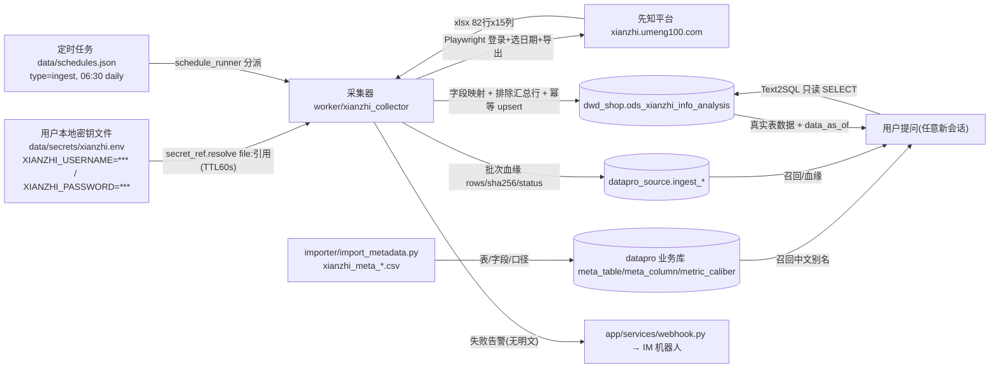
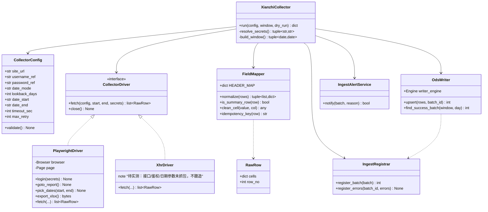
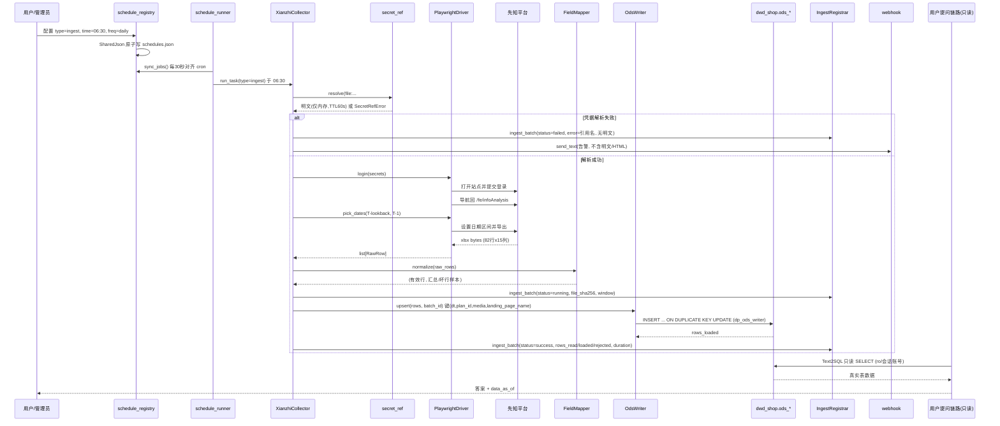
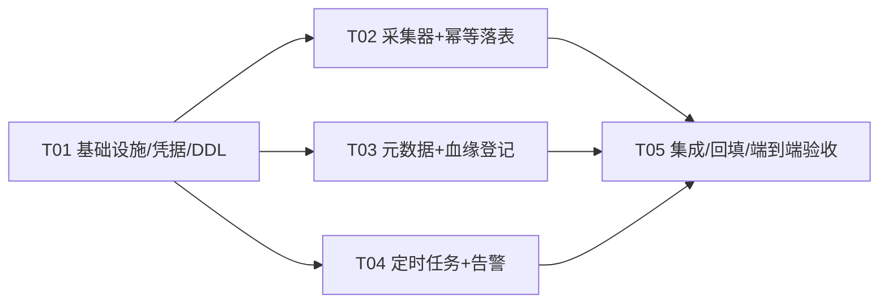

# DataPro — 先知平台投放数据「路径 C」采集落表技术方案

| 文档信息 | 内容 |
|---|---|
| 版本 | v1.0（设计阶段，不含业务代码） |
| 作者 | 高见远（Architect，software-datapro-xianzhi-ingest） |
| 目标 | 定时把先知-代理商系统的投放数据采集成真实数仓表、登记元数据/血缘，让用户在任意新会话用自然语言取数分析 |
| 上游 | 主理人一手实测结论 + `AGENTS.md` + 现成源码核实 |
| 纪律 | 复用现成能力；不破「数仓查询全程只读」红线；凭据零明文落地；不臆造未抓包的 XHR 接口 |

> **证据约定**：本文所有结论标注 `文件路径:行号` 或一手实测证据。凡未做抓包/未验证的一律写「待实测」，不编造接口名。

---

## 1. 方案总览

### 1.1 一句话结论

**新增一个独立的 Python 采集 worker（Playwright 登录并导出先知报表 → 15 列 ASCII 字段映射 → 以 `(dt, plan_id, media, landing_page_name)` 幂等 upsert 到 `dwd_shop.ods_xianzhi_info_analysis`），复用 `secret_ref.py` 管凭据、`import_metadata.py` 登记 `meta_*`、`models_source.py` 的 `ingest_*` 记血缘、`webhook.py` 告警，并把采集作为一种新任务类型扩展进现有 `schedule_registry` + `schedule_runner`（不新建第二套调度）；写入用专属 `dp_ods_writer` 账号且只授 ods 表权限，数仓查询侧仍为只读账号，红线不破。**

### 1.2 数据流图



### 1.3 Implementation Approach（技术难点与选型）

| 难点 | 对策 | 依据 |
|---|---|---|
| 站点需登录的 SPA，登录后落到 websiteManagement，需再导航回 infoAnalysis | Playwright 保留会话上下文，登录后显式 `goto('/fe/infoAnalysis')` | 主理人一手实测 |
| 凭据已明文泄露两次 | 凭据只存 `file:` 引用 + 用户本地密钥文件；运行期 `resolve()` 仅内存；日志/异常绝不回显 | `app/services/secret_ref.py:3-12`、`:142-152`、`:222-231` |
| 默认时间窗锚点 11-16~11-22 与文件数据 11-27 不符导致 0 行 | 落真实表后「昨天」按日历恒等于本表最新分区；元数据标注本表粒度与 `MAX(dt)`；P1 建议按召回表取锚点（见 §9-5） | `AGENTS.md:27`、`app/config.py:39`、`app/core/statemachine.py:441-442` |
| 上传文件表只绑会话，切新对话召回不到 | 不再走 `app/services/file_ingest.py:164-194` 的 `dp_uploads.f_{file_id}` 会话表；落公共 `dwd_shop` 真实表，会话账号天然有 `GRANT SELECT ON dwd_shop.*` | `app/services/db_identity.py:43-51` |
| 站点数据可能延迟/回溯修正 | 每天回看 N 天 + 幂等 upsert；`ingest_batch` 记窗口与校验和 | `app/db/models_source.py:82-105` |
| 与已有 `dwd_campaign_daily` 关键词高度重叠导致误召回 | 新表用「先知/代理商/引流课/落地页/B站」差异化关键词；口径用 `choice_keywords` 消歧 | `app/services/recall.py:65-74` |
| 不能给采集器数仓业务库写权限 | 专属 `dp_ods_writer` 只授两张 ods 表 INSERT/UPDATE/SELECT；DDL 由运维账号执行；查询链路仍走 `ro`/会话只读账号 | `AGENTS.md:8,20,171`、`app/db/models_source.py:1-8` |

### 1.4 复用 vs 新建清单

| 能力 | 复用/新建 | 落点 |
|---|---|---|
| 密钥引用与解析 | **复用**（零改造） | `app/services/secret_ref.py` |
| 元数据/口径导入 | **复用**（新增 CSV 模板，不改脚本） | `importer/import_metadata.py` |
| 数据源登记/血缘 5 张表 | **复用**（新增登记脚本，不改模型） | `app/db/models_source.py` |
| IM 告警 | **复用** | `app/services/webhook.py:81-105` |
| 定时任务配置/调度 | **复用并扩展任务类型**（见 §6 裁决） | `schedule_registry.py` / `schedule_runner.py` |
| 上传文件解析 | **不用于本链路**（参考其分列/类型推断范式） | `app/services/file_ingest.py:90-105,140-208` |
| 采集器（浏览器/导出/映射/落表） | **新建** | `datapro/worker/xianzhi_*.py` |
| DDL + 授权脚本 | **新建** | `datapro/importer/sql/` |
| 血缘登记脚本 | **新建** | `datapro/importer/ingest_registry.py` |

---

## 2. 凭据安全设计

### 2.1 密钥文件模板（仅占位符，真实密码由用户自行填写）

新建 `datapro/data/secrets/xianzhi.env`（**不提交**，被 `.gitignore` 的 `data/` 规则覆盖；`AGENTS.md:92,325`）：

```dotenv
# 先知-代理商系统采集凭据 —— 本地私密文件，禁止提交/贴聊天/贴工单
# 密码请先在先知平台自行轮换，再把新密码填入下方占位符
XIANZHI_USERNAME=***
XIANZHI_PASSWORD=***
```

仓库内只放模板 `datapro/data/secrets/xianzhi.env.example`（内容同上，值全为 `***`）。

**绝不出现**：真实密码、`XIANZHI_PASSWORD=<实际值>`、站点 URL 携带 token 的整串、Cookie/SessionID 原文。

### 2.2 与 `secret_ref` 的接线方式

采集运行配置 `datapro/data/ingest/xianzhi.json` **只存引用，不存明文**：

```json
{
  "source_code": "xianzhi",
  "site_url": "https://xianzhi.umeng100.com/fe/infoAnalysis",
  "username_ref": "file:data/secrets/xianzhi.env#XIANZHI_USERNAME",
  "password_ref": "file:data/secrets/xianzhi.env#XIANZHI_PASSWORD",
  "date_mode": "lookback",
  "lookback_days": 3,
  "timeout_sec": 45,
  "max_retry": 3
}
```

接线要点（均来自现成源码，不改 `secret_ref.py`）：

- `validate_ref()` 在配置写入/加载时校验引用形态（`app/services/secret_ref.py:175-189`），明文形态被 `looks_like_plaintext()`（`:192-196`）识别并拒绝；
- `resolve(ref)` 运行期解析，`file:PATH#VAR` 相对路径以 `datapro/` 为基准（`app/services/secret_ref.py:26-27,115-133`），TTL 缓存 60 秒（`app/config.py:83`），用户轮换后最多 60 秒生效；
- `health(ref)` 返回 `ok/missing/unresolved`，**不含明文**（`:222-231`），供管理端自检；
- 禁止使用 `extract_plaintext()`（`:198-219`）——那是历史明文迁移专用，本方案不产生任何明文。

### 2.3 采集器取凭据流程与 fail-closed

1. 启动批次 → `secret_ref.resolve(username_ref)` / `resolve(password_ref)`，明文只在局部变量与 Playwright 表单中存在；
2. 任一引用解析失败 → 抛 `SecretRefError`，采集器 **立即终止本次运行**：
   - `ingest_batch.status='failed'`、`error='凭据引用不可解析（file:...#XIANZHI_...）'`（**只写引用名，不写值**）；
   - 触发 webhook 告警；**绝不回退到任何明文默认值/环境变量兜底值**；
3. 日志规范：只打印 `ref` 名、`health()['state']`、`type(exc).__name__`；异常字符串若可能包含页面 HTML 或表单值，先过脱敏函数（仅保留类型名 + HTTP 状态码），不写 `exc` 原文；
4. 凭据不进 `ingest_batch`、不进 `ingest_row_error.raw_row`、不进 `query_record`、不进缓存。

### 2.4 用户「自己填密码」操作步骤（交付给用户）

| 步骤 | 操作 |
|---|---|
| 1 | 在先知平台自行轮换账号密码（不要在对话中告知助手） |
| 2 | 复制 `datapro/data/secrets/xianzhi.env.example` 为 `datapro/data/secrets/xianzhi.env` |
| 3 | 本地编辑该文件，把 `XIANZHI_USERNAME` / `XIANZHI_PASSWORD` 的 `***` 替换为轮换后的值并保存（文件已被 gitignore） |
| 4 | 执行自检 `python -m app.services.secret_ref check`（现有 CLI，`app/services/secret_ref.py:234-259`；工程师按需扩展为可指定 xianzhi 引用），确认两个引用状态为 `ok`，**输出不包含明文** |
| 5 | 在「定时任务」页配置运行时间（见 §6）；此后助手全程只接触 `file:` 引用 |

---

## 3. 采集器设计

### 3.1 模块路径与职责划分

| 文件 | 职责 |
|---|---|
| `datapro/worker/xianzhi_collector.py` | 编排：`run(config, window, dry_run)`，凭据解析 → 抓数 → 清洗 → 落表 → 血缘 → 告警 |
| `datapro/worker/xianzhi_driver.py` | `CollectorDriver` 接口 + `PlaywrightDriver`（MVP）+ `XhrDriver`（P1 占位，待抓包） |
| `datapro/worker/xianzhi_fields.py` | 15 列中文表头 → ASCII 列映射、空值归一、汇总行识别、幂等键计算 |
| `datapro/worker/xianzhi_ods.py` | `dp_ods_writer` 引擎、`INSERT ... ON DUPLICATE KEY UPDATE`、批次去重 |
| `datapro/worker/ingest_cli.py` | 手工/回填入口：`python -m worker.ingest_cli --code xianzhi --start ... --end ... [--dry-run]` |

### 3.2 数据结构与接口（classDiagram）



### 3.3 技术路线裁决：Playwright（A）vs XHR（B）

> **裁决：MVP 采用 A（Playwright，Python 包 + Chromium），并把抓取逻辑收敛在 `CollectorDriver` 接口后，预留 B（httpx/XHR）作为 P1 加固；B 的启动条件是先完成抓包实测。**

| 维度 | A Playwright | B XHR/httpx |
|---|---|---|
| 已有证据 | **主理人已实测**：登录 → 跳 websiteManagement → 回 infoAnalysis → 导出 82×15 xlsx，归档 `data/imports/xianzhi_infoAnalysis_20261127.xlsx` | 抓包未做；接口路径、鉴权头、日期参数**全部待实测**，本文不臆造 |
| 依赖现状 | 项目 Python 依赖**无 playwright**（`datapro/requirements.txt:1-12`、`pyproject.toml:6-19`），需新增 + `playwright install chromium` | `httpx` 已由 openai/dev 依赖带入，但优势只有在接口已知时成立 |
| 交付确定性 | 高：唯一已验证可跑通的路线 | 低：前置抓包未完成，不能让路径 C 卡住 |
| 稳定性 | 中：DOM 变更会破坏选择器 | 高：接口契约稳定 |
| 缓解 | 选择器集中管理 + 显式日期输入 + 失败告警 + 回看重跑 | 作为 A 的替换 driver，落表/元数据/调度层零改动 |

**补充裁决**：不把 `playwright-browser-use` skill 的 Node CLI 路径（`C:\Users\gaojinxin\.workbuddy\skills\...`）作为生产采集入口——那是环境专属的独立 skill 目录、未声明为项目依赖，不可部署；仅作为工程师复现登录/导出流程时的参考。

### 3.4 日期区间策略

| 模式 | 配置 | 用途 |
|---|---|---|
| `lookback`（默认） | `date_mode=lookback, lookback_days=3` → 每次抓 `[T-3, T-1]` | 定时任务每日增量；回看覆盖源端延迟/回溯修正，靠 upsert 幂等去重 |
| `range`（回填） | `date_mode=range, date_start, date_end` | 首次回填/手工补数；走 `ingest_cli.py` 显式指定 |

- **必须显式设置站点日期控件**，不依赖站点默认区间——这正是「11-16~11-22 默认窗 vs 11-27 数据」错配的根因（主理人一手结论）。
- 「昨天」按**日历**计算，与 `AGENTS.md:27`「显式「昨天/指定日期」恒按日历」一致。
- 时区 `Asia/Shanghai`（`app/services/schedule_runner.py:21`）。

### 3.5 分页处理

- 实测导出为单页 xlsx（82 行），**MVP 按单页实现**；
- `PlaywrightDriver` 在导出后校验行数与表头：若站点改成分页/滚动加载，导出文件行数会变化 → `ingest_batch.rows_rejected` 记录异常并告警「导出行数异常」，不静默入库；
- 分页支持列为 P1：若后续出现分页控件，在 `pick_dates()` 后循环点击「下一页」并合并 xlsx，或改走 B 路线按接口分页拉全量。**待实测**，不预设接口。

### 3.6 字段映射（15 列 → ASCII 表列）

一手证据：归档 xlsx 表头与样例行已用 XML 直接解析复核（`data/imports/xianzhi_infoAnalysis_20261127.xlsx`，1 表头 + **82 数据行**，样例 `2026-11-27, 高途高中班课-..., bilibili app（b站）, ..., 922222659, 231, 11, 7.63, ...`）。

| # | 中文表头（源） | ASCII 列名 | MySQL 类型 | 清洗规则 |
|---|---|---|---|---|
| 1 | 投放日期 | `dt` | `DATE` | `YYYY-MM-DD` → DATE；# |
| 2 | 投放账户名称 | `account_name` | `VARCHAR(128)` | `--`/空 → `''` |
| 3 | 媒体 | `media` | `VARCHAR(64)` | `--`/空 → `''`；保留原文（如 `bilibili app（b站）`），不做枚举归一 |
| 4 | 投放计划名称 | `plan_name` | `VARCHAR(255)` | `--`/空 → `''` |
| 5 | 落地页名称 | `landing_page_name` | `VARCHAR(255)` | `--`/空 → `''`（82 行中 65 行为 `--`，属正常空值） |
| 6 | 投放计划ID | `plan_id` | `VARCHAR(64)` | **按字符串保留**（存在 `0` 值，不可当 NULL/数字） |
| 7 | 展示 | `impressions` | `BIGINT UNSIGNED NULL` | 逗号/空格清洗；`--`/`-`/空 → `NULL` |
| 8 | 点击 | `clicks` | `BIGINT UNSIGNED NULL` | 同上 |
| 9 | 账面消耗 | `account_cost` | `DECIMAL(18,4) NULL` | 同上；**与 `dwd_campaign_daily.cost` 不是同一口径**，元数据须区分 |
| 10 | 登录用户数 | `login_users` | `INT UNSIGNED NULL` | 同上 |
| 11 | 引流课报名人数 | `lead_signups` | `INT UNSIGNED NULL` | 同上 |
| 12 | 引流课报名成本 | `lead_signup_cost` | `DECIMAL(18,4) NULL` | 同上；源端给定值，勿与账面消耗自行相除混用 |
| 13 | 高一引流课报名人数 | `grade1_signups` | `INT UNSIGNED NULL` | 同上 |
| 14 | 高二引流课报名人数 | `grade2_signups` | `INT UNSIGNED NULL` | 同上 |
| 15 | 高三引流课报名人数 | `grade3_signups` | `INT UNSIGNED NULL` | 同上 |

系统列（非源表头）：`id`、`ingest_batch_id`、`source_url`、`created_at`、`updated_at`。

**空值语义**：数值列 `NULL` = 源端未给；`0` = 源端明确为 0，二者不可混淆（呼应 `AGENTS.md:178`「0 单 ≠ 无数据」）。

### 3.7 汇总行识别与排除

配置 `summary_row.include=true` 表示**源端可能导出汇总行**（当前 82 行样本中未见；不能因此省略逻辑）：

- 识别规则（命中任一即排除）：`account_name`/`plan_name`/`media`/`landing_page_name` 任一含 `汇总|合计|总计|小计`；或 `dt` 为空/非日期；或整行数值列全空且文本列为空；
- 排除的行写入 `ingest_row_error(reason='summary_row')`（限量，见 `app/db/models_source.py:108-116`），计数进 `rows_rejected`；
- 若某批次汇总行占比 > 5% 或有效行数为 0 → 判失败并告警，不写空表。

### 3.8 幂等键（已用真实数据验证）

> **唯一键 = `(dt, plan_id, media, landing_page_name)`**

实测对 82 行做候选键验证：

| 候选键 | 唯一值数 | 重复 | 结论 |
|---|---|---|---|
| `dt + plan_id + media` | 81 | **1 组重复**（`plan_id='0'` 的两行，落地页分别为 `高中-19.8元- 周帅B站` 与 `高中-0元- B站-首选-wyw`） | ❌ 不安全 |
| `dt + plan_id + media + landing_page_name` | **82** | 0 | ✅ 采用 |
| 再加入 `account_name` | 82 | 0 | 冗余（样本内账户名被其他列唯一确定），不采用 |

- 写入用 `INSERT ... ON DUPLICATE KEY UPDATE`，回溯修正覆盖旧值；`updated_at` 自动刷新，`ingest_batch_id` 指向最近批次。
- 同窗口当天已有 `status='success'` 批次 → 直接跳过（多实例重复触发的兜底，见 §6.5）。

### 3.9 失败重试与超时

| 项 | 值 | 说明 |
|---|---|---|
| 单次页面操作超时 | `timeout_sec=45` | 登录/日期选择/导出各自计时 |
| 重试 | `max_retry=3`，指数退避 2/4/8s | 仅对网络/超时/5xx 重试；**登录失败（凭据错）不重试**，直接 fail-closed + 告警 |
| 浏览器崩溃 | 每次重试重建 Browser 上下文；最多 3 次 | 避免脏会话 |
| 批次状态机 | `running → success / failed`，`error` 只写类型与原因码 | `app/db/models_source.py:100` |
| 断点续跑 | 按 `window_start/window_end` 重跑；已成功窗口跳过，失败窗口从 `ingest_batch` 找到后重放 | 见 §7.2 |

---

## 4. 表结构设计

### 4.1 落库位置与写入账号边界（关键裁决）

> **落 `dwd_shop`（与公共数仓同库），不落 `datapro_source`，也不落 `dp_uploads`。**

| 决策 | 理由 |
|---|---|
| 放 `dwd_shop` | 会话级只读账号已被授予 `GRANT SELECT ON dwd_shop.*`（`app/services/db_identity.py:43-51`），Text2SQL 链路**零改造**即可查到；公共数仓语义正确 |
| 不放 `datapro_source` | 该库文档明确「只放登记与血缘，**不放业务数据本身**」（`app/db/models_source.py:1-8`） |
| 不放 `dp_uploads` | 会话绑定表正是「切新对话召回不到」的根因（`app/services/file_ingest.py:164-194`） |
| 写入账号 `dp_ods_writer` | 只授 `SELECT, INSERT, UPDATE ON dwd_shop.ods_xianzhi_info_analysis`（及后续第二张表）；**不授任何 `dwd_*` 业务表写权限**，无 DDL 权限；DDL 由运维用管理账号执行 |
| 查询账号不变 | 数仓查询仍走 `ro`（`app/config.py:21`）或会话派生只读账号（`db_identity.py`），「全程只读」红线不破（`AGENTS.md:8,171`） |

授权脚本模板（放 `datapro/importer/sql/ods_xianzhi_info_analysis.sql`，由运维执行，密码用环境变量注入）：

```sql
CREATE USER IF NOT EXISTS 'dp_ods_writer'@'%' IDENTIFIED BY '<运维注入>';
GRANT SELECT, INSERT, UPDATE ON dwd_shop.ods_xianzhi_info_analysis TO 'dp_ods_writer'@'%';
-- 禁止：GRANT ... ON dwd_shop.dwd_* / 禁止 DROP/CREATE 权限
```

### 4.2 DDL（MySQL 8.0）

```sql
CREATE TABLE IF NOT EXISTS dwd_shop.ods_xianzhi_info_analysis (
  id                  BIGINT UNSIGNED NOT NULL AUTO_INCREMENT COMMENT '代理主键',
  dt                  DATE            NOT NULL                COMMENT '投放日期(源:投放日期)',
  account_name        VARCHAR(128)    NOT NULL DEFAULT ''     COMMENT '投放账户名称',
  media               VARCHAR(64)     NOT NULL DEFAULT ''     COMMENT '媒体',
  plan_name           VARCHAR(255)    NOT NULL DEFAULT ''     COMMENT '投放计划名称',
  landing_page_name   VARCHAR(255)    NOT NULL DEFAULT ''     COMMENT '落地页名称(--表示源端空)',
  plan_id             VARCHAR(64)     NOT NULL DEFAULT ''     COMMENT '投放计划ID(字符串,可能为0)',
  impressions         BIGINT UNSIGNED     DEFAULT NULL        COMMENT '展示',
  clicks              BIGINT UNSIGNED     DEFAULT NULL        COMMENT '点击',
  account_cost        DECIMAL(18,4)       DEFAULT NULL        COMMENT '账面消耗',
  login_users         INT UNSIGNED        DEFAULT NULL        COMMENT '登录用户数',
  lead_signups        INT UNSIGNED        DEFAULT NULL        COMMENT '引流课报名人数',
  lead_signup_cost    DECIMAL(18,4)       DEFAULT NULL        COMMENT '引流课报名成本',
  grade1_signups      INT UNSIGNED        DEFAULT NULL        COMMENT '高一引流课报名人数',
  grade2_signups      INT UNSIGNED        DEFAULT NULL        COMMENT '高二引流课报名人数',
  grade3_signups      INT UNSIGNED        DEFAULT NULL        COMMENT '高三引流课报名人数',
  ingest_batch_id     BIGINT              DEFAULT NULL        COMMENT '最近写入批次ID(血缘)',
  source_url          VARCHAR(255)    NOT NULL DEFAULT ''     COMMENT '采集来源页面',
  created_at          DATETIME        NOT NULL DEFAULT CURRENT_TIMESTAMP,
  updated_at          DATETIME        NOT NULL DEFAULT CURRENT_TIMESTAMP ON UPDATE CURRENT_TIMESTAMP,
  PRIMARY KEY (id),
  UNIQUE KEY uk_ods_xianzhi_grain (dt, plan_id, media, landing_page_name),
  KEY idx_ods_xianzhi_dt (dt),
  KEY idx_ods_xianzhi_batch (ingest_batch_id)
) ENGINE=InnoDB
  DEFAULT CHARSET=utf8mb4 COLLATE=utf8mb4_general_ci
  COMMENT='先知-代理商系统投放数据ODS,一行=某日某计划某媒体某落地页投放表现';
```

**关于分区**：`ingest_dataset.partition_col` 登记为 `dt`（逻辑分区/时间列），但**不做 MySQL 物理 `PARTITION BY`**——本表日增约 82 行，物理分区无收益；且 MySQL 要求分区键包含所有唯一键，会与 `PRIMARY KEY(id)` 冲突。用 `idx_ods_xianzhi_dt` 支撑时间窗查询即可。

### 4.3 增量/全量策略

| 项 | 值 |
|---|---|
| `load_mode` | `incremental`（`app/db/models_source.py:55`） |
| `incremental_col` | `dt`；`partition_col` = `dt` |
| 写入方式 | upsert（按 §3.8 唯一键），非 append 非全表覆盖 |
| 首次回填 | 用 `range` 模式手工跑，仍走同一 upsert 逻辑 |
| 重复运行 | 同 `(dataset, window)` 已有 success 批次则跳过；即使重跑也幂等 |

---

## 5. 元数据与血缘登记

### 5.1 登记表/字段/口径的具体填法

复用 `importer/import_metadata.py`（`ALIASES`/`KIND_FIELDS` 见 `:16-30`），新增 3 个 CSV 模板放 `datapro/importer/templates/`；导入命令：

```bash
python -m importer.import_metadata --file importer/templates/xianzhi_meta_tables.csv --kind tables --dry-run
python -m importer.import_metadata --file importer/templates/xianzhi_meta_columns.csv --kind columns --dry-run
python -m importer.import_metadata --file importer/templates/xianzhi_calibers.csv --kind calibers --dry-run
# 校验无误后去掉 --dry-run 正式导入（脚本末尾自动 metadata_store.invalidate()，:193-195）
```

**(a) `meta_table`（表级，字段参见 `app/db/models.py:127-147`）**

| 列 | 值 |
|---|---|
| `db_name` | `dwd_shop` |
| `table_name` | `ods_xianzhi_info_analysis` |
| `cn_name` | 先知代理商投放明细日表 |
| `granularity` | 一行 = 某投放日期 × 某计划ID × 某媒体 × 某落地页的投放表现 |
| `update_freq` | 每日 T+1 06:30（Asia/Shanghai），回看 3 天 |
| `owner` | 由用户指定（待明确 §9-3） |
| `dt_level` | L2 |
| `description` | 先知-代理商系统导出的投放数据，含账户/媒体/落地页/展示/点击/账面消耗/登录用户/引流课报名及高一二三拆分。**与 `dwd_campaign_daily` 不同**：本表是引流课投放明细、含落地页与年级维度；问「先知/代理商/引流课/落地页/B站」优先用本表，问通用投放 ROI 用 `dwd_campaign_daily` |
| `keywords` | `先知,代理商,引流课,落地页,B站,bilibili,投放账户,报名人数` |
| `priority` | P1 |
| `status` | active |

> **消歧要点**：刻意不把「花费/消耗/曝光/点击/GMV」写进本表 `keywords`——这些词已被 `dwd_campaign_daily` 占用（`app/services/recall.py:70-74`）。让通用词走旧表，专属词走新表；指标层的同义词用口径 `aliases` + `choice_keywords` 兜底。

**(b) `meta_column`（字段级，字段参见 `app/db/models.py:150-166`）**

15 行，每行 `db_name=dwd_shop, table_name=ods_xianzhi_info_analysis, col_name=<ASCII>, cn_name=<中文表头>, data_type=<DDL 类型>, is_pii=false`。重点条目：

| col_name | cn_name | caliber_id | common_pitfalls |
|---|---|---|---|
| `dt` | 投放日期 | — | 源端日期；相对窗口锚点见 §5.4 |
| `plan_id` | 投放计划ID | — | 字符串，`0` 是合法值，不可当 NULL |
| `landing_page_name` | 落地页名称 | — | `--` 表示源端空值，已归一为 `''`；是幂等键一部分 |
| `account_cost` | 账面消耗 | M901 | 与 `dwd_campaign_daily.cost` 口径不同，不可直接对比/相加 |
| `lead_signups` | 引流课报名人数 | M902 | 高一/二/三是其拆分，不可与总报名数相加 |
| `lead_signup_cost` | 引流课报名成本 | M905 | 源端给定值，勿用 `账面消耗/报名人数` 覆盖 |
| `grade1/2/3_signups` | 高一/二/三引流课报名人数 | — | 年级拆分维度 |

**(c) `metric_caliber`（口径，字段参见 `app/db/models.py:112-124`）**

`logic` 遵循模板引擎支持的 `聚合 WHERE 过滤` 形式（`AGENTS.md:170`），不写 `FROM`（由 `source_table` 提供）：

| metric_id | metric_name | aliases | definition | logic | source_table | choice_keywords |
|---|---|---|---|---|---|---|
| M901 | 先知账面消耗 | 消耗,花费,成本,广告消耗,先知消耗,账面花费 | 先知平台当日账面消耗合计 | `SUM(account_cost) WHERE dt='{date}'` | dwd_shop.ods_xianzhi_info_analysis | 先知,代理商,引流课,落地页,bilibili,B站 |
| M902 | 先知引流课报名人数 | 报名,报名人数,报名数,引流课报名,线索,留资 | 先知平台当日引流课报名人数合计 | `SUM(lead_signups) WHERE dt='{date}'` | 同上 | 先知,引流课,报名 |
| M903 | 先知展示量 | 曝光,展示,曝光量,展示量 | 先知平台当日展示合计 | `SUM(impressions) WHERE dt='{date}'` | 同上 | 先知,引流课,B站 |
| M904 | 先知点击量 | 点击,点击量,点击数 | 先知平台当日点击合计 | `SUM(clicks) WHERE dt='{date}'` | 同上 | 先知,引流课,B站 |
| M905 | 先知引流课报名成本 | 报名成本,获客成本,CPA | 源端给出的引流课报名成本合计 | `SUM(lead_signup_cost) WHERE dt='{date}'` | 同上 | 先知,引流课 |
| M906 | 先知登录用户数 | 登录用户,登录人数 | 先知平台当日登录用户数合计 | `SUM(login_users) WHERE dt='{date}'` | 同上 | 先知,引流课 |

`choice_keywords` 作用是当用户只说「消耗/报名」时，召回层据「先知/引流课/落地页/B站」等上下文选中本表口径，而非 `dwd_campaign_daily` 的同类口径。

### 5.2 `ingest_*` 血缘登记（独立库 `datapro_source`）

由新建 `datapro/importer/ingest_registry.py` 调用 `app/db/source_session.py` 的独立 engine（`AGENTS.md:22-23`）写入；**不修改 5 张模型**：

| 表 | 写入内容 |
|---|---|
| `ingest_source`（`:21-35`） | `code='xianzhi'`, `name='先知-代理商系统'`, `kind='scraper'`, `owner=<用户>`, `status='active'` |
| `ingest_dataset`（`:38-62`） | `source_code='xianzhi'`, `dataset_code='info_analysis'`, `db_name='dwd_shop'`, `table_name='ods_xianzhi_info_analysis'`, `grain=...`, `primary_key='dt,plan_id,media,landing_page_name'`, `incremental_col='dt'`, `partition_col='dt'`, `load_mode='incremental'`, `dtype_policy='typed'`, `schema_version=1`, `status='active'`, `meta_registered=true` |
| `ingest_field_map`（`:65-79`） | 15 行，`src_field`=中文表头、`col_name`=ASCII、`data_type`=DDL 类型、`transform`=`date_parse / dash_to_null / trim_number`、`required`（`dt/plan_id/media/landing_page_name`=true），`schema_version=1` |
| `ingest_batch`（`:82-105`） | 每次运行一行：`batch_no=<uuid>`、`dataset_id`、`source_code='xianzhi'`、`db_name/table_name`、`load_mode`、`window_start/end`、`source_file`（归档 xlsx 或导出临时路径）、`file_sha256`、`rows_read/loaded/rejected`、`status`、`error`、`triggered_by='scheduler:<task_id>'` 或 `'manual:<user>'`、`started_at/finished_at/duration_ms` |
| `ingest_row_error`（`:108-116`） | 汇总行/解析失败行样本（限量），`reason='summary_row'/'bad_type'`，`raw_row` 只存源行文本（**不含凭据**） |

> 注意：`import_metadata.py:127` 的 `upsert` 对 `MetaTable` 只按 `table_name` 查找（模型唯一键却是 `(db_name, table_name)`，`models.py:134`）。本项目目前表名全局唯一，故不阻塞；工程师新增模板时**务必显式写 `db_name=dwd_shop`**。

### 5.3 Text2SQL 召回链路

用户提问 → `recall.py` 用 `meta_table.keywords` 与 `meta_column.cn_name` 命中（`app/services/recall.py:226,253,275`）→ `metric_caliber.aliases/choice_keywords` 消歧 → 生成只读 SQL 走 `ro`/会话账号查 `dwd_shop.ods_xianzhi_info_analysis`。因此「消耗/花费/成本 → 账面消耗」「报名 → 引流课报名人数」通过 M901/M902 的 aliases 实现，而「先知/引流课」上下文通过 choice_keywords 避免误命中旧表。

### 5.4 `data_as_of` 标注

- 现状：相对时间锚点来自基准表 `MAX(dt)`，默认 `dwd_order_detail_di`（`app/config.py:39`），结果事件带 `data_as_of` / `data_as_of_basis`（`app/core/statemachine.py:441-442`）——这正是「11-16~11-22 锚点 vs 11-27 数据」错配的机制来源。
- 本方案的根治：① 每天定时抓 T-1，使「昨天」（日历）恒等于本表最新分区；② 元数据 `description` 明示本表时间列与更新频率；③ 批次 `window_end` 即该批数据 as-of；
- **仍需 P1 增强（见 §9-5，需用户拍板）**：`partition_clock.anchor(table=...)` 按召回表取 `MAX(dt)`，`statemachine` 把召回表传入，使「最近 7 天」这类相对问题问先知数据时锚到本表而非订单表。未做之前，相对时间窗问题仍可能 0 行，需在答案中提示用户使用明确日期。

---

## 6. 定时任务接入

### 6.1 裁决：复用 `schedule_registry` + `schedule_runner` 并扩展任务类型（不新建第二套）

> **裁决：扩展现有任务模型，新增 `type` 字段（`question` 默认值 / `ingest`），由 `schedule_runner.run_task()` 按类型分派；配置仍落 `data/schedules.json`（经 `SharedJson`），调度仍由同一 APScheduler 实例管理。**

理由：

1. `AGENTS.md:304` 已记「定时任务仅单实例：APScheduler 作业与同步签名都在进程内存，多实例会重复执行」——再建第二套调度会让同一隐患翻倍；
2. 用户明确「运行时间通过定时任务配置」——单一配置面（现有「定时任务」页）体验一致，且 `owner` 隔离已就绪（`schedule_registry.py:22-27`、`:33-51`）；
3. 现成 `SharedJson` 跨进程原子写、`record_run` 运行记录（`:87-95`）、`_cron`/`_signature`/`sync_jobs`（`schedule_runner.py:67-106`）可直接复用，改动面小；
4. 向后兼容：`type` 缺省为 `question`，历史任务行为不变。

**不采用**新建独立 APScheduler 作业/独立 JSON 文件的方案（重复造轮子 + 多实例风险叠加）。

### 6.2 需要改造的现成文件（最小改动）

| 文件 | 改动 |
|---|---|
| `app/services/schedule_registry.py` | `add()`（`:33-51`）增加 `type`、`ingest_code` 字段（默认 `question`）；`update()`（`:53-65`）允许 patch `type`/`ingest_code` |
| `app/services/schedule_runner.py` | `run_task()`（`:27-57`）按 `type` 分派：`question` 走原 Pipeline，`ingest` 调 `XianzhiCollector.run()` 并把结果映射成 run 记录；`_signature()`（`:81-82`）把 `type`/`ingest_code` 纳入签名以触发作业重建 |
| `data/schedules.json` | 新增一条 `type='ingest'` 任务（由用户/管理接口添加） |

### 6.3 配置文件与 cron 示例

任务记录（`data/schedules.json`，`SharedJson` 管理）：

```json
{
  "id": "z9x1ab2c",
  "name": "先知投放数据每日采集",
  "type": "ingest",
  "ingest_code": "xianzhi",
  "question": "",
  "freq": "daily",
  "time": "06:30",
  "enabled": true,
  "owner": "<用户>",
  "runs": []
}
```

- cron：`CronTrigger(hour=6, minute=30, timezone=Asia/Shanghai)`（复用 `schedule_runner.py:67-78` 的 `_cron`）；等价表达式 `0 30 6 * * *`；
- 采集器运行参数（日期模式/回看天数/超时/凭据引用）单独放 `datapro/data/ingest/xianzhi.json`（§2.2），与「何时跑」解耦；
- 用户通过现有「定时任务」页改 `time` 即可调整运行时间，`sync_jobs()` 每 30 秒对齐（`schedule_runner.py:109-117`），下一轮生效。

### 6.4 任务执行记录与告警

- 每次采集写 `ingest_batch`（完整血缘）+ `schedule_registry.record_run()`（简版：status/rows/data_as_of），两处都留痕；
- 失败调 `app/services/webhook.py:81-105` 的 `send_text()` 发 IM（复用 `INSPECTION_WEBHOOK_URL/TYPE/SECRET`，`datapro/.env.example:85-89`）；发送失败只记日志不影响主链路（该函数的既有语义，`:103-105`）。

### 6.5 多实例下单副本约束

- 现状 still 进程内（`AGENTS.md:304`）：`max_instances=1, coalesce=True`（`schedule_runner.py:104-105`）只约束单进程；
- 本方案加**数据层幂等兜底**，即使两个实例同时触发也不会重复污染：
  1. `ingest_batch` 按 `(dataset_id, window_start, window_end)` 查当天已有 `success` 批次 → 跳过；
  2. `uk_ods_xianzhi_grain` 唯一键 + upsert → 重复写不产生重复行；
- 彻底的多副本方案（Redis job store 或分布式锁）超出本次范围，**待明确**（§9 之外的技术债，建议后续单独立项）。

### 6.6 程序调用时序（sequenceDiagram）



---

## 7. 失败与可观测

### 7.1 告警通道（复用 webhook）

| 场景 | 告警级别 | 消息内容（**不含凭据/HTML 原文**） |
|---|---|---|
| 凭据引用不可解析 | 高 | `先知采集失败：凭据引用 XIANZHI_PASSWORD 不可解析（state=unresolved），请检查密钥文件` |
| 登录失败 | 高 | `先知采集失败：登录被拒（仅类型名 + HTTP 状态码），请确认密码已轮换` |
| 导出行数异常/表头不符 | 中 | `先知采集异常：rows_read=0 或表头缺列，疑似站点改版，请人工核查` |
| 汇总行/坏行占比超阈值 | 中 | `先知采集部分拒绝：rows_rejected=N，详见 ingest_row_error` |
| 批次 success | 低（可选） | `先知采集成功：window=..., rows_loaded=82, as_of=...` |

统一封装 `app/services/ingest_alert.py`（薄封装 `webhook.send_text`），确保消息拼接前先过滤敏感字段。

### 7.2 断点续跑

- `ingest_batch` 是续跑锚点：失败批次的 `window_start/window_end` 可直接作为 `--start/--end` 重放；
- 成功批次按窗口跳过（§6.5）；
- `ingest_row_error` 保留坏行样本，修正字段映射后可定向重放该窗口；
- 重放全程走同一 upsert，不产生重复行。

### 7.3 血缘与日志红线

- 每次运行必须有 `ingest_batch`（含 `file_sha256`、`rows_*`、`triggered_by`、`duration_ms`）——这是幂等、审计与回溯的唯一锚点（`app/db/models_source.py:82-105`）；
- **绝不写日志的内容**：账号密码明文、`file:` 引用的解析结果、Cookie/SessionID、页面 HTML 原文、含 token 的完整 URL；
- 异常日志格式固定为 `类型名 + 错误码 + 批次号`，调试需要页面内容时只记录「表头哈希/行数」等摘要；
- 采集写入与数仓查询账号物理隔离（§4.1），任何情况下 `dp_ods_writer` 都不能用于查询链路。

---

## 8. 实施任务分解

### 8.1 Required Packages

```
新增：
- playwright>=1.40            # 路线 A：浏览器自动化采集（Python 包）
  - 浏览器二进制：python -m playwright install chromium  # 非 pip 依赖，需联网安装
- openpyxl>=3.1               # XLSX 解析；现已被 import_metadata.py:67 / file_ingest.py:74 使用，
                              # 但 requirements.txt 未声明 —— 本次一并补上
已有（无需新增）：
- apscheduler>=3.10           # 调度（requirements.txt:10）
- httpx                       # 随 openai/dev 依赖带入，P1 路线 B 使用
- sqlalchemy>=2.0, pymysql>=1.1, pydantic-settings>=2.0
```

需修改 `datapro/requirements.txt` 与 `datapro/pyproject.toml:6-19`。

### 8.2 文件清单（相对路径）

**新增**

```
datapro/data/secrets/xianzhi.env.example          # 模板，值全 ***
datapro/data/ingest/xianzhi.json                  # 采集配置，凭据仅 file: 引用
datapro/importer/sql/ods_xianzhi_info_analysis.sql # DDL + dp_ods_writer 授权模板
datapro/importer/ingest_registry.py               # ingest_* 登记
datapro/importer/templates/xianzhi_meta_tables.csv
datapro/importer/templates/xianzhi_meta_columns.csv
datapro/importer/templates/xianzhi_calibers.csv
datapro/importer/templates/xianzhi_field_map.csv
datapro/worker/xianzhi_collector.py
datapro/worker/xianzhi_driver.py
datapro/worker/xianzhi_fields.py
datapro/worker/xianzhi_ods.py
datapro/worker/ingest_cli.py
datapro/app/services/ingest_alert.py
datapro/tests/test_xianzhi_collector.py
datapro/tests/test_xianzhi_e2e.py
datapro/tests/fixtures/xianzhi_infoAnalysis_20261127.xlsx  # 从 data/imports 复制做测试夹具
```

**修改**

```
datapro/requirements.txt
datapro/pyproject.toml
datapro/.env.example
datapro/app/services/schedule_registry.py
datapro/app/services/schedule_runner.py
```

### 8.3 任务清单（按依赖排序，共 5 项）

#### T01 — 项目基础设施与凭据/DDL 准备　`P0`

- **源文件**：`requirements.txt`、`pyproject.toml`、`.env.example`、`data/secrets/xianzhi.env.example`、`data/ingest/xianzhi.json`、`importer/sql/ods_xianzhi_info_analysis.sql`
- **依赖**：无
- **内容**：声明 playwright/openpyxl；给 `.env.example` 补 `ODS_WRITER_URL`/采集相关项；产出密钥文件模板（全 `***`）与采集配置（仅 `file:` 引用）；产出 DDL + `dp_ods_writer` 授权脚本；文档化 `playwright install chromium`。
- **验收标准**：
  1. `python -m playwright install chromium` 后 Playwright 可启动；
  2. 配置中两个凭据字段均通过 `secret_ref.validate_ref()`，草稿模板里无任何非占位符密码；
  3. DDL 在 MySQL 8.0 执行成功，`dp_ods_writer` 对 ods 表可 INSERT 但对 `dwd_order_detail_di` INSERT 被拒；
  4. `SHOW GRANTS FOR 'dp_ods_writer'` 输出无 `dwd_*` 写权限。

#### T02 — 采集器与幂等落表　`P0`

- **源文件**：`worker/xianzhi_collector.py`、`worker/xianzhi_driver.py`、`worker/xianzhi_fields.py`、`worker/xianzhi_ods.py`
- **依赖**：T01
- **内容**：实现 §3 全部逻辑（Playwright 登录/导航/选日期/导出、15 列映射、`--` 归一、汇总行排除、4 列幂等键、回看窗口、重试超时、fail-closed）。
- **验收标准**：
  1. 用归档 xlsx 夹具跑 `normalize()`：解析出 **82 行**、表头 15 列、`plan_id='0'` 的两行不被误合并、汇总行被排除并计数；
  2. dry-run 不写库；
  3. 同一窗口连跑两次，表内仍为 82 行（upsert 幂等）；
  4. 故意把 `password_ref` 指向不存在的文件 → 批次 failed 且日志/告警中无明文；
  5. 显式设置日期，`window_start/end` 正确落 `ingest_batch`。

#### T03 — 元数据与血缘登记　`P0`

- **源文件**：`importer/templates/xianzhi_meta_tables.csv`、`xianzhi_meta_columns.csv`、`xianzhi_calibers.csv`、`xianzhi_field_map.csv`、`importer/ingest_registry.py`
- **依赖**：T01
- **内容**：按 §5 填 4 个模板；实现 `ingest_source/dataset/field_map/batch` 登记（复用 `source_session` 独立 engine），`meta_*` 用现成脚本导入。
- **验收标准**：
  1. 四份模板 `--dry-run` 无校验错误；正式导入后 `meta_table/meta_column/metric_caliber` 可查到新表与 M901~M906；
  2. `ingest_dataset.meta_registered=true`，`ingest_field_map` 有 15 行且中文表头与归档 xlsx 一致；
  3. 在问答页问「先知的账面消耗/引流课报名人数」→ 召回 `ods_xianzhi_info_analysis` 而非 `dwd_campaign_daily`；问通用「投放 ROI」仍命中旧表。

#### T04 — 定时任务与告警接入　`P1`

- **源文件**：`app/services/schedule_registry.py`、`app/services/schedule_runner.py`、`app/services/ingest_alert.py`、`tests/test_schedule_ingest.py`（可并入 `tests/test_xianzhi_collector.py`）
- **依赖**：T01（可与 T02/T03 并行，仅集成时需 T02 接口）
- **内容**：按 §6.2 扩展 `type`/`ingest_code`、分派执行、签名纳新字段、失败告警封装。
- **验收标准**：
  1. 旧 `question` 任务行为不变（回归现有定时任务用例）；
  2. 新建 `type=ingest` 任务在设定时间触发一次采集，`record_run` 有 status/rows；
  3. 改 `time` 后下一轮 `sync_jobs` 重建作业；
  4. 失败告警消息中 grep 不到密码字符串或 `<html` 片段。

#### T05 — 集成、回填与端到端验收　`P0`

- **源文件**：`worker/ingest_cli.py`、`tests/test_xianzhi_e2e.py`、`tests/fixtures/xianzhi_infoAnalysis_20261127.xlsx`
- **依赖**：T02、T03、T04
- **内容**：手工/回填 CLI；把归档 xlsx 作为夹具；跑通「配置 → 采集 → 落表 → 元数据 → 定时 → 新会话提问」全链路。
- **验收标准**：
  1. `python -m worker.ingest_cli --code xianzhi --start 2026-11-27 --end 2026-11-27` 后表内有 82 行、批次 success；
  2. **切一个新会话**问「11-27 先知的账面消耗和报名人数」能正确命中真实表（验证会话绑定问题已根治）；
  3. 不带日期问「最近 7 天…」时，若锚点仍为订单表（§9-5 未做），答案须提示数据日期/建议使用明确日期，不静默返回 0 行当作结论；
  4. 全链路日志/告警/数据库 grep 不到任何明文密码。

### 8.4 Shared Knowledge（工程师必读约定）

- 一切凭据只以 `env:` / `file:` / `kms://` 引用出现，明文的唯一合法落点是用户本地 `datapro/data/secrets/xianzhi.env`（gitignore）；
- 表唯一键 `(dt, plan_id, media, landing_page_name)`，写入一律 upsert；`plan_id='0'` 是合法值；
- 数值列空值 = `NULL`（源未给），`0` = 源明确为 0；文本空值归一为 `''`（源 `--`）；
- 中文表头 → ASCII 列映射见 §3.6，`ingest_field_map` 与之保持一致；
- 写入用 `dp_ods_writer`（仅 ods 表），查询用 `ro`/会话只读账号；任何代码路径不得用 writer 执行查询链路；
- 采集脚本不要 import `app.services.file_ingest`（会话绑定路径与本方案无关）；
- 时间与时区统一 `Asia/Shanghai`；「昨天/指定日期」按日历，`data_as_of` 语义见 §5.4；
- 告警/日志敏感规则见 §7.3；`webhook.send_text` 失败只记日志、不抛异常；
- 新增功能先登记 `docs/DataPro-功能清单.md`（`AGENTS.md:176`）——由主理人统一登记，工程师提醒即可。

### 8.5 Task Dependency Graph



T02/T03/T04 在 T01 完成后可并行；仅 T05 为汇合验收。

---

## 9. 待明确事项（5 条）

| # | 事项 | 类型 | 建议默认值 / 裁决 | 谁拍板 |
|---|---|---|---|---|
| 1 | 采集日期策略：默认「每天抓昨天 + 回看 3 天」是否接受？首次回填范围（近 30 天 / 指定起日）？ | **需用户拍板** | 建议回看 3 天 + 首次回填近 30 天 | 用户 |
| 2 | 运行时间定在几点？先知报表 T+1 实际就绪时间是否已确认？ | **需用户拍板** | 建议 06:30；若站点上午才更新须后移 | 用户 |
| 3 | 表落 `dwd_shop` + 建 `dp_ods_writer` 账号由谁执行？元数据 `owner` 填谁？ | **需用户拍板** | 建议接受落 `dwd_shop`；运维建账号，owner 填用户本人 | 用户/运维 |
| 4 | 站点 XHR 抓包未做（路线 B 前置）；是否本阶段安排抓包？ | 技术待实测 | 本阶段走 A；抓包完成且稳定后再切 B，接口细节**待实测**，本文不臆造 | 主理人/工程师 |
| 5 | 全局 `data_as_of` 锚点仍是 `dwd_order_detail_di`；「最近 7 天」问先知数据会锚错。是否本阶段做「按召回表取锚点」小改造？ | **需用户拍板（影响范围）** | 建议 P1 追加 `partition_clock.anchor(table=...)` + `statemachine` 传召回表；未做前用明确日期规避 | 用户/主理人 |

> 另有一项**非阻塞技术债**：定时任务多实例仍进程内（`AGENTS.md:304`）。本方案已用「批次窗口去重 + 唯一键 upsert」兜住数据正确性，但彻底方案（Redis job store / 分布式锁）建议单独立项。

---

## 附录：一手证据索引

| 结论 | 证据 |
|---|---|
| 站点登录跳转、导出 82×15 | 主理人实测；归档 `data/imports/xianzhi_infoAnalysis_20261127.xlsx`（XML 直接解析复核：表头 15 列、82 数据行、样例 `2026-11-27 / bilibili app（b站） / 922222659 / 7.63`） |
| 幂等键需含落地页 | 同上文件：候选键 `dt+plan_id+media` 只有 81 个唯一值（`plan_id='0'` 两行），加落地页后 82 个唯一 |
| 无 playwright 依赖 | `datapro/requirements.txt:1-12`、`datapro/pyproject.toml:6-19` |
| 密钥引用/TTL/fail-closed | `app/services/secret_ref.py:3-12,115-133,142-152,175-196,222-231` |
| ingest_* 表结构与边界 | `app/db/models_source.py:1-8,21-116` |
| 元数据导入范式 | `importer/import_metadata.py:16-30,116-156,193-195` |
| 定时任务结构/调度/单实例 | `app/services/schedule_registry.py:13,33-51,87-95`；`app/services/schedule_runner.py:21,27-57,67-117`；`AGENTS.md:304,310` |
| 只读红线与账号 | `AGENTS.md:8,20-21,171`；`app/config.py:21`；`app/services/db_identity.py:43-51` |
| 会话文件表召回问题 | `app/services/file_ingest.py:6-10,164-194`；`AGENTS.md:30` |
| 时间锚点与 data_as_of | `AGENTS.md:27`；`app/config.py:39`；`app/services/partition_clock.py:1-16,55-64`；`app/core/statemachine.py:441-442` |
| 关键词冲突 | `app/services/recall.py:65-74` |
| 告警能力 | `app/services/webhook.py:52-105`；`datapro/.env.example:85-89` |
