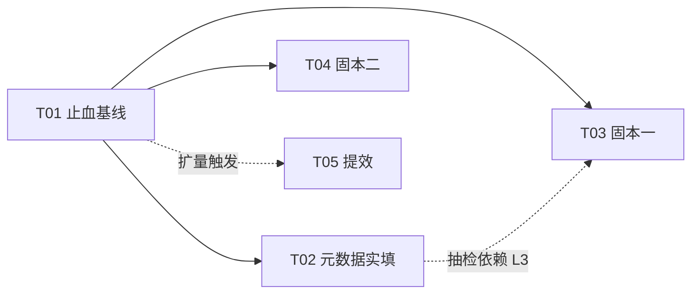

# DataPro 团队协作规范与交付流程

| 文档信息 | 内容 |
|---|---|
| 产出角色 | 交付总监（齐活林 / Qi，主理人） |
| 上游输入 | 《DataPro-现状分析与优化需求池》（许清楚）、《DataPro-架构评审与技术优化方案》（高见远） |
| 依据 | `AGENTS.md`（§8 禁止事项 / §9 维护约定）、《DataPro项目章程》§2.2/§6/§9、《DataPro-治理模板包》、《DataPro-测试方案》§5、《DataPro-灰度方案与用户手册》、software-company 团队 SOP |
| 适用范围 | DataPro 所有需求、Bug 修复、分析评审与上线交付活动 |
| 状态 | v1.0，供团队直接执行；流程变更走变更记录单 |
| 工作方式 | 本次为**分析类部分工作流**，仅产出文档，未改代码、未做 Git 操作 |

> 一句话结论：DataPro 缺的不是设计，而是**落地与证据**。协作与交付流程要围绕「功能清单先登记 → 门禁有证据 → 文档与代码同步 → 灰度可回滚」四件事运转，而不是另起一套重流程。

---

## 1. 角色与职责（RACI）

> 团队角色与项目章程 §7 的实际岗位合并说明；R=执行、A=最终负责、C=需咨询、I=需知会。

| 事项 | 交付总监（主理人） | PM（许清楚） | 架构师（高见远） | 工程师（寇豆码） | QA（严过关） | 项目内角色 |
|---|---|---|---|---|---|---|
| 需求登记 / PRD | A | R | C | I | I | 业务接口人 C（口径） |
| 架构设计 / 任务分解 | A | C | R | I | I | 后端/算法 C |
| 代码实现 / 一致性审查 | I | I | C | R（A：自审 IS_PASS） | I | 后端/算法/前端执行 |
| 测试与路由判定 | I | I | C | C（修 Bug） | R/A | — |
| Gate 评审（G0~G5） | R（组织） | C | C | I | C | 业务+安全+项目经理 A（章程 §9 三方签字） |
| 灰度与值班 | C | R（协调） | C | C（修复） | I | 运维/值班 R、PM A |
| 文档与功能清单同步 | A（监督） | R（功能清单） | R（HLD/设计） | R（代码相关章） | C | 全员遵守 AGENTS.md §9 |
| Git 提交 / 推送 | A（仅用户明确要求时） | I | I | R（按指令） | I | — |

**外部必需方**：安全团队（G1 一票否决签字）、业务接口人（口径确认、评测标注、灰度反馈）、数据工程（元数据导入、只读账号）、运维（部署/监控/告警）。这几方缺席时，对应 Gate **不得**由内部代签。

---

## 2. 工作流路由（每次任务开始前先判断）

| 场景 | 判定标准 | 流程 | DataPro 例子 |
|---|---|---|---|
| 🏗️ **标准 SOP** | 多模块/前后端联动、>10 源文件、需架构决策 | PM → 架构师 → 工程师 → QA | P2-1 多实例一致性改造、P1-2 Rerank+Milvus 接入 |
| ⚡ **快速模式** | 单页/小工具/明确功能、≤10 源文件 | 主理人建团队 → 工程师一次写完 → QA 验证 | P1-1 口径裁决与会话回收**前端入口**（后端接口已就绪） |
| 🔧 **BugFix 快捷** | 明确 Bug、非新功能 | 建团队 → 工程师定位修复 → QA 回归 | P0-4 时间窗锚点错（默认窗口落到无数据分区） |
| 📋 **部分工作流** | 只要分析/评审/PRD | 按需要拉 PM 或架构师，交付文档 | 本次协作规范搭建、架构评审、安全评审 |

原则：**宁选快速模式，不选过重流程**；但 P0 合规/Owner 签字类事项不得因"快速"跳过安全门禁。

### 团队协作铁律（software-company SOP）

1. **团队由主理人亲自创建**（`TeamCreate`），不得委派成员创建；每次任务命名 `software-<项目简称>`。
2. **成员按角色拉入**：PM / 架构师 / 工程师 / QA 分别以对应身份加入，主理人按阶段下发任务；不得由主理人代写成员的专业产出。
3. **信息流经主理人中转**：成员产出回传给主理人，由主理人汇总后转交下一阶段；成员之间不直连。
4. **成员结论为准**：PRD / 架构设计 / 代码 / 测试结果必须由对应成员输出后才采信。
5. **质量关卡**：工程师完成全部文件后做全局一致性审查（`IS_PASS: YES/NO`，不过则修复重审，最多 2 轮）；QA 每轮做智能路由判定（源码 Bug → 工程师 / 测试 Bug → QA 自修 / 全过 → 成功），最多 2 轮。
6. **所有输出简体中文**，关键结论用表格 / 列表 / Mermaid，结构化落盘到 `docs/`。

---

## 3. 端到端交付流程

| 阶段 | 入口条件 | 动作与产出 | 出口条件（DoD） |
|---|---|---|---|
| **0. 需求登记** | 用户/灰度反馈/巡检发现 | 在 `docs/DataPro-功能清单.md` 先登记条目（编号+状态+变更登记行） | 有唯一编号，禁止"先开发后补登记" |
| **1. PRD** | 登记完成 | PM 产出用户故事、P0/P1/P2、可测验收标准、待确认问题 | 验收标准可测；待确认问题已指定拍板方 |
| **2. 架构 + 任务分解** | PRD 通过 | 架构师产出方案、文件列表、接口/数据、时序、有序任务与依赖、共享约定 | 任务有依赖与验收标准；复用项明确标注，不重复造轮子 |
| **3. 实现 + 自审** | 任务就绪 | 工程师按任务批量实现；做全局一致性审查 | `IS_PASS: YES`；后端 `pytest -q`、前端 `npm run build`（带 TEMP 覆盖）通过 |
| **4. 测试验证** | 代码就绪 | QA 按 L1~L5 编写/运行测试，智能路由判定 | 测试全绿；Bug 已归位修复（最多 2 轮，遗留项书面记录） |
| **5. Gate 评审** | 门禁项有证据 | 按治理模板包 §3 填 Gate 记录，业务+安全+项目三方签字 | 章程 §6 该 Gate 全部达成；G4 另需安全 S1~S10 签字 |
| **6. 灰度试点** | G4 通过 | 按灰度方案内部→灰度1→灰度2；每日站会 15 分钟、四项指标看板、👍/👎 反馈闭环 | 准出条件达成（正确率≥90%、👎率<20%、无安全事件） |
| **7. 复盘扩量** | 灰度准出 | G5 复盘报告、二期规划；风险登记册更新 | 门禁全过 → 申请扩量；未过则回到修复优先 |

### 3.1 变更与决策管理

- **书面变更单**：范围/口径/技术/计划变更一律用 `docs/DataPro-治理模板包.md` §2 的 `CR-YYYYMMDD-XX`，三方签字后同步章程/下游文档版本号；口头结论不生效。
- **风险登记册**：每周更新（模板 §1），状态 `Open / Mitigating / Closed / Occurred`；`Occurred` 转变更记录单 + 独立复盘。
- **周报 / 双周口径会**：周报按模板 §4；双周按 §5 新口径裁决、口径变更评审、评测集标注分工。
- **待确认问题升级**：技术选型可由架构师拍板（见 §5.2）；合规、预算、组织资源、试点人选必须由用户/决策层/安全团队拍板，未拍板前不得越过对应 Gate。

### 3.2 完成的定义（DoD，每次改动收尾必做）

1. 更新 `docs/DataPro-功能清单.md`（状态 + 变更登记行，日期升序）。
2. 更新 `AGENTS.md` 对应章节（技术栈/目录/命令/约束/待办变化）。
3. 验证：后端 `pytest -q`；前端改动 `npm run build`；prompt/召回改动必须跑评测 `eval/runner` + `eval/recall_eval` 并归档报告。
4. 不提交密钥、`.env`、`data/`、`node_modules`、构建产物；Git 提交与推送**仅在用户明确要求时**执行（AGENTS.md §8/§9）。
5. 新功能未登记、越权/脱敏未复核、召回 0 命中仍让模型自由生成 SQL —— 任一命中即视为未完成。

### 3.3 工具与环境约定（本机）

| 场景 | 约定 |
|---|---|
| Python | 用全路径解释器（`C:\Program Files\Python314\python.exe`），不用 `python` 短命令 |
| 前端构建 | 先 `$env:TEMP='e:\Project\AgentProject\datapro\.tmp'; $env:TMP=$env:TEMP; npm run build` |
| PowerShell | 5.1 版本，不支持 `&&`；用 `;` 或 `if ($?) {}` |
| 后端启动 | 不开 `--reload`，改代码手动重启 |
| Git / gh | 不在 PATH；gh 未安装，PR 自动化不可用；禁止 force push |
| Docker / K8s | 本机无；镜像构建、CI Linux 实跑、RWX/Ingress 验证转有环境方 |
| 数据库变更 | 一律 Alembic revision + upgrade，禁止手写 ALTER / 依赖 create_all |

---

## 4. 质量门禁体系（交付流程的硬约束）

| 层 | 内容 | 时机 | 当前状态（来自评审） |
|---|---|---|---|
| L1 单元测试 | pytest 校验器/召回打分/状态机（37 文件 216 项） | 每次提交 | ✅ 已有，需持续 |
| L2 评测回归 | 种子 50/50 通过；golden 仅 3 条 | 每次 prompt/召回变更 + Gate | ⚠️ golden 不足，需扩到 ≥20 |
| L3 功能测试 | F01~F14 | G2/G3 | ✅ 有用例，需逐项记录 |
| L4 安全测试 | S1~S10（含 S9 数据夹带指令、S10 超长输入） | G3、G4 前必过 | ❌ 无通过记录，G1 签字未完成 |
| L5 性能测试 | 并发 50 P90≤30s、Milvus P95≤500ms | G4 前 | ❌ 未压测 |
| G4 清单 | 测试方案 §5 六项（含审计回放、一键停服演练） | 灰度准入 | ❌ 全未勾选 |
| 章程 §2.2 | 可执行率≥95%、正确率≥90%、幻觉率≤2%（一票否决）、拒答恰当率≥95%、P90≤30s | 各 Gate | ⚠️ 仅种子集证明，不能外推生产 |

**治理缺口（架构师核查结论）**：`/admin/audit` 节点级回放**未实现**（仅 DP 标记码单条查询）；`feature.data_pro_enabled` **部分实现**（后端 503，无运行时开关/前端维护页）。因 S8「同一 trace 完整回放」是 G4 门禁项，建议**补实现**而非删文档承诺。

---

## 5. 基于项目现状的优化与新增功能

### 5.1 核心判断（PM + 架构师一致）

> 瓶颈不是重新设计，而是「补落地 + 修锚点 + 复用已有能力」。只有 **P2-1 多实例一致性**是一处有边界的新增架构改造。

六层健康度：取数链路 ✅（1 处 correctness 缺口）、数据与口径 ⚠️、权限与安全 ❌（G1 一票否决未过）、多实例与状态 ⚠️（已声明单实例边界）、可观测 ⚠️、部署与交付 ⚠️。

### 5.2 优先级清单（P0 上线阻断 / P1 一个迭代 / P2 可排期）

| 级别 | 需求 | 性质 | 关键动作与验收 |
|---|---|---|---|
| **P0-1** | 安全评审与数据出域合规定稿 | 补评审/补文档 | 权限设计 §5 五项签字；DeepSeek 出域书面裁决；否决则私有化立项 |
| **P0-2** | 生产元数据 50 表实填 | 补数据 | dry-run 零错误；抽检 20 条不回退种子；召回命中不回退 |
| **P0-3** | 用户级表权限收紧与账号整治 | 补配置 | 非管理员 100% 白名单；越权 100% E003+审计；改密换密钥 |
| **P0-4** | 默认时间窗改读真实分区 | 增强（原 P2，提 P0） | 默认窗口末端 == F50 `MAX(dt)`；分区落后 2 天 0 误判；显式日期语义不变 |
| **P0-5** | 上线门禁验证包 | 补验证/补文档 | G4 清单逐项附证据；S1~S10；并发 50 P90≤30s；告警/停服演练 |
| P1-1 | 口径裁决 + 会话回收前端入口 | 补入口（接口已就绪） | 管理员零手工 API |
| P1-2 | Rerank + Milvus 实部署与 50+ 表评测 | 增强 | 先固化基线再接入；降级可用；表命中≥95%/口径≥90% |
| P1-3 | 灰度监控看板与告警通道 | 补部署/补文档 | 四项日指标可查；告警演练 1 次；Langfuse 合规确认 |
| P1-4 | 治理文档定稿与追溯一致性 | 补文档/补核查 | 7 份 v0.1 定稿；F49/F50 编号去重；回放/停服补实现或改承诺 |
| P1-5 | 评测集扩真实分布 | 增强 | golden≥20（带 expect）、真实 case≥30 |
| P2-1 | 多实例一致性改造 | 新增（有边界） | 编辑锁/定时任务/学习/巡检迁 Redis 或库；2 副本无重复覆盖 |
| P2-2 | 容器化与 K8s 首次实跑 | 补验证 | 镜像构建、RWX、Ingress/TLS、worker 单副本 |
| P2-3 | 边缘体验与依赖治理 | 新增+增强 | diff 导出报告；SheetJS 告警清零；联网源评估 |

**两处"看起来是新功能、其实是补落地"**：P1-1 前端入口、P1-4 文档/追溯——后端接口与文档骨架已具备，禁止重复造轮子。

### 5.3 架构师五项技术裁决（已拍板，除非用户推翻）

1. **P0-4 时间窗**：`partition_clock` TTL 缓存（10min）+ 惰性刷新 + worker 每小时兜底；只改相对/默认窗口，**显式"昨天/指定日期/区间"仍按日历**；`EVAL_FIXED_ANCHOR` 隔离评测，`PARTITION_READ_ENABLED=false` 可回退。
2. **出域否决的模型替换**：`llm/client.py` openai 兼容封装可平滑切私有化（配置级，不兼容时加单点 adapter）；但 prompt/评测基线是模型相关资产，换模型必须重跑 eval 与幻觉率门禁。
3. **身份透传**：维持 B（user→表白名单），书面声明**表级非行级**，行级/列级隔离需另立项目；A 方案列二期。
4. **P2-1 最小范围**：只迁并发写会错乱的四类（编辑锁、定时任务、自动学习、巡检），读多写少配置暂留共享卷；`/metrics` 按 pod 聚合；首发不做。
5. **首发部署**：单节点 Docker Compose（api 1 + worker 1）；若平台强制 K8s，API/worker 各 1 副本、RWX 或降 1 副本、initContainer 迁移；P2-1 作为扩 2 副本硬前置。

### 5.4 实施任务包（T01~T05，源自架构师任务分解）

| 任务 | 覆盖 | 依赖 | 协作 |
|---|---|---|---|
| **T01 止血基线**（签字/账号/时间窗/门禁包） | P0-1/3/4/5 | — | 安全+业务接口人配合；工程师执行 |
| **T02 元数据实填** | P0-2 | T01（L3 结论） | 业务填报+数据工程导入 |
| **T03 固本一**（前端入口/召回/看板/评测） | P1-1/2/3/5 | T01（合规结论） | 部署侧+业务复核 |
| **T04 固本二**（治理定稿/追溯闭环） | P1-4 | T01 | 三方 Gate 签字 |
| **T05 提效**（多实例/容器/边缘） | P2-1/2/3 | T01，扩量触发后启动 | 运维/有 Docker 机器 |

---

## 6. 待用户/外部拍板事项（未定则相关 Gate 不放行）

| # | 事项 | 拍板方 | 未定时的临时约束 |
|---|---|---|---|
| 1 | DeepSeek 是否可处理真实业务数据；否决则私有化选型与预算归属 | 决策层 + 安全团队（书面） | 只跑内部/脱敏数据，并行私有化 POC |
| 2 | 是否进入 G4；试点部门、业务接口人、观察期 | 用户 + PM + 业务方 | 不启动灰度 |
| 3 | 生产 50 表元数据填报责任人与时限 | 业务方 + 数据工程 | 不宣称口径问答生产可用 |
| 4 | 权限设计 §5 五项签字（B 边界/脱敏 v1/L3 字段/审计时长/水印） | 安全团队 | G1 不过，不得灰度 |
| 5 | demo 种子日期是否每日对齐、评测基准重取节奏 | 用户/测试负责人 | 保持现状，CI 固定 anchor |

---

## 7. 落地建议（下一步 5 件事）

1. **先拍板 §6 的 1 和 4**（出域与权限签字）——这是唯一的一票否决路径，决定后续是否需要私有化模型。
2. **按 T01 建止血迭代**：`partition_clock` 改动 + 账号整治 + 门禁包证据收集，完成后再谈灰度。
3. **并行启动 T02**：业务方按模板填报生产 50 表，数据工程 dry-run 导入；抽检只选生产新增表，避免种子回退干扰判定。
4. **建立看板与证据目录**：`eval/reports/` 归档每次回归，`docs/` 中 Gate 记录、CR 单、风险登记册按治理模板包填写；"无证据不勾选"。
5. **灰度后再排 T03/T05**：前端入口与可观测先补；多实例改造只在"扩 2 副本 / 日活>500"触发后启动。

---

## 附录：文档索引

| 文档 | 作用 |
|---|---|
| `AGENTS.md` | 项目长期事实源（禁止事项 + 维护约定） |
| `docs/DataPro项目章程.md` | 目标/门禁指标/里程碑/治理机制 |
| `docs/DataPro-功能清单.md` | 需求登记与状态流转（先登记再开发） |
| `docs/DataPro-现状分析与优化需求池.md` | 本次 PM 产出：现状、痛点、P0/P1/P2 需求池 |
| `docs/DataPro-架构评审与技术优化方案.md` | 本次架构师产出：六层评审、五项裁决、技术方案、T01~T05 |
| `docs/DataPro-治理模板包.md` | 风险登记册 / 变更单 / Gate 记录 / 周报 / 会议纪要 |
| `docs/DataPro-测试方案.md` | L1~L5 分层、S1~S10、G4 准入清单 |
| `docs/DataPro-灰度方案与用户手册.md` | 灰度批次、每日监控、用户手册 |
| `docs/DataPro-运维手册Runbook.md` | 告警、故障处理、降级开关、值班升级路径 |

> 本规范随项目阶段演进更新；流程变更需走变更记录单并同步本文件版本号。
