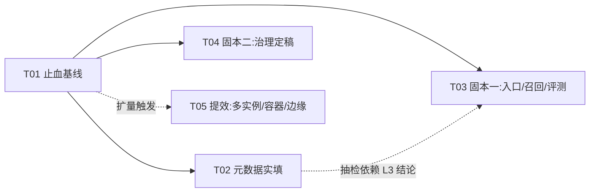

# DataPro 架构评审与技术优化方案

| 文档信息 | 内容 |
|---|---|
| 产出角色 | 架构师（高见远 / Gao） |
| 上游输入 | 《DataPro-现状分析与优化需求池》（产品经理 许清楚）+ `AGENTS.md` 全文（唯一长期事实源） |
| 核对文档 | 章程 / HLD / 权限与脱敏设计 / 功能清单 / 测试方案 / 灰度方案 / Runbook |
| 工作方式 | 只读核对源码（关键结论均标注 `文件:函数` 或文档章节）+ 本方案文档；未改代码、未改其他文件 |
| 状态 | 供主理人汇编、供 G4 门禁与迭代排期使用 |

> **一句话结论**：DataPro 的主链路设计是完整的，当前瓶颈不是"要重新设计"，而是**设计已具备但落地缺失**（安全签字、生产数据、门禁证据、监控看板、前端入口）与**少数 correctness 缺陷**（默认时间窗锚点）。因此本方案的主基调是"补落地 + 修锚点 + 复用已有能力"，仅在多实例一致性上做一处有边界的新增改造。

---

## 1. 评审结论总览（六层健康度）

| 层 | 健康度 | 结论（设计 vs 落地） | 关键证据 |
|---|---|---|---|
| **取数链路** | ✅（含 1 处 ⚠️） | 状态机 / IR / 确定性时间窗 / 结构化重试 / few-shot / IR-SQL 形状校验 / 答案优先 / 双重只读**设计与实现均到位**，无重设计需求。唯一 correctness 缺口：默认时间窗锚点 `latest_partition()` 是算出来的 T-1，不是真实分区（P0-4）。 | `AGENTS.md` §4.1「取数链路/时间语义解析/语义中间表示/结构化重试」、§4.2-10；`app/core/statemachine.py:275-320`（TIME 节点）、`app/core/time_window.py:35-59`、`app/services/executor.py:24-34`（占位符绑定）；`app/services/spec_check.py`、`app/services/fewshot.py` |
| **数据与口径** | ⚠️ | 能力齐备（`metadata_store` 读库+种子回退、`import_metadata` 导入、口径歧义检测、D03 裁决），但**生产 50 表未实填**，库空时回退 11 表种子，属"设计已具备、数据未落地"；golden 仅 3 条，评测过拟合固定种子。 | `AGENTS.md` §7(P0)、§6「golden 会随种子数据漂移」；`app/services/metadata_store.py:39-74`（`merge_calibers(db, SEED)` 回退）；`docs/功能清单.md` D02/D05；需求池 D-1/Q-1 |
| **权限与安全** | ⚠️→**❌（G1 门禁）** | 代码层已实现 B 方案（user→表白名单，E003 拦截+审计）、11 权限点、返回层脱敏、只读双防线；但**默认继承全局白名单未收紧、演示弱口令与默认 AUTH_SECRET 未替换、权限设计 §5 五项未签字、DeepSeek 出域无书面裁决**。从"设计已具备但落地缺失"看是 ⚠️；从 G1 一票否决项看当前是 ❌。 | `AGENTS.md` §4.1(A02/B12/S04)、§6；`app/services/db_access.py:1-10`（未配置=继承白名单）、`app/api/routes_admin.py:375-400`；`docs/DataPro-权限与脱敏设计.md` §1.2/§5；`docs/DataPro项目章程.md` §4.1 选型原则1/§10 |
| **多实例与状态** | ⚠️ | **会话 / 限流 / Token 撤销已上 Redis**（`session_state`/`rate_limit`/`token_store`），这部分设计到位；但**定时任务、巡检、自动学习、编辑锁、LLM 注册表/技能/知识等仍进程内或 JSON**，2 副本会重复执行/互相覆盖。不是缺陷，是"已声明的单实例边界"，扩副本前必须做 P2-1。 | `AGENTS.md` §6「定时任务仅单实例」「巡检同样单实例/JSON」「自动学习 JSON」「编辑锁为进程内」；`app/services/schedule_runner.py`、`app/services/inspection.py`、`app/services/learned_skills.py`；需求池 P2-1 |
| **可观测** | ⚠️ | `/metrics`（Prometheus 文本，进程内）、F48 Langfuse 薄封装、F41 标记码溯源**已实现**；但 Langfuse 默认 no-op、Grafana/Loki/业务看板未落地、`/metrics` 多实例不聚合。**核查结论：`/admin/audit` 节点级回放未实现**（无该路由，仅有 `/api/v1/trace/{DP码}` 返回单条记录，不能按 trace_id 回放节点链）；**`feature.data_pro_enabled` 部分实现**（后端 chat 拦截 + health 暴露已实现，但非运行时动态开关、无前端"维护中"页、admin 无切换接口）。 | `app/main.py:63-71`、`app/services/tracing.py`、`app/api/routes_trace.py:25-48`、`app/api/routes_admin.py`（全表无 audit 路由）、`app/main.py:74-85`（router 清单）；`app/api/routes_chat.py:52-54`、`app/config.py:70`；Runbook §4「`/admin/audit` 输入 trace_id → 节点级回放」、§3 `feature.data_pro_enabled`；`docs/功能清单.md` I03/I04/F48 |
| **部署与交付** | ⚠️ | Dockerfile / compose / K8s YAML / nginx / initContainer 迁移**已编写并通过语法校验**，但本机无 Docker/K8s、未实跑，镜像名为占位；CI workflow 未经 Linux 真机；文档 7 份 v0.1 骨架与实现脱节、功能清单编号重复（F49×2/F50×2）、A05 状态口径不一致。属"交付物已备、验证与治理未落地"。 | `AGENTS.md` §5/§6、§7(P3)；`docs/DataPro-功能清单.md:58-61`（F49/F50 各两条）、`:284`（A05 备注 vs §7）；`docs/DataPro-架构设计HLD.md` §8；需求池 C-1/C-2 |

**归纳**：六层中只有"取数链路"接近可交付状态；P0 的五项里有四项（安全签字、生产元数据、权限收紧、门禁验证包）本质是**落地与证据**问题，一项（P0-4 时间窗）是**真实 correctness 缺陷**。因此把 P0-4 从 §7 的 P2 提到 P0 止血，架构侧**认可**——它违反 §4.2-11「0 单 ≠ 无数据」，会静默给出错误结论，比"没数据"更危险。

---

## 2. 关键技术裁决（结论 + 理由 + 备选）

### 裁决一：P0-4 默认时间窗改读真实分区 —— **采纳，但需限定改动边界与缓存策略**

**结论（拍板）**：
1. **读真实分区的时机 = 进程内 TTL 缓存 + 惰性刷新 + 定时兜底**（三者组合），**不是**每请求直读、**也不是**仅启动时读一次。
   - 新增 `app/services/partition_clock.py`（可命名为 `DataBoundaryCache`）：缓存一个 `anchor: date`（= 事实表真实 `MAX(dt)`），TTL 默认 10 分钟（配置 `PARTITION_CACHE_TTL_SECONDS`），首次访问惰性加载，失败回退 `today-1` 并告警一次。
   - 定时兜底：复用现有 `worker/inspection_worker.py` 每小时周期，顺带刷新一次 anchor，避免低流量时缓存长期陈旧。
   - **复用已有探针**：不新写 SQL，抽取 `data_boundary.probe()` 中的 `MIN/MAX(dt)` 逻辑为可复用函数 `data_boundary.latest_dt()`（只查订单事实表 `dwd_order_detail_di`，单表 `SELECT MAX(dt)`，走 `executor_service` 只读账号 + A02 过滤），`probe()` 与 `partition_clock` 共用它，避免两处口径分裂。
2. **改动边界（关键，保护确定性语义）**：
   - `latest_partition(today, anchor=None)` 增加可选参数 `anchor`；**只有"相对窗口/默认窗口/本周本月今年 clamp"使用 anchor**；
   - **"昨天/今天/指定日期/明确区间"继续按日历 `today` 解析，不随分区漂移**——用户说"昨天"是日历语义，改成数据语义会引入新的静默错误；
   - `default_window()`、`resolve()` 中 `_RECENT`/本周/本月/今年分支、`statemachine.py:435/452` 的"0 单"提示统一取 `anchor`。
3. **评测基准影响与隔离**：新增 `EVAL_FIXED_ANCHOR` 环境变量（仅 eval/runner 使用），评测时注入固定 anchor，使 `eval_v1_seed` 的相对时间用例保持既有确定性；`eval_golden` 的 G001–G003 是固定日期，不受影响。改动后仍需重跑 `eval_v1_seed` + `eval_golden` 归档新基线（因相对时间用例的窗口会整体平移到真实分区），并确认 `volatile` 用例不产生固定日期误判。
4. **回滚**：`PARTITION_READ_ENABLED=false` 或探针失败即回退 `today-1`，行为与现状完全一致。

**理由**：P0-4 的根因是"锚点与事实脱节"，不是"时间解析逻辑错"。每请求直读会给每次取数增加一次 DB 往返（违反 P90≤30s 的稳健性）；仅启动读取在长运行实例上仍会漂移；TTL 缓存兼顾新鲜度与成本。限定只改相对窗口，可保住 §4.2-10「日期算术不进模型」和 §7「确定性语义」两条核心设计，不污染显式日期。

**备选方案**：①（不采纳）启动时读一次——实现最简单但跨天漂移依旧；②（不采纳）每请求直读——语义最准但增加 P90 抖动与 DB 压力，且探针失败需同步降级，复杂度更高；③（可选增强）把 anchor 写 Redis 供多副本共享——首发单副本不需要，P2-1 时再补，避免提前引入耦合。

---

### 裁决二：出域合规否决时的模型替换成本 —— **低~中，抽象层可平滑切换，但需重新评测**

**结论（拍板）**：`app/llm/client.py` 的 openai 兼容封装**具备平滑替换基础**，私有化改造不需要改状态机/prompt/工具链，只需改注册表配置（前提：私有模型提供 OpenAI 兼容 `/v1/chat/completions`）。替换成本评估如下：

| 维度 | 成本 | 依据 |
|---|---|---|
| 接入配置 | 低 | `LLMClient.resolve()` 从注册表/`.env` 实时取 `base_url/api_key/model`，`_get_client()` 按 `(base_url, api_key)` 缓存 `AsyncOpenAI` 实例并自动换实例，改配置下一次请求生效、无需重启（`app/llm/client.py:57-81`） |
| 代码改造 | 低（兼容）~中（不兼容） | 若私有化模型（vLLM / Xinference / 私有 Qwen/GLM）暴露 OpenAI 兼容端点 → 零代码，仅注册表新增条目；若不兼容 → 只需在 `_get_client`/`_call_once` 加一层轻量 adapter（单点，~1 文件） |
| 功能风险 | 中 | 依赖 `response_format={"type":"json_object"}` JSON mode（`:121`）、`usage` token 字段（`:130-134`）、`timeout`（`:122`）。私有模型若不支持 JSON mode，`_parse_json` 有围栏/花括号兜底（`:34-49`），但解析失败率上升→重试/升级增多；token 统计可能为空 |
| 质量风险 | 中~高 | DeepSeek 的 SQL 生成能力是 50/50 基线的关键。换模型后必须重跑 `eval_v1_seed`（可执行/正确/时间窗/幻觉）与 `recall_eval`，并按章程 §2.2 重新验证幻觉率 ≤2%、正确率 ≥90%；prompt 里的 MySQL 方言约束（`sql_gen` v3）仍需保持 |
| 成本/运维 | 需单独立项 | 私有化 GPU 资源、Embedding/Rerank 本地部署（章程 §4.1 要求）、运维席位——由 P0-1 书面裁决触发，不在本方案内定预算 |

**理由**：抽象层把"供应商"隔离在 `resolve()` 一处，是正确的高内聚设计；但 prompt 与评测基线是"模型相关资产"，替换时必须连带重评，否则会拿旧基线证明新模型——这是架构上必须提示的风险。

**备选方案**：①（推荐过渡）合规裁决前不接生产数据，仅内部数据/脱敏数据跑 DeepSeek，同时并行做私有化 POC；②（若裁决允许出域）维持现状，仅在 Langfuse 上报时做字段脱敏（见裁决三）。

---

### 裁决三：身份透传 A/B —— **架构侧拍板：维持 B（表级白名单），但必须书面承认其边界**

**结论（拍板）**：
- **维持当前 B 方案**（user→表白名单，在 VALIDATE 前按 `ctx.user_role`/`ctx.user_id` 校验，越权 E003 不消耗重试；`app/services/db_access.py`、`app/core/statemachine.py` VALIDATE 前分支）。**理由**：A 方案（`SET SESSION app_current_user` + 数仓视图行级过滤）依赖数仓已有行级权限设施，`AGENTS.md`/权限设计均未记载该设施存在；在"未确认存在"的前提下为 A 改造数仓，投入大且阻断 G1。B 已实现、可测试、可审计，是最短路径。
- **必须书面声明 B 的能力边界**（写入权限设计 §5 结论）：B 是**表级（库表白名单）**授权，**不是行级、不是列级**；L3 敏感列依赖返回层 `masking.py` 脱敏（与 B 解耦，双层防线）；行级隔离目前**不具备**，若业务提出"同一张表不同人看不同行"，属于新增需求，需另立 A 方案或数仓视图项目。
- B 的既有安全约束保留：管理员不受限、删除用户同步清理 `db_access`、库优先 JSON 兜底、60s 缓存写即失效（`db_access.py`）。

**理由**：把"选型未定"变成"选型已定 + 边界清晰"，直接消除 P0-1 的一票否决阻塞点之一；边界声明避免后续把表级权限误当行级权限用。

**备选方案**：A 方案（数仓会话变量 + 视图）——仅当安全团队确认数仓已有行级权限设施且要求行级隔离时启动，作为二期；不可为了"方案更优雅"在 G4 前切换。

---

### 裁决四：P2-1 多实例改造的范围与最小可行方案 —— **必须先迁"并发写"状态，读多写少的全局配置可暂留共享卷**

**结论（拍板）**：

| 状态 | 当前实现 | 首发（1 副本） | 2 副本最小可行改造 |
|---|---|---|---|
| 会话 / 限流 / Token 撤销 | Redis（降级内存） | ✅ 已可用 | 保持；生产必须关闭"降级内存"（Redis 不可用时 fail-closed 或告警，避免撤销丢失） |
| 文件编辑锁 | 进程内 5 分钟锁 | ✅ | **必须迁 Redis**（`SET key value NX EX 300` + 释放校验 token），2 副本下否则并发编辑互相覆盖 |
| 定时任务（作业+同步签名+配置/记录 JSON） | APScheduler 内存 + JSON | ✅ | **必须迁**：Redis job store 或"Redis 分布式锁抢执行 + 配置/记录落业务库表"，2 副本不重复执行、不互相覆盖 |
| 自动学习（技能规范/记忆 JSON） | 进程内 JSON | ✅ | **必须迁业务库表**（按 user 隔离、限额、去重逻辑保持），否则两副本各写一份、互相覆盖 |
| 巡检规则/结果 JSON | JSON（200 条） | ✅ | **必须迁业务库表**（或 Redis），结果与规则共享；worker 保持单副本 |
| LLM 注册表 / 技能 / 知识 / 口径裁决 / 角色矩阵 | JSON（管理员低频写） | ✅ | **可暂留共享 RWX PVC**（读多写少、管理员低频写、last-write-wins 可接受）；P2-1 二期再统一迁库 |
| `/metrics` 进程内 | 进程内计数 | ✅ | 不改代码：Prometheus 按 pod 抓取 + 查询层聚合（sum(rate(...))），不需迁 Redis |

**最小可行原则**：只迁**并发写且会错乱**的四类（编辑锁、定时任务、自动学习、巡检），读多写少的配置类靠共享卷过渡；worker 恒定单副本（巡检/会话回收本就是单实例语义）。**首发不做 P2-1**：按裁决五用单副本部署，P2-1 作为扩量（日活>500 或 2 副本）前置。

**理由**：P2-1 若一次做全（把所有 JSON 都迁库）会牵涉 Alembic 多张新表 + 全套 CRUD 改造，工期长、回归面大；按"并发写优先"切分可用最小成本消除 2 副本的数据错乱，同时不阻断首发。

**备选方案**：①（不采纳）首发直接 2 副本 + 全量 P2-1——把架构改造放进关键路径，风险与工期都不可控；②（可选）全部状态迁 Redis 而非业务库——查询/审计友好度差，学习数据等需要持久化的不适合只放 Redis。

---

### 裁决五：首发部署形态 —— **拍板：首发单节点 Docker Compose（或 K8s 单副本过渡），P2-1 不纳入首发**

**结论（拍板）**：
- **首发 = 单节点 Compose**（api 1 副本 + worker 1 + mysql + redis + 可选 Milvus/Langfuse）；理由：G4 灰度仅 20~30 人（灰度方案 §1），远低于章程/HLD 的"日活>500 / QPS>20"扩量触发线；单副本规避 P2-1 全部风险；本机无 Docker，需在有 Docker 的机器完成首次镜像构建验证。
- **若公司平台强制 K8s**：接受 K8s 但**API 明确 1 副本**、worker 1 副本、`INIT_DB_ON_STARTUP=false` + migrate initContainer、PVC 先按 RWX 准备（RWO 则锁死 1 副本），P2-1 作为扩到 2 副本的硬前置（HLD §8 / AGENTS.md §6）。
- **首发前置条件（缺一不可）**：裁决二的出域书面结论、P0-1 签字、P0-2 元数据、P0-3 账号整治、P0-4 时间窗、P0-5 门禁包；镜像名替换 registry；CI 在 Linux 实跑一次。

**理由**：与章程 §4.1「MVP 单机可跑，不提前上 K8s」和 HLD §8 一致；把未验证的 K8s/多实例风险挡在灰度之外。

**备选方案**：首发即 K8s 2 副本——必须同时完成 P2-1 + RWX 验证 + 首次实跑，作为"平台强制"时的退路，不作为默认建议。

---

### 裁决补充（不单列为待确认，架构侧直接定）

- **`/admin/audit` 节点回放与 `feature.data_pro_enabled`**：核查确认——前者**未实现**（无路由，只有 DP 标记码单条查询 `/api/v1/trace/{code}`）；后者**部分实现**（后端 chat 503 开关，非动态、无前端维护页）。P1-4 的处理方式：**要么补实现**（最小：按 trace_id 查 `audit_log` 节点链的只读接口 + 前端管理页；停服补一个 admin 运行时开关 + 前端 503 拦截页），**要么修正文档承诺**（Runbook §4 改为"用 DP 标记码查单条 + 直查 audit_log 表"、停服描述改为"改配置重启"）。**架构建议补实现**，因为 S8「同一 trace 完整回放」是 G4 门禁项，删承诺等于删验收依据。
- **种子日期自动对齐（裁决三之外）**：`worker.align_seed_dates --apply` 是**测试/演示数据工具，不进生产链路**；P0-4 落地后，"最近 N 天"锚定真实分区，种子漂移不再导致错误答案。是否每日自动对齐**只影响 demo/CI**：建议 demo 环境每日对齐 + CI 固定 anchor 重取基准，生产不跑。是否要求 demo 每日新鲜 → 列为待明确（见 §6）。

---

## 3. 技术方案（逐条对应 P0/P1/P2）

> 通用原则：**复用已有能力优先**，改动点精确到模块/文件/函数；每条给出兼容性、风险、回滚。

### P0-1 安全评审与数据出域合规定稿 `补评审/补文档`
- **改动点**：非代码。`docs/DataPro-权限与脱敏设计.md` §1.2/§5 按裁决三填写 B 方案结论与边界；§2.2 脱敏规则 v1、§2.3 L3 字段清单、§3.1 审计保留时长由安全团队落定；章程 §10 补 LLM 部署书面裁决。
- **接口/数据结构**：无变化（若裁决否决出域，按裁决二新增一条私有化 LLM 注册表记录，配置结构不变）。
- **兼容性**：B 方案是现状，零代码改动；若最终选 A，另立项目。
- **风险/回滚**：签字未落 = G1 不过 = 不得灰度；无技术回滚，属组织决策。
- **复用**：现有注册表（`llm_registry`）、脱敏（`masking.py`）、A02（`db_access.py`）均为可评审的现成实现。

### P0-2 生产元数据 50 表实填与口径确认 `补数据`
- **改动点**：业务方按 `docs/DataPro-元数据与口径库模板.md` 填报；数据工程用 `importer/import_metadata.py --dry-run`（零错误）→ 正式 `--kind` 导入 `meta_table/meta_column/metric_caliber`（Alembic 0004）。抽检脚本用现有召回评测 `eval/recall_eval.py`。
- **数据结构**：无 schema 变化；仅数据行。导入时未知模板列被过滤、口径缺 `owner` 兜底空串（`AGENTS.md` §4.1 D05）。
- **兼容性**：`metadata_store.merge_calibers(db_rows, seed_rows)` 按 `table_name/metric_id` 覆盖种子（`metadata_store.py:24/72`），生产条目自动优先；**抽检 20 条"无种子回退"需在验收时明确判定口径**（种子表与生产表同名时如何算命中），建议抽检只选生产新增表。
- **风险/回滚**：错误口径入库会污染生成；回滚 = 备份库表后按批次 delete + 重导（提供导入批次标记列可选）。**不得为"看起来命中"降低召回阈值**。
- **复用**：导入脚本、召回评测、元数据管理接口全部现成，禁止新写导入器。

### P0-3 用户级表权限收紧与账号整治 `补配置`
- **改动点**：通过现有 `PUT /admin/users/{id}/table-access`（`routes_admin.py:388-400`）为所有非管理员设置 `inherit=false` + 岗位白名单；`PUT /admin/users/{id}` 改演示账号密码（`routes_admin.py:300-319`）；`.env` 替换 `AUTH_SECRET`、`auth_seed_*_password`、`session_db_secret`、数仓/业务库口令；清理测试 Token/黑名单。
- **数据结构**：无变化（业务库 `db_access` / `user_account` 已存在）。
- **兼容性**：收紧后"未配置=继承全部"的演示行为消失，需先确认灰度账号已配置，避免把试点用户锁死；导出审批重跑会按申请人当前权限复核（`AGENTS.md` §6 B13），已实现，仅验证。
- **风险/回滚**：误配导致用户全部 E003——回滚 = 临时恢复 `inherit=true`（须审批留痕）。改 `AUTH_SECRET` 会使全部在线令牌失效，安排在低峰并公告重登。
- **复用**：A02/B12 全部现成，禁止新写权限模块。

### P0-4 默认时间窗改读真实分区 `增强 / 复用 F50` —— 方案见**裁决一**
- **改动点**：
  - 新增 `app/services/partition_clock.py`（TTL 缓存 + 惰性加载 + 降级）；
  - `app/services/data_boundary.py`：抽出 `latest_dt()`（单表 `MAX(dt)`）供 `probe()` 与 clock 共用；
  - `app/core/time_window.py`：`latest_partition(today, anchor=None)`、`default_window(today, anchor=None)`、`resolve(..., anchor=None)` 相对分支用 anchor，显式日期仍用 today；
  - `app/core/statemachine.py:288-320/435/452`：TIME 节点与"0 单"提示注入 `partition_clock.anchor()`；
  - `app/config.py`：新增 `partition_read_enabled`、`partition_cache_ttl_seconds`、`eval_fixed_anchor`；
  - `worker/inspection_worker.py`：每小时顺带刷新 anchor（可选兜底）；
  - `tests/test_time_window.py` + `tests/test_data_boundary.py` + 新增 `tests/test_partition_clock.py`。
- **数据结构**：无 DB 变化；anchor 为进程内 `date` + 时间戳（P2-1 时可挪 Redis）。
- **兼容性**：`latest_partition(today)` 单参调用全部保持（anchor 默认 None → 回退 today-1）；`EVAL_FIXED_ANCHOR` 隔离评测；`PARTITION_READ_ENABLED=false` 完全回退现状。
- **风险/回滚**：探针走只读账号，失败按现状降级；需专门构造"分区落后 2 天"用例验证 0 误判，并确认显式"昨天"仍按日历解析（回归 `eval_v1_seed` 的 C021–C025 固定日期用例）。**最大风险是误把显式日期也改成数据日期**，代码评审须重点看 `resolve()` 分支边界。

### P0-5 上线门禁验证包 `补验证/补文档`
- **改动点**：`docs/DataPro-测试方案.md` §5 清单逐项勾选并附报告路径；S1~S10（`权限与脱敏设计.md` §4 + 测试方案 §3 S9/S10）逐条记录；并发 50 用 Locust（克隆库，禁止直打生产）——相关代码已具备（`rate_limit.py`、`executor.py` 信号量 `exec_max_concurrency`、`/metrics`），**无需为压测改代码**；Grafana/Loki/看板按 P1-3 部署；`ops/prometheus/alerts.yml` 四条规则 + 巡检规则演练；Runbook 停服演练（现状为改配置重启，见裁决补充）；CI `.github/workflows/ci.yml` 在 Linux runner 实跑一次（本机无 Linux，用 CI 环境）。
- **数据结构**：无变化；产出为报告文件 `eval/reports/*` 与清单勾选。
- **兼容性/风险**：压测环境必须与生产隔离；Milvus P95 项若环境未就绪，按需求池允许先用 mock 替代并**明确标注未验证**，不得勾选为通过。
- **复用**：现有 216 项 pytest、评测 runner、召回评测、`/metrics`、`worker.check_langfuse`。

### P1-1 口径裁决管理与会话回收前端入口 `补入口 / 零后端开发`
- **改动点**：`frontend/src/App.vue`（设置页新增加「口径裁决」分区、管理员可见）、`frontend/src/api/admin.js`（或现有 admin api 模块新增 `listRulings/setRuling/deleteRuling/sweepSessions`）、`frontend/src/style.css`（内联表单样式）。**后端 `/admin/calibers/rulings`、`/admin/sessions/sweep` 已就绪（`routes_admin.py:36-57/142-147`），禁止重造**。
- **接口/数据**：复用 `RulingIn{metric_id,note}` 与 sweep 返回值；无新数据结构。
- **兼容性**：写操作仍需 `require_admin`；前端隐藏不作为唯一防线。
- **风险/回滚**：纯前端，回滚 = 撤销前端改动；用 `npm run build`（TEMP 覆盖）验证。

### P1-2 Rerank 精排 + Milvus 实部署与 50+ 表评测 `增强 / A05`
- **改动点**：`app/services/vector_recall.py`（新增 Rerank 阶段，`VECTOR_RERANK_ENABLED`/`VECTOR_RERANK_MODEL`，本地 BGE-Reranker 符合 P0-1 出域结论；连不上/未装依赖自动跳过，保留"关键词优先 + 向量补位"）；`importer/ingest_vectors.py`（灌 50+ 表）；新增 `eval/rerank_eval.py` 或扩展 `recall_eval.py`（固化基线报告）；`ops/` 增 Milvus compose。
- **数据结构**：向量集合 `datapro_meta` 结构不变（`uid/type/text/payload`）；Rerank 只改排序，不改存储。
- **兼容性**：`VECTOR_BACKEND=milvus` 连不上自动回退内存/关键词（`AGENTS.md` §4.1 A05），`recall_degraded=true` 保留。
- **风险/回滚**：Rerank 引入额外时延（关注 Milvus P95≤500ms 与取数 P90）；回滚 = `VECTOR_RERANK_ENABLED=false` 且 `VECTOR_BACKEND=memory`（现状基线）。**必须先固化当前 97.5%/92% 基线报告再接入**，否则"有提升"无法证伪。

### P1-3 灰度监控看板与告警通道落地 `补部署/补文档`
- **改动点**：部署侧 Grafana 看板（QPS/时延分位/节点失败率/token，数据源 `/metrics` + Loki）、业务看板（可执行率/拒答率/👎率日趋势，数据源 `query_record`/`audit_log`）；`ops/prometheus/alerts.yml` 四条规则 + 巡检失败规则演练；Langfuse 启用与否按 P0-1 合规结论决定——**若否决出域，明确以本地 trace + F41 标记码替代并写入 Runbook**（`app/services/tracing.py` 默认 no-op 已具备）。
- **数据结构**：无变化；看板为部署侧配置。
- **兼容性**：`/metrics` 进程内计数，多副本按 pod 聚合（见裁决四）；Langfuse 上报含问题/prompt/SQL 属数据出域面，必须随 P0-1 结论走。
- **风险/回滚**：可观测本身引入出域风险；回滚 = 关闭 Langfuse Key（回到 no-op），看板/告警无运行时风险。

### P1-4 治理文档定稿与追溯一致性治理 `补文档/补核查`
- **改动点**：7 份 v0.1 文档（章程/HLD/权限设计/评测规范/灰度/测试方案/Runbook）定稿标版本与评审结论；功能清单 F49（对话记录 / 文件版本链）与 F50（数据边界 / 自动学习）编号去重（建议后者改 F51/F52 并全库引用同步）；变更登记按日期排序；A05 状态与 `AGENTS.md` §7 统一为"后端就绪、Rerank/Milvus 未落地（🔨）"；**按裁决补充决定 `/admin/audit` 回放与停服开关是补实现还是改文档承诺**；测试方案补登 S9/S10 引用。
- **数据结构**：若补回放接口 → 新增 `GET /admin/audit/replay?trace_id=` 只读接口（返回 `audit_log` 按 trace_id 的节点序列，按 `require_admin`）；停服动态开关 → `PUT /admin/feature/data-pro-enabled`（写 Redis/配置，运行时生效），前端在 503 时显示维护页。
- **兼容性**：接口新增不影响现有；编号变更需同步 `AGENTS.md`/需求池映射。
- **风险/回滚**：纯文档零风险；补实现部分按常规 `npm run build` + pytest 验证。

### P1-5 评测集扩真实分布与 golden 持续积累 `增强`
- **改动点**：灰度反馈用 `eval/harvest.py` 生成 draft；人工把相对时间问题改**固定日期**并加 `expect` 断言后 promote（`eval_golden.jsonl`）；每次 prompt/召回变更跑 `eval/runner` + `eval/recall_eval` 并归档报告。
- **数据结构**：`eval_golden` 行格式不变；golden ≥20、真实 case ≥30、取数类带 `expect`。
- **兼容性**：`harvest` 重跑保留人工 `reviewed`/断言/备注（已实现，`AGENTS.md` §4.1 F46），无需改脚本。
- **风险/回滚**：golden 污染会污染 few-shot（`promote_fewshot` 从 golden 生成示例）——新增示例前必须过校验器（`AGENTS.md` §4.1 few-shot 段）。

### P2-1 多实例一致性改造 `新增（有边界）` —— 方案见**裁决四**
- **改动点**（按优先级）：`app/services/session_state.py` 附近新增 Redis 编辑锁 helper（复用前缀 `dp:lock:edit:{file_id}`，与现有 session Redis 同一连接）；`app/services/schedule_runner.py`（Redis 锁抢执行 + 配置/记录落业务库新表，Alembic 新版本）；`app/services/learned_skills.py`/`memory_store.py`（JSON→业务库表，保留按用户隔离/限额/去重/敏感拦截）；`app/services/inspection.py`（规则/结果落库，worker 单副本不变）；`app/config.py` 增 Redis 高可用相关开关。
- **数据结构**：新增业务库表（如 `schedule_job`/`schedule_run`/`learned_skill`/`memory`/`inspection_rule`/`inspection_result`），需 Alembic 迁移 + JSON→DB 一次性迁移脚本。
- **兼容性**：迁移期双写/只读切换；读多写少配置类暂留共享卷（裁决四）。
- **风险/回滚**：迁移脚本必须可回滚（保留 JSON 备份）；双副本压测验证"无重复、无覆盖"方可放量。

### P2-2 容器化与 K8s 首次实跑验证 `补验证`
- **改动点**：在有 Docker 的机器构建 `docker build`（镜像名替换 registry）；`docker compose up -d` 起全栈；K8s `kubectl apply -f ops/k8s/secret.example.yaml` → `datapro.yaml`，验证 Ingress/TLS/HPA/PVC（RWX 或 1 副本）；worker 单副本。
- **数据结构**：无变化。
- **兼容性**：`INIT_DB_ON_STARTUP=false` + migrate initContainer 已就绪（`config.py:13`、`AGENTS.md` §6）。
- **风险/回滚**：RWX 不满足时按 AGENTS.md §6 降 1 副本；回滚 = `kubectl rollout undo`。

### P2-3 边缘体验与依赖治理 `新增+增强`
- **改动点**：`app/services/file_diff.py` + `frontend` 版本对比页新增"导出 CSV/MD 报告"；前端依赖升级/替换 SheetJS 0.18.5 消除 `npm audit` 告警后 `npm run build`（TEMP 覆盖）；`app/services/web_search.py` 来源质量抽检，必要时评估博查/Serper API。
- **数据结构**：无变化（导出为文件）。
- **兼容性/风险**：SheetJS 升级可能改变 XLSX 读写行为，需回归文件编辑场景（`AGENTS.md` §6 单表≤5000 行）。

---

## 4. 实施任务分解（有序，≤5 任务）

> 分组：**先止血 → 再固本 → 后提效 + 协作规范落地**。依赖尽量只指向 T01；标 👤=单人可完成，🤝=需业务方/安全/运维配合。

| 任务 ID | 任务名 | 覆盖需求 | 依赖 | 主要产出物 | 验收标准 | 协作 |
|---|---|---|---|---|---|---|
| **T01** | **止血基线：安全签字 + 账号整治 + 时间窗锚点 + 门禁包** | P0-1/3/4/5 | — | 权限设计 §5 结论与出域书面裁决；收紧后的 `db_access`/账号/密钥；`partition_clock.py` + `time_window`/`statemachine` 改动 + 测试；门禁清单勾选 + 报告路径 | 五项签字完成；非管理员 100% 明确白名单、越权 100% E003+审计；默认窗口末端 == F50 `MAX(dt)`、分区落后 2 天 0 误判、显式日期语义不变；S1~S10/G4 逐项勾选附证据 | 🤝 安全+业务接口人（裁决与填报）；👤 代码与时间窗 |
| **T02** | **生产元数据与口径实填**（可与 T01 并行，验收依赖 T01 的 L3 字段结论） | P0-2 | T01（L3 结论） | 生产 50 表元数据入库；`import_metadata --dry-run` 零错误报告；抽检 20 条记录 | 生产条目命中 20/20 且不回退种子；召回评测表命中≥97.5%、口径≥92% | 🤝 业务方填报 + 数据工程导入；👤 抽检与评测 |
| **T03** | **固本一：管理入口 + 评测持续化 + 召回/可观测增强** | P1-1/2/3/5 | T01（合规结论决定 Langfuse/Rerank 形态） | 裁决与回收前端入口；Rerank + Milvus 基线/评测报告；Grafana 看板 + 告警演练；golden≥20/真实 case≥30 | 管理员零手工 API；Milvus 降级可用且 `recall_degraded=true`；四项日指标可查、告警演练 1 次；golden 带 `expect`、回归归档 | 🤝 部署侧 Grafana/Loki、业务复核；👤 前端/召回代码 |
| **T04** | **固本二：治理定稿与追溯闭环** | P1-4 | T01（裁决结论写入文档） | 7 份文档 v0.1→定稿；功能清单编号/A05 状态/变更登记修正；`/admin/audit` 回放与停服开关"补实现或改承诺"的落地 | 编号冲突 0、状态口径统一；S8 回放有实现或文档不再承诺；停服演练 1 次 | 👤 文档+代码核查；🤝 Gate 三方评审签字 |
| **T05** | **提效：多实例改造 + 容器化/K8s 实跑 + 边缘治理** | P2-1/2/3 | T01（首发前不启动；扩量触发后启动） | Redis 锁 + 定时任务/学习/巡检落库迁移脚本；镜像与 K8s 实跑报告；diff 导出 + 依赖告警清零 | 2 副本无重复/覆盖、worker 单副本；镜像构建/compose/K8s RWX 验证；`npm run build` 通过 | 🤝 运维/有 Docker 机器；👤 改造代码 |

**排期建议**：T01 是关键路径（含所有 P0），T02 并行；T03/T04 在灰度内/后一个迭代；T05 按日活触发，不进首发。T01 内部顺序：安全裁决先行（决定后续形态）→ 账号整治与时间窗并行 → 门禁包最后汇编（依赖前面产出的证据）。

---

## 5. 共享知识 / 跨文件约定

- **时间锚点与占位符**：SQL 一律用 `{date_start}`/`{date_end}`（历史别名 `{date}/{start_date}/{end_date}` 兼容）；日期算术只在 `app/core/time_window.py`，模型不推算；新增 anchor 只作用于相对窗口与默认窗口，**显式日期恒按日历 today**；评测用 `EVAL_FIXED_ANCHOR` 固定。
- **错误码**：沿用 `E001~E010`；越权表 = `E003`（不消耗重试、写审计）；限流 = `E007`/429；LLM 超时 = `E005`；DB 异常 = `E006`；扫描过大 = `E009`；不得新增同义码。
- **响应与事件格式**：SSE 事件沿用现有 `data: {json}\n\n`；API 返回沿用现状（列表类 `{items,total,page,page_size}`），不引入新的统一包装；管理接口统一 `require_admin`/`require_permission(code)`。
- **审计字段**：节点级审计经 `audit_service.record(node, ctx, event)` 异步写 `audit_log`；trace_id 由 `trace_middleware` 注入并从响应头 `X-Trace-Id` 返回；标记码 `DP-{query_record.id:04d}`；回放接口按 trace_id 查节点链，缺失字段标"待核实"，不编造。
- **日志规范**：旁路（审计/记录/学习/Langfuse）写失败只 `logger.warning` 且 60s 内不重试，不影响主链路；脱敏/权限拒绝必须可检索（含 user、table、node）。
- **配置与环境**：所有配置走 `app/config.py`（pydantic-settings），新增开关必须有默认值且默认=现状（可回滚）；密钥只放 `.env`/注册表 JSON（gitignore），禁止明文入库；`alembic.ini` 保持纯 ASCII。
- **数据分级**：L1/L2/L3 与列规则以 `masking.py` 的列名关键词 + 权限设计 §2 为准；分组键敏感列校验与返回层脱敏共用同一份列名规则（`is_pii_column/is_identifier_column`），不许各写一份。
- **文档同步约定（AGENTS.md §9）**：任何改动收尾必须更新功能清单（状态+变更登记）与 AGENTS.md 对应章节；变更登记按日期升序；新功能先登记再开发。
- **验证命令**：Windows 全路径 Python `C:\Program Files\Python314\python.exe`；前端构建先 `$env:TEMP='e:\Project\AgentProject\datapro\.tmp'; $env:TMP=$env:TEMP; npm run build`；PowerShell 5 不支持 `&&`；无 Docker 的验证需转 CI/有 Docker 机器。

---

## 6. 待明确事项（仅列真正需用户/外部团队拍板，≤5）

| # | 需拍板事项 | 拍板方 | 为何必须外部定 | 架构侧建议（供参考） |
|---|---|---|---|---|
| 1 | **DeepSeek/LLM 是否可处理生产真实业务数据；若否决，私有化模型选型与预算归属** | 用户/决策层 + 安全团队（书面） | 合规裁决与预算非技术决策，且决定 P1-2 Rerank/Embedding 是否必须本地化 | 裁决前只跑内部/脱敏数据，并行私有化 POC；兼容层已具备（裁决二） |
| 2 | **是否进入 G4 灰度；试点部门、业务接口人、观察期起止** | 用户/PM + 业务方 | 涉及组织资源与对外承诺，章程 §6/§10、灰度方案 §1 均要求明确 | 建议内部数据团队先 1 周，再单部门 20~30 人灰度；接口人前置参与 P0-2 口径确认 |
| 3 | **生产 50 表元数据与口径的填报责任人 + 完成时限** | 业务方 + 数据工程 | 数据内容只有业务方能提供；dry-run 通过与否取决于填报质量 | 以模板分批交付，先覆盖灰度部门高频表；抽检只选生产新增表避免种子干扰 |
| 4 | **权限设计 §5 五项签字（身份透传 B 边界、脱敏规则 v1、L3 字段清单、审计保留时长、水印组件）** | 安全团队（G1 一票否决） | 安全合规签字不可由架构代签 | 采纳裁决三：维持 B + 书面声明表级边界；A 方案列二期 |
| 5 | **demo/测试环境的种子日期是否要求每日自动对齐，以及评测基准重取的责任人/节奏** | 用户/测试负责人 | 取决于演示与 CI 的运营要求，非纯技术选择 | P0-4 落地后生产不再依赖种子新鲜度；建议仅 demo 每日对齐 + CI 固定 anchor 重取，生产不跑 |

> 已由架构侧直接拍板、**不**列入本节的：身份透传 A/B（裁决三，维持 B）、P2-1 范围与首发部署形态（裁决四/五）、时间窗读取时机与缓存策略（裁决一）、`/admin/audit` 与停服开关处理方式（裁决补充，建议补实现）。这些如需推翻，请用户明确指示。

---

## 7. 附：关键核查结论溯源（供复核）

| 核查项 | 结论 | 一手证据 |
|---|---|---|
| `/admin/audit` 节点回放 | **未实现** | `app/api/routes_admin.py` 全文无 audit 路由；`app/main.py:74-85` router 清单无 audit；仅 `app/api/routes_trace.py:25-48` 的 `/api/v1/trace/{code}` 返回单条记录（按 DP 码，非 trace_id，无节点链）。文档承诺见 Runbook §4、权限设计 §3.2 |
| `feature.data_pro_enabled` 一键停服 | **部分实现** | `app/config.py:70` 定义、`app/main.py:60` health 暴露、`app/api/routes_chat.py:52-54` chat 返回 503；但为启动配置（非运行时切换），前端无"维护中"页，admin 无切换接口。文档承诺见 Runbook §3/§5 |
| 默认时间窗与真实分区不一致 | **确认** | `app/core/time_window.py:35-37` `latest_partition = today-1`；`AGENTS.md` §6 末两条明确"不等于真实最新分区"；`app/services/data_boundary.py:76-77` 已有真实 `MIN/MAX(dt)` 探针可复用 |
| 生产元数据种子回退 | **确认** | `app/services/metadata_store.py:72` `merge_calibers(db_calibers, SEED_CALIBERS)`；`AGENTS.md` §7(P0) |
| A02 默认继承白名单 | **确认** | `app/services/db_access.py:5-7` 注释与 `tables_for`（未配置返回 None）；`AGENTS.md` §4.1(A02)/§7(P0) |
| 功能清单编号/状态不一致 | **确认** | `docs/DataPro-功能清单.md:58-61` F49×2、F50×2；`:284` A05 备注"Rerank 未实现" vs `AGENTS.md` §7"后端已就绪" |
| LLM 抽象层可平滑切换 | **确认** | `app/llm/client.py:57-81` 注册表优先/按 base_url+key 缓存实例；`:121` JSON mode、`:130-134` token 用量 |
