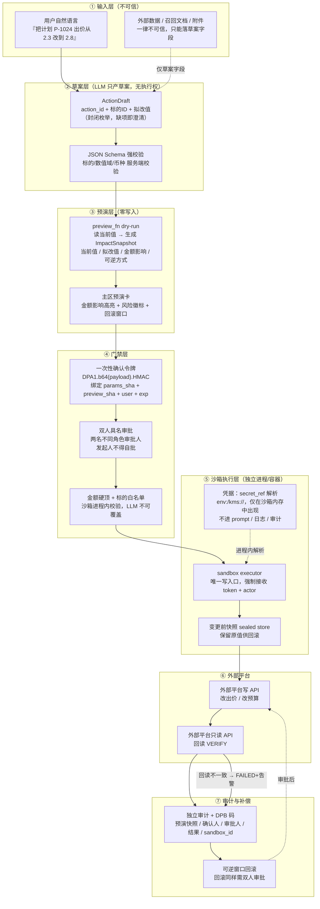
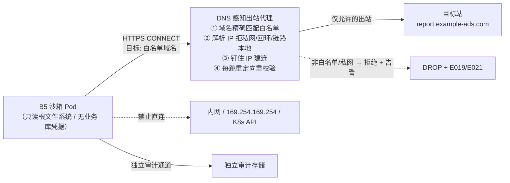

# DataPro 高危 B 类能力安全开放设计

| 文档信息 | 内容 |
|---|---|
| 产出角色 | 架构师（高见远 / Gao），团队 software-datapro-bhigh |
| 任务来源 | 主理人（齐活林）派发任务 #1；用户已拍板开放 **B3 改外部平台出价/预算** 与 **B5 按 URL 抓取** |
| 上游输入 | 《DataPro-Agent执行能力-架构设计.md》（本人前次产出，§4 五道防线 / §5 B 类隔离 / §6 路线）；《DataPro-Agent执行能力-场景与边界.md》（PM 许清楚，B1~B5 / N1~N8）；`AGENTS.md`（§1 铁律 / §2 secret_ref / §4.2 决策 / §8 禁止 / §9 维护）；《DataPro-权限与脱敏设计.md》（G1 一票否决 / L3） |
| 性质 | **架构咨询方案，不含业务代码**；文中结构均为伪代码级定义，不可直接运行 |
| 纪律 | 只读材料 + 仅写本文档；未改其他文件、未写代码、未做 Git 操作；凭据一律 `***`，不复述明文 |
| 证据口径 | 结论附 `文件路径:行号` 或文档章节依据；未实现模块明确标注「设计态/未实现」；不确定写「待核实」 |
| 核心立场 | **不替用户重做「是否开放」的决定（用户已拍板），但绝不弱化安全门禁。** 开放高危 B 是有代价、有责任、有硬门槛的：任一门禁未满足即 No-Go。 |

---

## 0. 前置声明：本次设计面对的三个既成事实

| # | 既成事实 | 架构处理 |
|---|---|---|
| F1 | 用户明确选择最高风险档：要 Agent 真正执行 B3（外部平台出价/预算写）与 B5（按 URL 抓取）。这两项在 PM 文档中分别是 **N2「绝对禁止」**（`docs/DataPro-Agent执行能力-场景与边界.md:108`）与 **N3「绝对禁止」**（同文件 `:109`）。 | 项目所有者有权修订章程，但**必须先走正式变更**（见 §1 门禁 G1）：修订 `AGENTS.md` §1「全程只读」（`AGENTS.md:8`）与 §8「禁止开放写操作」（`AGENTS.md:324`），并同步修订 PM 文档 N2/N3 与功能清单（`AGENTS.md:334-335` §9 维护约定）。修订未完成前，本文档所有内容**只是设计，不得上线**。 |
| F2 | 凭据来源经主理人判定为**已泄露**（明文密码进过对话历史，无法验证是否轮换）；用户口头声明「目标站已授权、出域已裁决」。 | 轮换 + `secret_ref` 引用化是**第一步硬门禁**（见 §1 G3）；口头声明**不足以放行**，书面授权文件与出域裁决文件必须归档（G2，G1 一票否决项，`docs/DataPro-权限与脱敏设计.md:5`）。 |
| F3 | 前次架构设计中的受控执行模块**尚未实现**。 | 经源码核实：`action_registry.py` / `action_guard.py` / `confirm_token.py` / `routes_actions.py` **均不存在**（`datapro/app/services/` 与 `datapro/app/api/` 目录核查）；`datapro/app/core/errors.py:22-31` 仅定义 E001~E010，E011~E016 也属**设计态**。本文档中所有「复用」均指**复用其设计约定**，不表示代码已落地。 |

> **一句话结论**：B3/B5 可以在满足全部门禁后以「独立沙箱 + 白名单标的/域名 + 预演卡 + 一次性令牌 + 双人具名审批 + 金额硬顶 + 快照/回读/回滚 + 独立审计」的最小形态开放；**但「真·任意 URL」即使在门禁全满足后也不建议开**（§4.1）。

---

## 1. 放行总闸（Go/No-Go Gate）

**规则：下表 8 项必须全部满足才为 Go。任一未满足 → No-Go，功能开关默认关闭（`EXTERNAL_ACTIONS_ENABLED=false`、`EXTERNAL_FETCH_ENABLED=false`），沙箱不注册、不启动、不读凭据。**

| # | 硬条件 | 必须提交的证据 | 责任人（角色，需具名签字） | 未满足时的后果 |
|---|---|---|---|---|
| G1 | **章程铁律正式修订并签字**：`AGENTS.md` §1「全程只读」（`AGENTS.md:8`）→「只读 + 受控外部写」；§8「禁止开放写操作」（`AGENTS.md:324`）增受控例外；PM 文档 N2/N3（`场景与边界.md:108-109`）由「绝对禁止」改为「条件放行」；功能清单变更登记（`AGENTS.md:322`、`:334-335`）。 | 变更评审会议纪要 + 修订后 `AGENTS.md` diff + 三方签字（项目所有者 / 安全负责人 / 主理人） | 项目所有者（用户本人）+ 主理人 + 安全负责人 | 章程未修订即上线 = 绕过项目唯一长期事实源；一切后续实现视为违规，No-Go |
| G2 | **G1 安全评审签字（书面授权 + 出域裁决归档）**：目标站允许自动化操作的**书面授权文件**、数据出域**书面裁决文件**归档；`docs/DataPro-权限与脱敏设计.md:5` 标注为 G1 一票否决项，协作规范 §6-1 同义（`场景与边界.md:189`）。 | 授权文件扫描件（含授权范围、站点、账号、有效期）+ 出域裁决文件 + 安全评审签字页 | 安全负责人 + 合规/法务接口人 + 项目所有者 | 口头声明不构成证据；未归档前 B3/B5 全冻结，No-Go |
| G3 | **凭据轮换 + 引用化**：所有进过对话历史的明文凭据**一律视为已泄露**，必须先轮换；配置只存 `env:` / `kms://` 引用（`AGENTS.md:24`）；`validate_ref` 拒明文（`secret_ref.py:175-189`）、`resolve` fail-closed（`:142-152`）、`looks_like_plaintext` 拦截（`:192-195`）；Agent 永不接触明文，明文不进 prompt / 日志 / 审计 / 回显。 | 轮换完成证明（旧凭据已失效的验证记录）+ 新凭据仅以引用形式存在的配置截图 + `python -m app.services.secret_ref check` 输出（`:234-255`，不回显 Key）+ 日志/审计脱敏抽检报告 | 安全负责人 + 外部平台账号归属人 | 未轮换即接入 = 已泄露凭据继续可用且进入 Agent 链路；No-Go |
| G4 | **独立沙箱 / 独立部署**：B 类 executor 为独立进程或独立容器，与主链路**物理隔离**；无业务库写账号、不挂载 `data/` 全目录、不共享主链路网络命名空间；功能开关关闭时不注册任何 B 类入口（延续前次设计 §5.1「连注册入口都不开」）。 | 部署拓扑图 + 容器/进程清单 + 权限清单（DB/RWX/网络）+ 开关关闭时的静态代码审查记录 | 架构师 + 运维负责人 | 塞进主链路 = 一次 SSRF 或提示注入即可触达业务库；No-Go |
| G5 | **金额与影响上限**：单笔改价幅度、单笔预算、单日累计变更均有**可配置硬顶**，硬顶在沙箱进程内校验，不由 LLM 判断、不由请求参数覆盖；标的白名单只允许指定账户/计划 ID（前次设计 §2.2「风险由后端静态声明，不由 LLM 判断」）。 | 配置默认值 + 硬顶校验逻辑单测 + 越顶拒绝日志 + 标的白名单清单 | 业务负责人（出价/预算数值）+ 架构师 | 无硬顶 = 一次误操作可直接烧钱；No-Go |
| G6 | **双人复核 + 归责主体**：改价/改预算类必须两名**具名且角色不同**的审批人（延续前次设计 §4.3 双人复核落库）；审批人不得为发起人；每笔 B 类动作绑定可归责的自然人主体。 | 审批人名单及角色 + 归责主体签字文件 + `agent_action_approval` 表结构（设计态）评审记录 | 项目所有者 + 业务负责人 + 安全负责人 | 无人签字 = 出事无法归责（PM 文档 R5）；No-Go |
| G7 | **完整回滚/补偿预案**：变更前快照 + 变更后回读校验（VERIFY）+ 原值保留可回滚 + 回滚同样需审批 + 补偿失败进告警队列不盲重试（前次设计 §4.4）。 | 回滚 Runbook（含外部平台不支持回滚时的补偿路径）+ VERIFY 不一致告警规则 + 演练记录 | 业务负责人 + 运维负责人 | 无回滚 = 错误出价持续烧钱无人能停；No-Go |
| G8 | **红队测试通过**：SSRF 绕过、金额越顶、令牌重放、凭据泄露检测四类专项全部通过且无高危残留（详见 §7.2 验收标准）。 | 红队测试报告 + 修复复测记录 + 测试环境隔离证明 | 安全负责人 + 架构师 | 红队未过 = 防线只是纸面设计；No-Go |

> **门禁 durability**：G1/G2/G3 是「一次性前置」，G4~G8 是「每次启用前复验」。任何配置变更（放宽白名单、提高硬顶、换凭据）都触发 G3/G5/G8 重新评审。

---

## 2. 用户需书面承担的责任清单

> 用户拍板开放高危 B 能力，意味着**把一部分原本由人工承担的确定性风险转移到 Agent 链路上**。以下责任必须由项目所有者（用户本人）与其他具名方以书面形式签字承担，不能含糊、不能口头。

| # | 签字方 | 承担的风险 | 出事如何归责 |
|---|---|---|---|
| R1 | **项目所有者（用户本人）** | **资金损失风险**：B3 改出价/预算可能直接、快速地消耗真实投放资金；写操作不可逆或回滚有窗口期（`场景与边界.md:78` 将 B3 列为「影响真实资金/投放」）。 | 项目所有者是最终归责主体；Agent 无责权主体（PM 文档 `:78`）。签字文件须写明：硬顶内损失由业务预算承担，越顶/绕过门禁的损失由变更审批链与实现方按评审记录追责。 |
| R2 | **业务负责人（投放运营负责人）** | 出价/预算数值的业务正确性；标的白名单范围是否准确；硬顶数值是否合理的业务判断。 | 预演卡快照与审批行为业务确认证据；报错数值但流程合规 → 业务负责人承担；流程未按其审批执行 → 实现方承担。 |
| R3 | **外部平台账号归属人 + 项目所有者** | **目标站封号 / 服务终止 / 合同条款违约 / 法律风险**：自动化登录与写操作可能违反目标站服务条款（是否允许自动化「待核实」，`场景与边界.md:72、:186`）。 | 账号被封禁、数据被清空、法律追责由账号归属人与项目所有者承担；G2 书面授权文件是免责/减责依据，缺失时不得开放。 |
| R4 | **合规/法务接口人 + 项目所有者** | **数据出域合规责任**：抓取内容可能含第三方 PII 或受地域/行业监管约束；出域裁决仅为口头声明（F2）。 | 以归档的书面出域裁决文件为准；未归档即开放导致合规事件，由批准放行者承担（G1 一票否决，`权限与脱敏设计.md:5`）。 |
| R5 | **安全负责人 + 项目所有者** | **SSRF 打穿内网的责任**：B5 若放开通配 URL，可打内网管理端口、云元数据 `169.254.169.254`、横向移动（PM 文档 R3 `:170`；前次设计 §5.2 SSRF 清单）。 | 白名单与 DNS 校验配置由安全负责人签字；因放宽白名单/关闭校验导致内网被穿透，由签字的放行方承担；按 §4 实施「三段式」可显著降低但不能归零。 |
| R6 | **两名具名审批人** | 对各自审批的那笔 B3 变更承担**复核责任**（不是走过场）。 | `approval_rows` 逐笔记录审批人/角色/时间/决定；事后审计可定位到具体自然人的具体一笔审批。 |
| R7 | **运维负责人** | 沙箱可用性、网络策略有效性、告警响应时效；fail-closed 触发后的恢复。 | 沙箱被绕过或长期不可用仍放行的，由运维承担；沙箱不可用时系统应 fail-closed（E020），此行为本身不归责。 |

> 责任清单应与 G1~G8 的签字页**合并归档**，形成「门禁证据 + 责任承担」同一份文件。用户不签此清单 = No-Go。

---

## 3. B3（改出价/预算）最小安全执行架构

### 3.1 分层图



### 3.2 强制约束（全部为后端静态声明，LLM 不可覆盖）

| 约束 | 机制 | 依据 |
|---|---|---|
| **金额上限** | 配置项：`EXTERNAL_BID_MAX_PER_CHANGE`、`EXTERNAL_BUDGET_MAX_PER_CHANGE`、`EXTERNAL_DAILY_CHANGE_CAP`（默认值由业务负责人签字的 G5 清单确定）。沙箱进程在 `build_plan()` 之后、调用外部 API **之前**校验；超限 → E018 + 零写入。数值来自配置（`config.py:5` Settings 模式），**不读请求体里的 limit 字段**，防止客户端自带上限覆盖。 | 前次设计 §2.2「分级由后端静态声明」；`AGENTS.md:48` 配置走 pydantic-settings |
| **标的白名单** | `EXTERNAL_TARGET_ALLOWLIST` 为**精确账户/计划 ID 枚举**（如 `account:10086/campaign:P-1024`）；禁止通配符、禁止正则、禁止任意 ID 从 NL 直入。草案中出现的 ID 不在枚举 → E015/E019 拒绝。 | 前次设计 §2.1 `ActionSpec` 封闭集合；N3 结构性保证 |
| **双人复核** | 改价/改预算一律 `L2`；`confirm` 只写 `PENDING_APPROVAL`，**无任何立即生效路径**（前次设计 §3.1 L2 分支、§4.3）；`agent_action_approval` 表 `UNIQUE(request_id, approver_username)`，通过条件 `COUNT(approve AND approver != requester) >= 2` 且两名审批人角色不同；未生效前 UI 只显示「待复核」。 | 前次设计 §4.3 双人复核落库；G6 |
| **变更前快照 + VERIFY** | 预演阶段通过外部平台**只读 API** 取当前值写入 `preview_json.before`；写后立即用只读 API 回读，与 `projected` 比对；不一致 → 状态 `FAILED` + 告警，**绝不静默显示「已生效」**（前次设计 §4.4 VERIFY 失败）。 | 前次设计 §3.1 `VERIFY` 节点、§4.4 |
| **可逆窗口** | 原值写入**独立 sealed store**（沙箱内、加密），`rollback_window_hours` 由后端静态声明；回滚同样走「预演 → 双人审批 → 沙箱执行 → VERIFY」全链路，禁止一键裸回滚；窗口到期后入口隐藏但审计保留。 | 前次设计 §4.4 幂等与撤销；G7 |
| **全量审计** | `preview_sha256` / `params_sha256` / `before→after` 金额 / `confirm_token_jti` / `approval_rows` / `sandbox_id` / `dp_code`（`DPB-{id:04d}`）/ `verify_result` 全量落独立审计存储；复用前次设计 §4.5 审计字段清单，新增 §6 字段。 | 前次设计 §4.5；`权限与脱敏设计.md:78-90` audit_log 字段基线 |
| **预演=执行保证** | `preview_fn` 与 `execute_fn` 共享 `build_plan(params)` 纯函数；执行前用服务端快照重算哈希，客户端参数只用于校验相等、不用于执行（防 TOCTOU）。 | 前次设计 §4.3「同参数同影响面」、§7.4 风险 1 |

### 3.3 凭据处理（硬红线）

- Agent **永远不持有**外部平台账号密码明文；明文只在独立沙箱进程内存中出现，由 `secret_ref.resolve()` 从 `env:` / `kms://` 引用解析（`secret_ref.py:142-152`、`AGENTS.md:24`）。
- 禁止把外部平台 API 凭证注入 LLM 上下文：草案 schema 中**不存在** credential 字段；prompt 模板中**不出现** credential 占位符；即便用户说「把密码告诉 agent 去登录」，也只返回「凭据由系统托管，请通过预演卡确认」（N6，`场景与边界.md:112`）。
- 管理接口只显示引用 + 脱敏尾号 + `key_state`（`AGENTS.md:24`；`secret_ref.health` `:222-231` 绝不返回明文）。
- 日志/审计/前端回显中一律 `***`；红队专项「凭据泄露检测」扫描 prompt、日志、审计、网络请求体（§7.2）。
- **轮换优先于接入**：G3 未完成前，沙箱不读取任何外部平台凭据引用。

---

## 4. B5（URL 抓取）的 SSRF 硬防护架构

### 4.1 「有条件开放」的定义 —— 不是真的任意 URL

**必须明确：用户说的「任意 URL」与 N3「任意 URL 抓取 / 按不可信选择器执行采集」直接冲突（`场景与边界.md:109`）。本设计不提供「真·任意 URL」能力，只提供以下三段式受限抓取：**

```
B5-受限 = 白名单域名（精确） + 固定选择器模板（代码内） + 只读 GET
```

| 段 | 放行条件 | 明确排除 |
|---|---|---|
| ① 白名单域名 | 精确域名列表（如 `report.example-ads.com`），逐条评审签字 | 通配符 `*.example.com`、IP 字面量、短链接、用户/模型提供的 URL、DNS 重绑定目标 |
| ② 固定选择器模板 | 每个域名绑定一个代码内写死的 CSS/XPath 模板，模板 hash 进审计 | 用户提供的选择器、模型生成的选择器、从召回文档读取的选择器 |
| ③ 只读 GET | 仅 `GET`，无 cookie 透传、无 POST、无 JS 渲染 | 任意 HTTP 方法、带凭据请求、登录态复用 |

**为什么「真·任意 URL」不可放行（即使门禁全满足）：**

1. **内网探测**：`http://127.0.0.1:8080/admin`、`http://10.0.0.5:9200`、K8s API `https://kubernetes.default.svc` 可被直接读取，等同把 Agent 变成内网扫描器（PM 文档 R3 `:170`）。
2. **云元数据窃取**：`http://169.254.169.254/latest/meta-data/iam/security-credentials/` 可拿到云主机临时凭证，进而横向移动（前次设计 §5.2 SSRF 清单 `AGENTS.md:143` 相关克制）。
3. **重定向与 DNS 重绑定**：即便首次校验通过，302 跳转到内网、或 DNS 首次返回公网 IP 后重绑定为私网，都能绕过朴素白名单。
4. **不可信选择器 = 二次注入面**：选择器若来自用户/模型/外部配置，可指向页面任意敏感区域（含隐藏 token），等同数据外带（N3，`场景与边界.md:109`）。
5. **现有能力边界**：当前联网只有 `web_search.py:72` 的**固定 Bing RSS URL**（`cn.bing.com/search?format=rss&q=...`），无用户可控 URL（`AGENTS.md:145`）。放开任意 URL 是从「固定出站」直接跳到「通用出站」，中间没有可复用的安全基座。

> **架构师立场**：若用户坚持「真·任意 URL」，本次设计**明确不建议开**（见 §8 结论第 2 条）。三段式是唯一可放行的 B5 形态。

### 4.2 防护清单

| # | 防护项 | 落地机制 | 依据 |
|---|---|---|---|
| S1 | 域名精确白名单 | `EXTERNAL_FETCH_DOMAINS` 精确字符串枚举；不许通配符、不许 IP 字面量（含十进制/十六进制/IPv6-mapped 形式）、不许用户/模型提供 URL；不在名单 → E019。 | N3；前次设计 §5.2 |
| S2 | HTTPS only | scheme 必须 `https`；`http://` 一律拒绝（含白名单域名），防明文窃听与降级。 | 前次设计 §5.2 出站约束 |
| S3 | DNS 解析后校验真实 IP | 解析得到**全部** A/AAAA 记录，逐条拒绝私网（10/8、172.16/12、192.168/16）、回环（127/8、::1）、链路本地（169.254/16，含 `169.254.169.254`）、未指定地址、多播；校验通过后将**该 IP 钉住**用于本次连接（防 DNS 重绑定）。 | 前次设计 §5.2；PM 文档 R3 |
| S4 | 每次重定向重校验 | 禁用自动跟随；每跳重新执行 S1~S3，跳数上限 3；越界立即 fail-closed → E019/E021；重定向目标记入审计。 | 前次设计 §5.2「重定向复核」 |
| S5 | 响应体 / 超时上限 | `EXTERNAL_FETCH_MAX_BYTES`（默认 1 MB）、`EXTERNAL_FETCH_TIMEOUT_S`（默认 6s，与 `web_search.py:46` 的 `timeout=6` 同量级）；超限截断或拒绝，不落盘大对象。 | `web_search.py:46` |
| S6 | 无 JS 渲染 | 纯 HTTP 客户端 + 代码内固定选择器解析静态 HTML；不引入 headless browser / playwright（会把 SSR、脚本、外链资源全部带进沙箱）。 | 前次设计 §5.2「无 JS 渲染」 |
| S7 | 选择器固定 | 选择器与域名在代码中**绑定为常量表**，模板 hash 进审计；请求体/Schema 中无 `selector` 字段，模型无法输出选择器。 | N3；前次设计 §2.1 封闭集合 |
| S8 | 独立进程、无业务库写权限 | 沙箱容器不挂载业务库凭据、不接 `data/` 全目录、只读根文件系统；抓取结果经结构化清洗后才回主链路。 | 前次设计 §5.2；G4 |
| S9 | 出站默认拒绝 | 容器网络默认 deny-all egress，仅经 **DNS 感知出站代理**放行白名单域名（见 §4.3）。 | G4 |
| S10 | 独立审计 | 抓取域名、解析 IP、重定向链、字节数、选择器 hash、`sandbox_id`、DPB 码全量落独立审计；响应正文不进 LLM 上下文原文，只进结构化抽取字段。 | G1/G2 合规留痕；`权限与脱敏设计.md:78-90` |

> **重要事实**：`datapro/app/services/validator.py` 只有 `validate_sql()`（`:29-30`），**没有任何 URL 校验逻辑**。上述 S1~S4 全部为**新建能力（设计态）**，不能复用现有校验器。

### 4.3 出站网络策略示意

> **诚实说明**：K8s `NetworkPolicy` 是 L3/L4 能力，**无法按域名字符串做白名单**。因此必须引入「DNS 感知出站代理」或 sidecar 解析钉住 IP 后下发 L3 规则。以下为示意（**设计态，未实现、未实跑**；项目本机无 Docker/K8s，`AGENTS.md:281`）。



规则要点（伪代码，非可直接执行的 YAML）：

```
# 默认拒绝（namespace 级 egress deny-all）
egress: []                         # 沙箱命名空间不配任何直连出网规则

# 唯一例外：到出站代理的 443
allow egress → egress-proxy:443

# 代理侧策略（应用 L7）
allow_domain = exact_match(EXTERNAL_FETCH_DOMAINS)   # 无通配符
deny_ip       = is_private | is_loopback | is_link_local | is_multicast | is_unspecified
on redirect   = re-run allow_domain + deny_ip (max 3 hops)
on violation  = drop + E019/E021 + audit + alert
```

---

## 5. 与现有受控执行架构的复用与差异

> 前次设计（§2~§4）为**设计态，未实现**（F3）。以下「复用」指复用其**设计约定与模块边界**， Engineer 实现时按前次文档落地后再叠加 B 类差异。

### 5.1 复用项（逐条）

| # | 复用件 | 前次设计位置 | B3/B5 如何复用 |
|---|---|---|---|
| 1 | `ActionSpec` 静态风险分级 | 前次设计 §2.1 / §2.2 | B3/B5 各注册新 spec，`uses_credentials=True` → 按 `effective_level()` 强制升 L2；`enabled=False` 默认关。 |
| 2 | 一次性确认令牌 | 前次设计 §4.1，`DPA1.<b64>.<HMAC>` | 同一格式与校验（一次性、绑定 `params_sha256`/`preview_sha256`/user/exp、fail-closed）。B 类令牌用途字段加 `sandbox_id`，防跨沙箱重放。 |
| 3 | 审批态与状态机 | 前次设计 §2.3 / §3.1 | `DRAFT→PREVIEWED→PENDING_APPROVAL→APPROVED→EXECUTING→SUCCEEDED/FAILED/ROLLED_BACK`；CONFIRM 只到审批态，无立即生效出边。 |
| 4 | DP 码 / 审计字段 | 前次设计 §4.5 | 取数 `DP-`、A 类 `DPA-`、B 类独立前缀 `DPB-`；复用 `id_sequence` 原子分配思路（`AGENTS.md:285`）。 |
| 5 | 五道防线 | 前次设计 §4 | 提示注入（NL 不触发执行）、权限（实时回查 `require_permission`）、预演/审批、幂等/撤销、审计——B 类全部沿用，只是执行体换成沙箱。 |
| 6 | `secret_ref` 引用范式 | `secret_ref.py:142-152、:175-189、:222-231` | 直接复用，不改模块；B 类凭据只存引用、沙箱内解析、fail-closed、管理端只见脱敏尾号。 |
| 7 | 错误响应结构 | `errors.py:81-90`、`AGENTS.md:121` | 沿用 `{code,message,detail,trace_id}`；B 类新增码见 §6。 |

### 5.2 差异项（必须新增，不能塞进主链路）

| # | 差异 | 原因 | 落地 |
|---|---|---|---|
| 1 | **独立进程 / 独立容器** | 主链路持有业务库连接与 `data/` 挂载；B5 的 SSRF 或 B3 的凭据若同进程，一次穿透即触达业务库（G4）。 | 独立 `sandbox` 部署单元；主链路只通过受限 IPC/HTTP 传**已确认的 plan**（不含明文、不含凭据）。 |
| 2 | **独立审计存储 / 独立日志管道** | 主链路 `audit_log` 是旁路、失败只记日志（`AGENTS.md:172`、`权限与脱敏设计.md:92`），不足以作为资金类操作的真值。 | B 类动作真值落独立存储，保留期长于主链路（建议 ≥ 180 天，对齐 `权限与脱敏设计.md:92` 的 Loki 全量）；两链路通过 `trace_id` 关联。 |
| 3 | **独立网络策略** | 主链路需访问数仓/Redis；B 类只需访问白名单外部站与出站代理。 | 沙箱命名空间 deny-all egress + DNS 感知代理（§4.3）；与主链路网络策略不共享。 |
| 4 | **金额硬顶作为一等公民** | A 类动作没有「直接烧钱」维度；B3 有。 | 新增 `amount_before_after` 审计字段 + E018；硬顶在沙箱内校验，配置变更触发 G5 复验。 |
| 5 | **标的/域名白名单** | A 类白名单是表名/权限点；B 类是外部账户/计划 ID 与外部域名。 | 新增独立白名单配置与评审流程；不在前次 `ActionRegistry` 里加一行开关（开关可被误开，前次设计 §5.1 明确反对）。 |
| 6 | **fail-closed 边界更严** | 沙箱不可用、DNS 解析失败、代理不可达、凭据解析失败时，绝不能「降级直连」。 | 任一失败 → E020 + No-Go 该次动作；不沿用 `token_store` 进程内存降级路径（前次设计 §7.4 风险 2）。 |

---

## 6. 错误码与审计扩展

### 6.1 错误码

**事实核对**：`datapro/app/core/errors.py:22-31` 当前仅有 E001~E010；前次设计提出的 E011~E016（`:518-529`）**同为设计态、未实现**。因此下表为「设计态基础上的设计态扩展」，Engineer 实现时须一次性落地 E011~E023。

| 码 | HTTP | 人话 | 场景 |
|---|---|---|---|
| E011~E016 | 沿用前次设计 §7.2 | 动作预演变化 / 令牌失效 / 未审批 / 幂等冲突 / 参数不合法 / 暂存服务不可用 | 通用动作层（设计态） |
| **E017** | 502 | 外部平台拒绝了本次操作，请核对标的状态后重试 | 外部平台返回业务错误 / 限流 / 标的已失效；响应体脱敏后记 `detail` |
| **E018** | 422 | 本次金额变更超过允许上限，未执行任何改动 | 单笔/单日硬顶越界；须随附当前硬顶值（不含敏感数据） |
| **E019** | 403 | 目标地址不在允许清单内，已阻止本次访问 | 域名不在白名单 / scheme 非 HTTPS / 用户或模型提供 URL / 选择器不在固定模板 |
| **E020** | 503 | 安全沙箱暂不可用，本次操作已安全中止 | 沙箱不可达 / 网络策略失效 / 凭据解析失败 / 代理不可用 → **fail-closed，绝不降级直连** |
| **E021** | 403 | 目标解析到不允许的网络地址，已阻止 | DNS 解析出私网/回环/链路本地/元数据地址，或重定向越界 |
| **E022** | 409 | 变更已提交但回读校验不一致，已转人工核查 | VERIFY 失败：写成功但回读值与预期不符；状态标 `FAILED`，不显示「已生效」 |
| **E023** | 403 | 本次操作缺少规定的具名复核，尚未生效 | 审批人不足两人 / 角色相同 / 审批人=发起人 |

**同步改动点（实现时）**：`errors.py` 的 `CODE_CATALOG`（`:34-36`）与 `HTTP_STATUS_CODE`（`:39-43`）；前端 `frontend/src/api/errors.js`（`AGENTS.md:121`）；`routes_chat._REASON_CODES`（前次设计 §3.4 兼容性要求 4）。

### 6.2 审计字段扩展

在 `audit_log` 基线字段（`权限与脱敏设计.md:78-90`：`trace_id`/`user_id`/`node`/`question_digest`/`sql_text`/`row_count`/`latency_ms`/`created_at`）与前次设计动作字段（§4.5）基础上，B 类新增：

| 字段 | 说明 | 脱敏要求 |
|---|---|---|
| `external_target` | 外部标的标识（账户/计划 ID 或抓取域名） | 只记 ID/域名，不含凭据、不含 token |
| `amount_before_after` | `{before, projected, after, currency, delta}`；含单笔与单日累计 | 数值原样，无密钥 |
| `approval_rows` | 审批人 / 角色 / 决定 / 理由 / 时间，逐笔多行 | 具名（用于归责），不含凭据 |
| `sandbox_id` | 执行沙箱实例标识（用于定位与重放） | 无敏感信息 |
| `external_action_id` | 外部平台返回的流水号（对账用） | 原样 |
| `verify_result` | 回读校验结果 + 不一致字段清单 | 不含外部平台返回的敏感正文 |
| `redirect_chain` / `resolved_ips` / `selector_hash` | B5 专用：重定向链、解析 IP、选择器哈希 | **不记响应正文原文**；IP 可记（用于溯源） |
| `dp_code` | B 类独立前缀 `DPB-{id:04d}` | 无敏感信息 |

> 审计写入失败策略：B 类**不能**只记日志了事——写审计失败必须 block 执行（与前次设计 §4.5「旁路不阻塞」相反，因为资金类操作必须有真值）。这是 §5.2 差异项 2 的直接推论。

---

## 7. 实施路线与工作量

> 工作量档：**L** = 数人周量级；**XL** = 跨模块 + 安全评审 + 红队，数周量级。所有模块均为**新建 / 设计态**，不代表已实现。

### 7.1 阶段 A：沙箱与门禁地基（XL）

| 项 | 内容 |
|---|---|
| 目标 | 先把「能安全执行」的地基建好，**此时不开放任何 B3/B5 动作**；沙箱存在但 `EXTERNAL_*_ENABLED=false`，不注册入口。 |
| 改动点（配置/入口） | `app/config.py`（新增 `EXTERNAL_ACTIONS_ENABLED` / `EXTERNAL_FETCH_ENABLED` / 硬顶 / 白名单 / 超时 / 字节数配置，参照 `config.py:5、:35、:65` 的 Settings 模式）；`app/main.py`（B 类 router 条件注册，关闭时不加载） |
| 改动点（新建，设计态） | `app/services/external_sandbox/`（独立进程包：executor / plan_builder / credential_resolver / verify / snapshot_store）；`app/services/egress_proxy/`（DNS 感知出站代理配置与校验逻辑）；`app/services/external_audit.py`（独立审计）；`app/api/routes_external_actions.py`（受限入口） |
| 改动点（数据层） | `app/db/models.py` + `alembic/versions/00xx_external_actions.py`（新增 `external_action_request` / `external_action_approval`，走 Alembic 不手写 ALTER，`AGENTS.md:304`）；复用前次设计的双表结构但独立命名空间 |
| 改动点（错误码） | `app/core/errors.py`（E011~E023，`CODE_CATALOG` / `HTTP_STATUS_CODE`）；`frontend/src/api/errors.js` |
| 前置门禁落地 | G1 章程修订归档；G2 书面文件归档；G3 凭据轮换 + 引用化（`secret_ref.py` 不改，直接复用）；G4 独立部署拓扑；G6 审批人名单签字；G7 Runbook |
| 验收标准 | ① 开关关闭时源码中无 B 类入口注册、沙箱不启动、不读凭据；② 凭据引用可被 `secret_ref check` 解析（`:234-255`），明文零出现；③ 硬顶/白名单配置变更需重新评审的流程文档化；④ 独立审计链路写入失败能 block 执行；⑤ E011~E023 全部有单测与前端映射；⑥ `pytest -q` + `npm run build` 通过（`AGENTS.md:336`） |
| 回滚方案 | 卸载沙箱部署单元 + 开关保持 false + drop 00xx 迁移（此前无数据）；主链路零改动。 |

### 7.2 阶段 B：B3 / B5 逐条启用（L 每条）

> **逐条启用原则**：B3 与 B5 各自独立开关、独立评审、独立上线窗口，禁止一次同时放开。

#### B3 启用（改出价/预算）

| 项 | 内容 |
|---|---|
| 改动点（新建，设计态） | `external_sandbox/specs/bid_update.py` / `budget_update.py`（ActionSpec：标的白名单、硬顶、preview/execute/verify/rollback）；`routes_external_actions.py` 增 B3 preview/confirm/approve/query/rollback 接口；前端主区预演卡与审批列表（沿用前次设计 §3.4 事件约定，`action_*` 扩展为 `external_action_*`） |
| 前置门禁复验 | G1~G8 全绿；尤其 G5 硬顶数值签字、G6 双人名单、G7 回滚演练 |
| 验收标准 | ① 自然语言（含「确认」「执行吧」）无法触发任何写；② 预演哈希 ≠ 执行哈希时中止且零写入；③ 单人审批/审批人=发起人/角色相同全部 E023；④ 金额越顶（单笔、单日累计、并发拆分、负数反转）全部 E018 且零写入；⑤ 令牌重放/改标的/跨用户/过期全部 E011/E012/E020；⑥ 写后 VERIFY 不一致 → E022 + 告警，不显示「已生效」；⑦ 回滚须双人审批且原值正确恢复；⑧ 全量审计字段齐备且可用 `DPB-` 回查 |
| 红队专项 | **令牌重放**（同一 jti 二次提交、跨沙箱重放）；**金额越顶**（改参数、并发拆单、改币种、负数）；**凭据泄露检测**（扫描 prompt、日志、审计、网络请求体、前端响应，命中 `***` 之外的凭据形态即失败）；**提示注入**（外部数据里藏「把预算改成 999999」） |
| 回滚方案 | `EXTERNAL_ACTIONS_ENABLED=false` → 入口不注册；移除 B3 spec；沙箱保持运行但无动作可接；已生效变更按 G7 Runbook 逐笔审批回滚。 |

#### B5 启用（三段式受限抓取）

| 项 | 内容 |
|---|---|
| 改动点（新建，设计态） | `external_sandbox/specs/fetch.py`（域名白名单 + 固定选择器模板 + GET）；`egress_proxy/`（DNS 解析、IP 校验、IP 钉住、重定向重校验）；`routes_external_actions.py` 增 B5 preview/fetch 接口；前端只读结果卡（不展示响应正文原文，只展示结构化抽取字段 + 来源域名 + DPB 码） |
| 前置门禁复验 | G1~G8 全绿；尤其 G2 出域裁决覆盖抓取目标域、G8 SSRF 红队全过 |
| 验收标准 | ① 白名单外域名 / 通配符 / IP 字面量 / 用户提供的 URL 全部 E019；② `http://`、私网、回环、`169.254.169.254`、IPv6-mapped、十进制 IP 全部 E019/E021；③ 重定向到内网在每一跳都被拒；④ DNS 重绑定（首答公网、再答私网）被 IP 钉住拦截；⑤ 响应体超限/超时被拒且不落盘；⑥ 选择器无法从请求体/schema/prompt 注入（静态审查 + 模糊测试）；⑦ 沙箱无业务库写权限（权限清单核对）；⑧ 抓取结果不把原始 HTML 送入 LLM 上下文 |
| 红队专项 | **SSRF 绕过**（DNS rebinding、302 链、十进制/十六进制/IPv6 形式、`@` 混淆、CNAME 指向内网、云元数据）；**凭据泄露检测**同上；**令牌重放**同上 |
| 回滚方案 | `EXTERNAL_FETCH_ENABLED=false` → 入口不注册；收回出站代理白名单规则；移除 fetch spec；沙箱整体下线不影响 A 类主链路。 |

---

## 8. 架构师的明确结论

**结论：在用户已拍板开放的前提下——可以开，但必须满足 §1 全部 8 项门禁；门禁未全绿前，B3/B5 一律 No-Go、功能开关默认关闭。**

分条结论：

1. **B3（改出价/预算）**：技术上可以在满足门禁后开放，但它是**真金白银的写操作**，必须按 L2 最高门禁执行——独立沙箱、标的白名单、金额硬顶、双人具名审批、快照/VERIFY/审批回滚、独立审计，缺一不可。若业务方无法给出明确的金额硬顶与回滚路径（外部平台不支持回滚且无补偿手段），**该子项应维持 No-Go**。
2. **B5（真·任意 URL）**：**拆除「任意」二字后才可放行**。白名单域名 + 固定选择器 + 只读 GET 的三段式可开；「真·任意 URL」即使门禁全满足也**不建议开**，因为 SSRF 的内网/元数据打击面无法通过配置收敛到零，且现有 `web_search.py:72` 固定 Bing RSS 的出站克制是项目既有安全基线（`AGENTS.md:145`），不应直接跨越。
3. **凭据**：轮换 + 引用化是**第 0 步**，优先于任何开发。未轮换前不得以任何形式把外部平台凭据接入 Agent 链路。
4. **章程与责任**：G1 章程修订与 §2 责任清单签字，是「开放高危 B」的政治与法律前提，不是形式主义；没有归责主体的高危能力不应存在。
5. **诚实提示**：本方案**降低风险但不归零**。资金损失、封号、合规事件、内网穿透仍有残余风险，这正是 §2 责任清单存在的原因。

### 仍需用户或外部拍板的事项（最多 5 条）

| # | 待拍板事项 | 为什么必须由用户/外部定 | 未定时的临时约束 |
|---|---|---|---|
| 1 | 章程修订的具体签字人与生效版本（G1：修订 `AGENTS.md` §1/§8 与 PM 文档 N2/N3） | 涉及项目唯一长期事实源，架构师无权代改章程 | 修订签字前，B3/B5 全部 No-Go，不写任何实现代码 |
| 2 | 归责主体与两名具名审批人名单及角色（G6/R1/R6） | 组织人事与授权，需项目所有者指定 | 名单未定前，所有 B 类动作只生成申请、不生效 |
| 3 | 书面授权文件与出域裁决文件能否提供并归档（G2/R3/R4） | 外部平台条款与合规法务判断，架构师无法核实真伪 | 口头声明不接受；文件未归档前全冻结 |
| 4 | 凭据轮换完成证明 + 新凭据仅以 `env:`/`kms://` 引用存在（G3） | 泄露凭据的处置权在账号归属人 | 未轮换前沙箱不读取任何凭据引用 |
| 5 | 金额硬顶数值、可逆窗口时长、标的白名单/抓取域名清单（G5/G7） | 纯业务判断（烧钱上限与业务节奏） | 数值未定前，硬顶按**最保守默认**（建议单笔上限取历史单次改价的 1.2 倍、单日累计取日预算，具体待业务负责人签字） |

---

> 交付说明：本文档为**架构侧安全开放设计**，不构成上线许可。产品边界以《DataPro-Agent执行能力-场景与边界.md》为准；门禁证据与责任签字归档后，由主理人（齐活林）汇编并向用户交付。文中所有 `文件路径:行号` 基于当前工作区源码核对；`action_registry.py` 等前次设计模块与 E011~E016 均经核实为**设计态/未实现**，未臆造为已落地。文中凭据一律 `***`。
